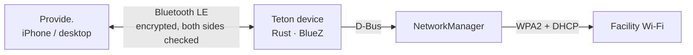
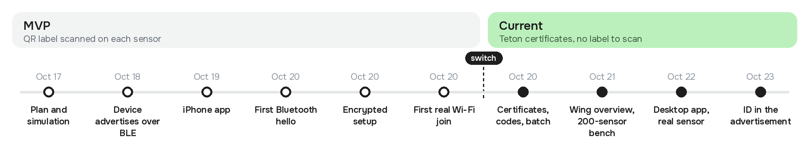

<p align="center">
  
</p>

<h1 align="center">Provide.</h1>

<p align="center"><strong>Offline app to provide Wi-Fi credentials to Teton sensors, securely and frictionless.</strong></p>

<p align="center">
  <a href="#what-provide-does">What it does</a> ·
  <a href="#watch-the-demo">Demo</a> ·
  <a href="#the-challenge">Challenge</a> ·
  <a href="#test-setup">Test setup</a> ·
  <a href="#option-considered">Options</a> ·
  <a href="#architecture">Architecture</a> ·
  <a href="#security">Security</a> ·
  <a href="#tech-stack">Tech stack</a><br />
  <a href="#why-an-app-not-a-website">Why an app</a> ·
  <a href="#what-is-inside-the-repo">Inside the repo</a> ·
  <a href="#try-it">Try it</a> ·
  <a href="#tests">Tests</a> ·
  <a href="#compatibility">Compatibility</a> ·
  <a href="#timeline">Timeline</a> ·
  <a href="#questions">Questions</a> ·
  <a href="#requirements-map">Requirements map</a> ·
  <a href="#limits-and-next-steps">Limits</a>
</p>

## What Provide. does

Open the app in the hallway and it lists the Teton sensors around you. Add your technician code and the site's Wi-Fi
once, tap **Set up all ready**, and watch the sensors join the network, six at a time. A sensor that fails tells you
why in plain words, and one tap retries it.

No internet, no shared network, no label to scan: the phone talks to the sensors over Bluetooth. Each sensor proves
it is Teton's before the app sends the password, and the password travels encrypted. The same app runs on iPhone and
desktop; a Rust service runs on the sensor.

## Watch the demo

Both videos show a wing of 200 simulated sensors: batch progress, errors and retries.

<table>
  <tr>
    <th>Mobile</th>
    <th>Desktop</th>
  </tr>
  <tr>
    <td align="center">
      <a href="docs/media/overall-200-sensors.mp4">
        
      </a>
    </td>
    <td align="center">
      <a href="docs/media/desktop-200-sensors.mp4">
        
      </a>
    </td>
  </tr>
  <tr>
    <td align="center"><a href="docs/media/overall-200-sensors.mp4">▶ Mobile · 41 s</a></td>
    <td align="center"><a href="docs/media/desktop-200-sensors.mp4">▶ Desktop · 25 s</a></td>
  </tr>
</table>

### How to use Provide.

| Step | Mobile | Desktop |
| --- | --- | --- |
| **1. Add the technician code**: paste, check, save | [▶ Watch](docs/media/mobile-technician-code.mp4) | [▶ Watch](docs/media/desktop-technician-code.mp4) |
| **2. Set up the site Wi-Fi**: site, SSID, password, save | [▶ Watch](docs/media/mobile-site-wifi.mp4) | [▶ Watch](docs/media/desktop-site-wifi.mp4) |
| **3. Open and test a sensor**: Test, then “world” received | [▶ Watch](docs/media/mobile-sensor-test.mp4) | [▶ Watch](docs/media/desktop-sensor-test.mp4) |
| **4. Configure one sensor**: Set up, then Device connected | [▶ Watch](docs/media/mobile-sensor-setup.mp4) | [▶ Watch](docs/media/desktop-sensor-setup.mp4) |
| **5. Configure all ready sensors**: batch, errors, retry | [▶ Watch](docs/media/mobile-configure-all.mp4) | [▶ Watch](docs/media/desktop-configure-all.mp4) |

All results in these videos are simulated; they show no real credentials.

## The challenge

A technician walks into a hospital with sensors that have no screen and no network. They must give each sensor the site's Wi-Fi password and see which ones connected, with no terminal, no cloud relay and no shared network.

## Test setup

<table>
  <tr>
    <td align="center" width="50%"><br/><b>iPhone 15 Pro</b> · the technician's phone</td>
    <td align="center" width="50%"><br/><b>MacBook</b> · desktop app and Teton's workshop</td>
  </tr>
  <tr>
    <td align="center"><br/><b>noe-lab</b> · Ubuntu device, QR printer, site Wi-Fi</td>
    <td align="center"><br/><b>Jetson 019</b> · real sensor hardware</td>
  </tr>
</table>

| Machine | What it did |
| --- | --- |
| **iPhone 15 Pro** (iOS 27) | Code import, site Wi-Fi from its QR code, real setups. |
| **MacBook** (macOS) | Desktop app. Also Teton's workshop: certifies sensors, issues technician codes (`teton-workshop`). |
| **noe-lab** (Ubuntu 22.04, x86-64) | First real device: joined the Wi-Fi from the iPhone. Also hosts the 200-sensor bench. |
| **Jetson 019** (Ubuntu 22.04, ARM64) | Staged like a production sensor as `TETON-7B09F20339`: setups from the Mac and the iPhone, reconfiguration. |
| **Internet box** (WPA2-Personal) | The site network the sensors join. |

## Option considered

### Transmission

| Option | Verdict |
| --- | --- |
| **Local network**: the sensor hosts a setup Wi-Fi, or both sides join the site network | Dropped: the brief forbids a shared local network at the start. |
| **Computer vision**: the phone shows a QR, the sensor's camera reads it | Dropped: one way, so the phone never learns if the sensor joined, and holding a phone in front of 200 cameras is slow. |
| **Bluetooth LE** | **Chosen**: two-way, no network, a few metres of range, and both phones and Ubuntu support it. |

### Authentication

| Option | Verdict |
| --- | --- |
| **Bluetooth pairing** (the phone's "Pair this device?") | Dropped. The sensor has no screen to show a code, so pairing cannot check which device is on the other end: a fake sensor could receive the password. |
| **A QR label on each sensor**, scanned before setup | Dropped after I built it: scanning 200 labels takes too long, and each label puts a secret in a patient room. |
| **An encrypted channel with certificates** ([Noise](https://noiseprotocol.org/noise.html)) | **Chosen.** The sensor proves it is Teton's with a certificate; the technician proves it with a code. Only then does the app send the password, encrypted. |

### Compared with Teton's current process

Teton's installers already set up Wi-Fi from a phone over Bluetooth: *WiFi Broadcast* in the Teton Alerts app
([installation manual](https://docs.teton.ai/hubfs/Deployment%20Templates/Teton_Installation_Manual.pdf), v4.0).
The manual does not describe how the broadcast protects the password, so the "not documented" cells need checking
with Teton.

| | Teton today (WiFi Broadcast) | Provide. |
| --- | --- | --- |
| **Channel** | Bluetooth, phone within 3 m | Bluetooth, phone within a few metres |
| **Who receives the password** | Edge units nearby; checks not documented | Only an Edge that proves it is Teton's, encrypted |
| **Who may configure an Edge** | Installer signed in with an activation code; check on the Edge not documented | A phone with a technician code the Edge verifies |
| **Result** | *Devices* tab, once the Edge is online | Each Edge answers over Bluetooth: connected with its IP, or the reason it failed |
| **Wrong password** | The Edge stays offline | The Edge returns to its previous network and says why |
| **Room mapping** | QR code on each Edge, linked to a bed | Left out on purpose: a scan per sensor would slow a wing of 200. Smith can map each sensor ID to its room once it is online |
| **Wi-Fi settings** | Per department, from Teton's platform | Per site, typed or scanned in the app |

## Architecture



- **Device.** A systemd service advertises the sensor's ID and state, runs the encrypted exchange and asks
  NetworkManager to join. If a join fails, the sensor returns to its previous network.
- **Configurator.** One screen over platform-free logic: the encrypted channel, the checks, a queue of six sensors at a
  time. Only Bluetooth, secure storage and the camera change per platform.

Details: [docs/ARCHITECTURE.md](docs/ARCHITECTURE.md).

## Security

- **Encrypted channel.** Each session gets fresh keys ([Noise](https://noiseprotocol.org/noise.html)). A recorded
  session cannot be read or replayed.
- **The sensor proves it is genuine** with a certificate from Teton. The app checks it before sending anything.
- **The technician proves they are authorized** with a code from Teton, per customer, valid 5 days at most.
- **Then the SSID and password go out**, encrypted, and nothing logs them.

Threats and limits: [docs/SECURITY.md](docs/SECURITY.md).

## Tech stack

### Device

| Stack | Why |
| --- | --- |
| **Rust** | Teton's fleet runs Rust, so the device code fits it. Memory safety for a daemon that parses radio input from anyone in range. |
| **BlueZ** through `bluer` | Ubuntu's Bluetooth stack. |
| **NetworkManager over D-Bus** | Ubuntu manages Wi-Fi with it, so the join is real. The password stays off the command line. |
| **`snow`** (Noise) and **`ed25519-dalek`** | Known implementations: I wrote no cryptography. |

### Configurator (Provide.)

| Stack | Why |
| --- | --- |
| **Expo / React Native**, TypeScript | One code base with native Bluetooth for the phone; the same screens run on desktop. |
| `react-native-ble-manager` on iPhone; **Tauri** with a Rust `btleplug` bridge on desktop | Native Bluetooth on each platform. iPhone has no Web Bluetooth. |
| **`@noble`** cryptography | Audited, pure JavaScript. |
| iOS Keychain behind Face ID | A lost phone keeps the code and site passwords locked. |

### Workshop (Teton's side, offline)

| Stack | Why |
| --- | --- |
| **Rust CLIs** `authority` and `stage`, in the device crate | They share the device's certificate and code types, so the workshop and the sensor cannot disagree on a format. |
| **Two Ed25519 authorities**, kept off the sensors | One certifies sensors, one issues technician codes. |

## Why an app, not a website

A web page needs no install, but it fails the challenge:

- **No Bluetooth on iPhone.** Every iOS browser runs on Safari's engine, which has no Web Bluetooth.
- **One dialog per sensor.** Where Web Bluetooth exists, the user picks each device in a system dialog: 200 sensors
  means 200 dialogs. The app sets up a wing in one tap.
- **Offline.** A page served by the sensor needs a shared network, which the brief forbids.
- **Secrets at rest.** The app keeps the code and site passwords in the iOS Keychain, out of browser storage.

## What is inside the repo

- **[The configurator](configurator/)**, Provide.: the technician's app for iPhone and desktop. It finds sensors,
  checks their certificate and sends the Wi-Fi encrypted, one sensor or a whole wing.
- **[The device](device/)**: a Rust service for the sensor, on Ubuntu. It answers over Bluetooth, checks the
  technician's code and joins the Wi-Fi through NetworkManager.
- **The workshop**: two Rust CLIs in the device crate. `authority` certifies sensors and issues technician codes;
  `stage` installs a certificate on a sensor before delivery.
- **Tests** on both sides: Noise vectors shared by the device and the app, refusal cases, the batch queue, a
  200-sensor simulation.
- **[docs/](docs/)**: setup and usage on Ubuntu, architecture, security, decision log.
- **[evidence/](evidence/)**: logs of the real runs, the simulations and the test runs.
- **[tools/](tools/)**: a bench that plays 200 sensors over a real Bluetooth chip, and the demo video scripts.
- **[AGENTS.md](AGENTS.md)**: the guide for AI coding agents: commands, rules and the skills I used.

## Try it

### Demo in a browser, no hardware

```sh
git clone https://github.com/NoeBrt/teton-provisioning.git
cd teton-provisioning/configurator && npm ci && npm run web
```

Open the URL Expo prints with `?demo=1`: 200 simulated sensors, no Bluetooth. Needs Node.js 22.18 or later.

### Why a build and not Expo Go

Provide. talks Bluetooth through `react-native-ble-manager`, a native library that Expo Go does not ship. In Expo Go
the app opens, runs the demo, and says "Bluetooth is unavailable in Expo Go". A real sensor needs your own build.

### 1. Deploy a sensor from your laptop

Use a blank Ubuntu 22.04 or later sensor with SSH, BlueZ, NetworkManager and a BLE peripheral adapter. Connect it
over USB or Ethernet so that changing its Wi-Fi later will not cut the SSH link.

The authorities' private keys stay on your laptop. A sensor only receives its certificate. Install the workshop tool
once (macOS or Linux, Rust, OpenSSH and GitHub CLI installed), from the latest `main` checkout root, then run it
from any folder. Sign in with `gh auth login` using an account with access to this private repository:

```sh
cargo install --path device --features stage --bin teton-workshop --locked   # first build: 1-2 minutes
teton-workshop init                           # once, for every customer: two authorities, their public keys
teton-workshop deploy user@192.168.55.1 --customer "Noé Home"
teton-workshop issue "Your full name" --customer "Noé Home" --customer "Hôpital Saint-Louis"   # a code for both
```

`deploy` takes any SSH host: an alias from `~/.ssh/config`, or `user@192.168.55.1` for a Jetson over USB. It reads
the sensor's architecture, downloads the v1.1.0 Linux binaries to your laptop, checks their SHA-256 and caches them.
It then asks for the sensor's sudo password once, copies the binaries, runs the installer, has the sensor create its key,
certifies that key for the customer, records your laptop's time as the sensor's earliest clock and starts the
service. Add the Wi-Fi interface after the host (`deploy <ssh-host> wlo1`) to pin one; by default NetworkManager
picks. `deploy` refuses a sensor that already runs the service: run `teton-workshop uninstall <ssh-host>` first. It
removes the service and the Wi-Fi the sensor was given, and moves the sensor's key to `/root/teton-backup`.

No Linux build is needed on your laptop or on the sensor. The first download per architecture needs internet on the
laptop; later deployments use its cache. Keep the checkout in place after installing the tool. For a local build or
a sensor without SSH, see [the manual setup](docs/SETUP.md#prepare-the-ubuntu-device).

A customer is a name or an ID: `"Noé Home"` becomes `NOE-HOME`, the ID that certificates and codes carry. Leave out
`--customer` and the tool offers the last customer again and waits for your yes. A script with no terminal must name
the customer. `teton-workshop help` lists every command, and [docs/SETUP.md](docs/SETUP.md) describes the manual
path (`teton-stage init`, `teton-workshop certify`) for a sensor without SSH.

Copy the two public keys from `teton-workshop init` into `configurator/src/authority.ts` (`DEVICE_AUTHORITY`,
`TECHNICIAN_AUTHORITY`) before you build the app.

### 2. Install the app on a phone

**iPhone** (Mac with Xcode, free Apple ID; the app lasts 7 days):

```sh
cd configurator && npm ci && npx expo prebuild -p ios
open ios/provide.xcworkspace                   # once: Signing & Capabilities › Team › your Personal Team
xcrun devicectl list devices                   # your iPhone's identifier
cd ios && xcodebuild -workspace provide.xcworkspace -scheme provide -configuration Release \
  -destination 'id=<IPHONE_ID>' -derivedDataPath build/dd -allowProvisioningUpdates \
  DEVELOPMENT_TEAM=<TEAM_ID> CODE_SIGN_STYLE=Automatic build
xcrun devicectl device install app --device <IPHONE_ID> build/dd/Build/Products/Release-iphoneos/provide.app
```

On the iPhone, trust the developer (Settings › General › VPN & Device Management) and allow Bluetooth.

**Android** (not tested): `cd configurator && npm ci && npx expo run:android --variant release` with the phone
plugged in.

### 3. Or install it on a desktop

**macOS** (Rust and the Xcode command-line tools): `cd configurator && npm ci && npm run desktop:install` puts
Provide. in `/Applications`. **Linux** (not tested): `npm run desktop:build`. Windows is not tested.

### 4. Set up the sensor

Open Provide. with no DEMO badge, scan the technician code, enter the site Wi-Fi, then tap **Set up** on
`TETON-XXXXXXXXXX`. The card ends on **Device connected** with the sensor's address; on Ubuntu,
`nmcli connection show --active` lists `teton-provisioned`.

Troubleshooting, tests and details: [docs/SETUP.md](docs/SETUP.md).

## Tests

What the automated tests check ([commands](docs/SETUP.md#tests)):

- **Interoperability.** The app replays the device's reference messages byte for byte.
- **Refusals.** A fake sensor, another customer or an expired code stops the session before the password leaves.
- **Device.** One phone at a time, Wi-Fi fallback, safe retries.
- **Scale.** A 200-sensor batch, in the device simulation and in the app's queue.
- **Desktop.** The Bluetooth bridge reaches Teton's service and nothing else.

## Compatibility

| Part | Tested on hardware | Supported, not tested | Not supported |
| --- | --- | --- | --- |
| **Device** | Ubuntu 22.04 on x86-64 and on ARM64 (Jetson) | Other Linux with BlueZ, NetworkManager and systemd | Bluetooth adapters without BLE peripheral mode |
| **Configurator** | iPhone (iOS 27), macOS | Android, Windows and Linux desktop | A plain browser: demo only |
| **Wi-Fi network** | WPA2-Personal | WPA3-Personal | Enterprise (802.1X) and captive portals |

On desktop, the app keeps the technician code and site passwords in the system keychain (macOS Keychain, Windows
Credential Manager, Secret Service on Linux), behind the account's own lock instead of Face ID.

## Timeline

<p align="center">
  <picture>
    <source media="(prefers-color-scheme: dark)" srcset="docs/media/timeline-dark.png" />
    
  </picture>
</p>

The MVP worked: on October 20 an iPhone set up a real device after scanning its QR label. The same evening I
replaced labels with Teton certificates, since scanning 200 labels does not fit a hospital wing.

## Questions

**How long does a wing of 200 sensors take?** About 4 minutes with one phone: six sensors at a time, 7.5 s each.
Measured on simulated sensors.

**Why six sensors at a time?** The phone spends most of a setup waiting for the sensor to join the Wi-Fi (about
5.5 s), so it can serve several sensors at once. Six links bring 200 sensors from about 8 minutes (three links) to
about 4. I stopped at six because the links share one Bluetooth radio: more links mean slower connects and more
failures. The real limit still needs measuring on 200 sensors.

**What if a fake sensor sits in the hallway?** It has no Teton certificate for its key, so the app stops before
sending the code or the password.

**What if a technician code leaks?** It works for its customers until it expires: one day by default, five at
most. Offline door locks in hotels and offices handle lost keys the same way. A sensor that records a code cannot
replay it, and `deploy` sets the sensor's earliest clock, so a sensor that boots in the past still refuses a code
that expired before its deployment. Revocation is a next step.

**What if someone steals a sensor? Doesn't it have a password?** The password guards SSH and the console, not the
disk. A thief who pulls the storage reads the key and the site's WPA2 password. Fix: disk encryption and per-sensor
Wi-Fi credentials.

**What if the password is wrong?** The sensor goes back to its previous network, the app shows why, and a batch stops
starting new sensors.

**What if the Bluetooth link drops mid-setup?** The app retries with the same attempt ID; the sensor returns the stored
result and joins once.

**Does any of this need internet?** Only before the visit, to install tools, download sensor binaries and build the app. Issuing codes and setting up Wi-Fi work offline.

**What is not proven yet?** 200 physical sensors, Android, the desktop app on Windows and Linux, a radio capture of
the current protocol.

**In a large hospital, most sensors sit out of Bluetooth range. Is one phone realistic?** Today the technician walks
the wing and the app picks up sensors on the way. Options to go further, none built yet:

- **Several technicians at once.** Smith splits the floors between them; each phone sets up its own share.
- **Relay.** Sensors already online pass the Wi-Fi to their neighbours over Bluetooth, with the same certificate
  checks. Each sensor then holds credentials worth stealing.
- **802.1X.** The hospital network trusts each sensor's Teton certificate, and sensors join at power-on with no phone.
  The hospital's IT has to run it.

**How could Provide. fit Teton's current process?** Teton's
[installation manual](https://docs.teton.ai/hubfs/Deployment%20Templates/Teton_Installation_Manual.pdf) (v4.0) already
uses a phone and Bluetooth: the installer signs in to the Teton Alerts app with a one-time activation code, scans the
QR code on the back of each Edge to link it to a bed, and turns on *WiFi Broadcast* to share the department's
network with the Edge units nearby. Provide. would slot into that last step:

- **Same app, same flow.** The Alerts app runs Provide.'s exchange instead of the broadcast. The installer's Teton
  account replaces the technician code, and the department's Wi-Fi settings replace the site form.
- **Checked, targeted, confirmed.** The phone sends the password only to an Edge that proves it is Teton's, and each
  Edge reports its own result in the *Devices* tab.
- **Fleet onboarding.** [Smith](https://docs.smith.teton.ai) approves a new device by hand today; the Edge's Teton
  certificate could let Smith accept it on its first check-in.

**What would Provide. add to Teton's current process?** A check of the Edge before it gets the password, a check
of the installer on the Edge, and a result per Edge even when it fails: see
[the comparison](#compared-with-tetons-current-process).

## Requirements map

| Challenge requirement | Where | Proof and limits |
| --- | --- | --- |
| **1. No internet** | Bluetooth LE | [Offline hello](evidence/real/service-offline-hello.txt): the phone, networking off, talked to the device. A full offline encrypted setup is not recorded yet. |
| **2. Real network connection** | NetworkManager on the device | Real joins from the [Mac](evidence/real/identity-advertisement.txt) and the [iPhone](evidence/real/real-join.txt). |
| **3. No plaintext credentials over the air** | Encrypted channel, sensor certificates, technician codes ([SECURITY.md](docs/SECURITY.md)) | Interoperability and refusal tests. A radio capture of the current protocol is still to do. |
| **4. Usable by a non-developer** | Automatic discovery, one-tap batch, errors in plain words | [Videos](#watch-the-demo), with simulated sensors. |
| **Setup and run on Ubuntu** | [docs/SETUP.md](docs/SETUP.md) | Not yet reproduced on a clean machine. |
| **Architecture writeup** | [docs/ARCHITECTURE.md](docs/ARCHITECTURE.md), [docs/SECURITY.md](docs/SECURITY.md) | 200-sensor figures come from [simulations](evidence/simulation/README.md). |

## Limits and next steps

**Limits today**

- **Proven on one real sensor at a time.** The 200-sensor runs are simulations; the six-link pace is not measured on
  real hardware.
- **Not run:** Android, the desktop app on Windows and Linux, a clean Ubuntu reproduction, a radio capture of the
  current protocol, a full offline setup on record.
- **The sensor's key sits in a file** on an unencrypted disk. A stolen sensor gives up its key and the site password.
- **No revocation.** A leaked technician code works until it expires, 5 days at most, and the app cannot refuse a
  stolen sensor.
- **One WPA2-Personal password per site.** Enterprise Wi-Fi (802.1X) is not supported.
- **The customer is written into the sensor's certificate**, so moving a sensor to another customer needs a new
  certificate.
- **No transfer between customers yet.** `deploy` refuses a sensor that already has the service, and
  `teton-stage install` refuses to replace a certificate. `uninstall` then `deploy` gives the sensor a new key, a new ID
  and a new customer. Moving a sensor while keeping its ID needs a procedure still to define: who authorizes it, and
  what happens to the old customer's Wi-Fi on the sensor.
- **Customer IDs come from names.** "Hôpital Saint-Louis" and "Hopital Saint Louis" both give `HOPITAL-SAINT-LOUIS`,
  and the workshop keeps no list of customers to catch two different hospitals with the same name. Check the ID that
  `deploy` and `issue` print.
- **The iPhone build uses a free Apple ID** and expires after 7 days.

**To make it complete**

1. Keep the sensor's key in its secure element and encrypt its disk.
2. Revoke technicians while sensors stay offline: the phone, which has signal more often than a sensor, renews a
   short code each day and hands every sensor it sets up the newest signed revocation list. Plan and prior art in
   [docs/REVOCATION.md](docs/REVOCATION.md).
3. Connect to Smith: accept certified sensors on first check-in, push revocation lists to sensors in service, map
   sensors to rooms, upload setup results.
4. Give each sensor its own Wi-Fi credentials (EAP-TLS with its Teton certificate).
5. Measure on real sensors: the link limit per phone, a batch of 200, a radio capture.
6. Ship signed builds (TestFlight, notarized desktop app).
7. Run Android and the Windows and Linux desktop builds on hardware.
8. Move the exchange into the Teton Alerts app, in place of *WiFi Broadcast*.
