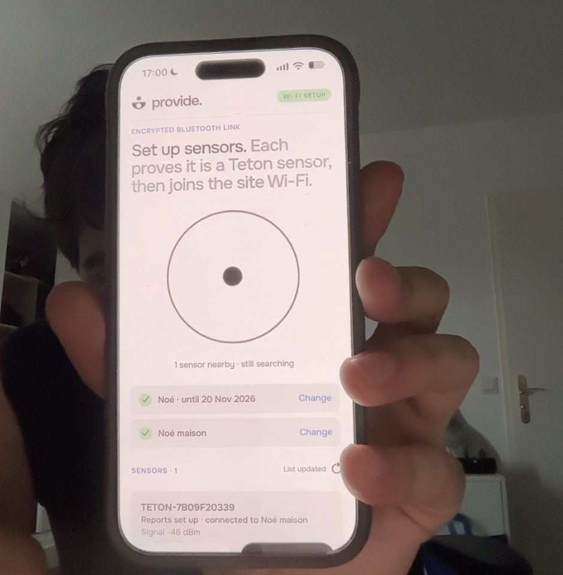
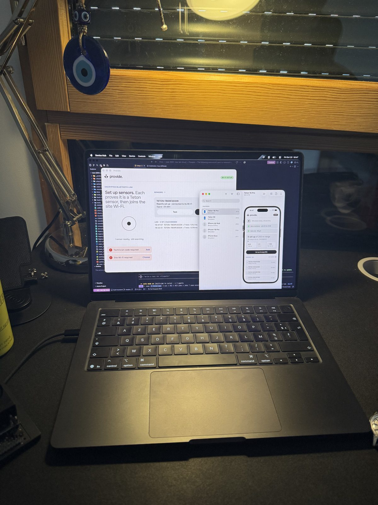
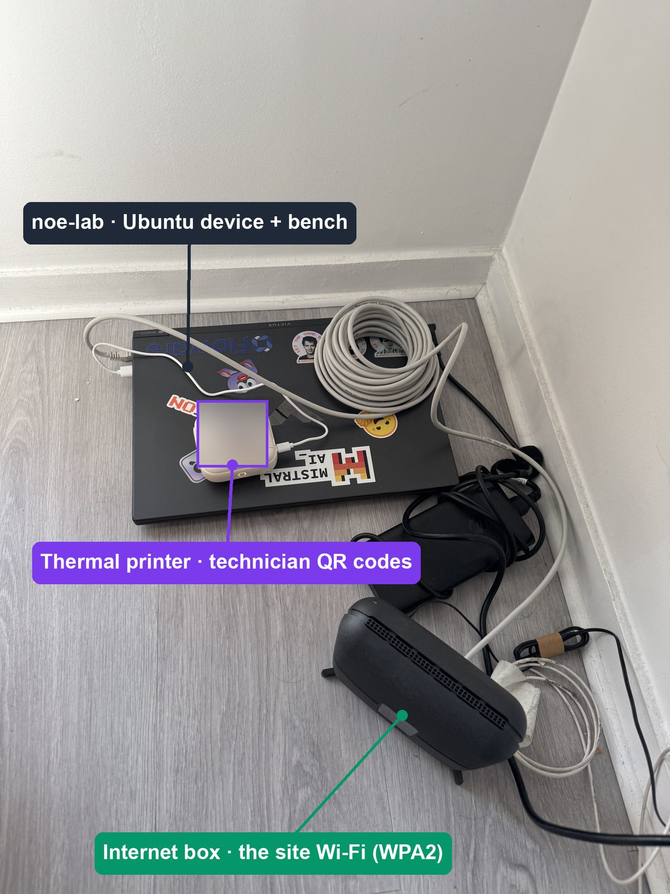
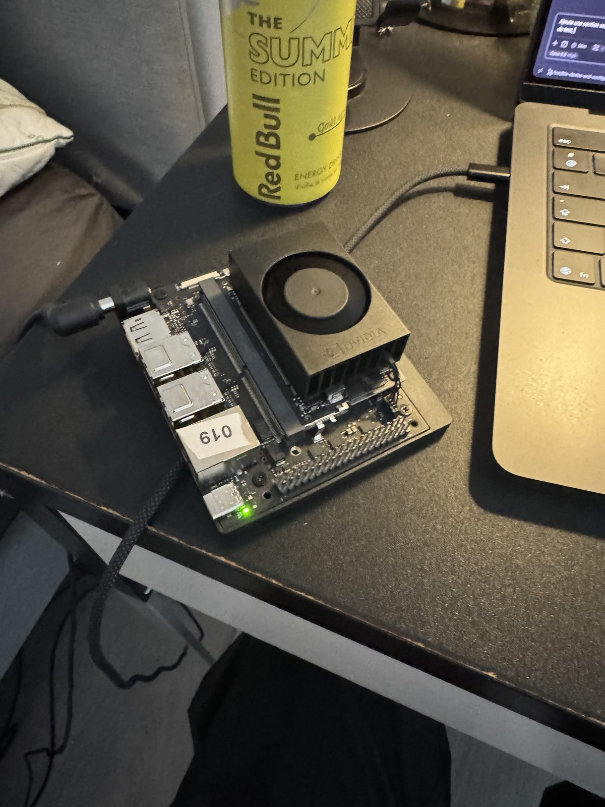
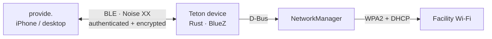

<p align="center">
  
</p>

<h1 align="center">provide.</h1>

<p align="center"><strong>From an offline sensor to a connected hospital wing.</strong></p>
<p align="center">Give headless Teton devices their Wi-Fi credentials over Bluetooth.<br />One technician. One app. No internet required during setup.</p>

<p align="center">
  <a href="#watch-the-demo">Watch the demos</a> ·
  <a href="#try-it">Try it</a> ·
  <a href="#tech-stack">Tech stack</a> ·
  <a href="#compatibility">Compatibility</a> ·
  <a href="#test-setup">Test setup</a> ·
  <a href="#requirements-map">Requirements map</a> ·
  <a href="#folder-tree">Folder tree</a> ·
  <a href="docs/SETUP.md">Ubuntu setup</a> ·
  <a href="docs/ARCHITECTURE.md">Architecture</a> ·
  <a href="docs/SECURITY.md">Security</a>
</p>

## The challenge

A technician arrives at a healthcare facility with headless devices that have no network connection. They need to send the facility’s Wi-Fi credentials securely and know which devices actually connected — without a terminal, a cloud relay or an existing shared network.

**provide.** discovers nearby sensors, authenticates both sides, sends encrypted credentials and reports the result of each Wi-Fi join. The same application serves an iPhone or a desktop, with a batch view for an entire wing.

## Watch the demo

Start with the original overview videos: a whole wing, 200 simulated sensors, batch progress and errors.

<table>
  <tr>
    <th>Mobile · original demo</th>
    <th>Desktop · 200 sensors</th>
  </tr>
  <tr>
    <td align="center">
      <a href="docs/media/overall-200-sensors.mp4">
        
      </a>
    </td>
    <td align="center">
      <a href="docs/media/desktop-200-sensors.mp4">
        
      </a>
    </td>
  </tr>
  <tr>
    <td align="center"><a href="docs/media/overall-200-sensors.mp4">▶ Mobile overview · 41 s</a></td>
    <td align="center"><a href="docs/media/desktop-200-sensors.mp4">▶ Desktop overview · 25 s</a></td>
  </tr>
</table>

### How to use provide.

Short videos show one action at a time, with a **visible pointer and click highlight**. Open a clip to view it at its original resolution: mobile 390 × 844, desktop 1280 × 800, at the source recording’s 25 fps. These MP4 tutorials preserve full colour and text detail.

| Step | Mobile | Desktop |
| --- | --- | --- |
| **1. Add the technician code** — paste, verify, save | [▶ Watch](docs/media/mobile-technician-code.mp4) | [▶ Watch](docs/media/desktop-technician-code.mp4) |
| **2. Set up the site Wi-Fi** — site, SSID, password, save | [▶ Watch](docs/media/mobile-site-wifi.mp4) | [▶ Watch](docs/media/desktop-site-wifi.mp4) |
| **3. Open and test a sensor** — Test → “world” received | [▶ Watch](docs/media/mobile-sensor-test.mp4) | [▶ Watch](docs/media/desktop-sensor-test.mp4) |
| **4. Configure one sensor** — Set up → Device connected | [▶ Watch](docs/media/mobile-sensor-setup.mp4) | [▶ Watch](docs/media/desktop-sensor-setup.mp4) |
| **5. Configure all ready sensors** — batch, errors, retry | [▶ Watch](docs/media/mobile-configure-all.mp4) | [▶ Watch](docs/media/desktop-configure-all.mp4) |

**Demo scope:** the original mobile overview was recorded in the iOS Simulator. The desktop overview and both tutorial layouts use a browser. All fleet results are simulated. Setup tutorials use a public test code and fictitious Wi-Fi details; the sensor tutorials use the app’s separate demo mode. The batch tutorial accelerates the middle of the run 4×. No real credentials are shown and these videos do not prove 200 physical devices were provisioned. [Recording details](docs/media/README.md).

## Built for the technician

- **Discover automatically.** Nearby sensors appear with their identity, signal and setup state.
- **Authorize once.** Import a technician code and enter or scan the facility’s Wi-Fi details.
- **Set up one or a whole wing.** A queue runs up to six sessions at a time, with progress for every sensor.
- **Fix the exceptions.** Filter errors, read the reason and retry failed devices.
- **See the actual result.** A successful device reports the IP address from that provisioning attempt.

## Tech stack

| Side | Stack | Why |
| --- | --- | --- |
| **Device** | **Rust** (1.88, `unsafe` forbidden) | Coherent with Teton's fleet, which runs Rust; memory safety for a daemon that parses radio input from anyone in range; one binary under systemd. |
| | **BlueZ** through `bluer` | Ubuntu's own Bluetooth stack: GATT peripheral and advertising, async on Tokio. |
| | **NetworkManager over D-Bus** (`dbus`) | What Ubuntu already uses to manage Wi-Fi, so the join is real (challenge constraint 2); the password never appears in a command line; failure reasons come from its signals. |
| | **`snow`** (Noise) and **`ed25519-dalek`** | Established implementations: no home-made cryptography. |
| **Configurator** (provide.) | **Expo / React Native**, TypeScript | One code base for the technician's phone, with native Bluetooth; the same screens run on desktop. |
| | `react-native-ble-manager` on iPhone; **Tauri 2** with a Rust `btleplug` bridge on desktop | Native Bluetooth on each platform; a web page cannot do it (no Web Bluetooth on iPhone). |
| | **`@noble`** curves, ciphers and hashes | Audited pure-JavaScript cryptography; the app replays the device's exact Noise bytes in its tests. |
| | iOS Keychain behind Face ID (`expo-secure-store`) | The technician code and site passwords stay locked on a lost phone. |

## Why an app, not a website

A web page was the obvious zero-install option. It fails the challenge on four points:

- **No Bluetooth on iPhone.** No browser on iOS supports Web Bluetooth (all of them run on Safari's engine), and the
  technician's phone is often an iPhone.
- **No scanning, one picker per device.** Where Web Bluetooth exists, the page cannot list nearby sensors by itself:
  the user picks each device in a system dialog. Two hundred sensors would mean two hundred dialogs; the app scans and
  sets up a whole wing in one tap.
- **Offline.** The hallway has no Internet, and a page served by the device would need a shared network, which the
  brief forbids at the start. An installed app works offline.
- **Secrets at rest.** The technician code and site passwords live in the iOS Keychain behind Face ID, not in browser
  storage.

The browser still has a role: the [demo mode](#try-it) runs the same screens with simulated sensors.

## Compatibility

| Part | Tested on hardware | Supported by the stack, not tested | Not supported |
| --- | --- | --- | --- |
| **Device** | Ubuntu 22.04 on x86-64 (BlueZ 5.64, MediaTek MT7921) and on ARM64 (Jetson, kernel 5.15) | Other Linux distributions with BlueZ ≥ 5.64, NetworkManager and systemd; Ubuntu 24.04 | A Bluetooth adapter without BLE peripheral mode; Wi-Fi not managed by NetworkManager |
| **Configurator** | iPhone 15 Pro, iOS 27; macOS (desktop app) | Android (same React Native code); Windows and Linux desktop (Tauri and `btleplug` support them) | A plain browser: demo only, no Bluetooth |
| **Wi-Fi network** | WPA2-Personal | WPA3-Personal (NetworkManager handles it; not tried) | Enterprise (802.1X/EAP) and captive portals |

On desktop, the technician code and sites are kept in memory only for now (lost when the app closes).

## Test setup

The real runs used these machines, each in the role it would have in the field.

<table>
  <tr>
    <td align="center" width="50%"><br/><b>iPhone 15 Pro</b> · the technician's phone<br/><sub>provide. with the real sensor <code>TETON-7B09F20339</code>, set up and on the site Wi-Fi</sub></td>
    <td align="center" width="50%"><br/><b>MacBook</b> · desktop configurator + Teton workshop<br/><sub>provide. desktop with the real sensor; the iOS Simulator in demo mode with 200 sensors</sub></td>
  </tr>
  <tr>
    <td align="center"><br/><b>noe-lab, printer and internet box</b><br/><sub>Ubuntu device and 200-sensor bench; the printer makes the technician QR stickers (blurred: a code is a credential); the box is the site Wi-Fi</sub></td>
    <td align="center"><br/><b>Jetson FLWR-O-019</b> · real sensor hardware<br/><sub>ARM64, Ubuntu 22.04, staged like a production sensor</sub></td>
  </tr>
</table>

| Machine | Hardware and software | What it did |
| --- | --- | --- |
| **iPhone 15 Pro** | iOS 27, provide. Release build (standalone, no Metro) | The technician's phone: hello, code import, site Wi-Fi from its QR code, real setups. |
| **MacBook** | macOS, Apple silicon; provide. desktop app (Tauri) | The desktop configurator. Also Teton's workshop: holds the authorities, certifies sensors, issues technician codes (`cargo authority`), builds the ARM64 device firmware in an Ubuntu 22.04 container. |
| **noe-lab** | x86-64, Ubuntu 22.04.5, kernel 6.8, BlueZ 5.64, NetworkManager 1.36, MediaTek MT7921 (BLE + Wi-Fi) | The first real device: hello, then real Wi-Fi joins from the iPhone. Also the 200-sensor bench: simulated sensors advertised over its real Bluetooth chip ([tools/teton_sim.py](tools/teton_sim.py)). Administered over Ethernet, so provisioning its Wi-Fi never cut the session. |
| **Jetson FLWR-O-019** | Floware sensor, ARM64, Ubuntu 22.04 (L4T), kernel 5.15, BlueZ 5.64 | Real sensor hardware, staged like a production sensor as `TETON-7B09F20339`: real setups from the Mac and the iPhone, reconfiguration, the identity-in-advertisement change. |
| **Internet box** | Home router, WPA2-Personal | The facility network the sensors join; no Internet needed during setup. |
| **Thermal printer** | Pocket printer (48 mm), paired with noe-lab | Prints the technician codes as QR stickers (`print-ticket`); the code goes in on stdin and no copy is kept. |

## Architecture



- **Device.** One systemd service, `teton-device`, running as an unprivileged user. It advertises the sensor's ID and
  state, and exposes one GATT service: **Hello** (a radio check) and **Provisioning** (Noise messages). The protocol
  lives in a library (`device/src/`), the service and its NetworkManager client in `device/bin/`. Two alternating
  Wi-Fi profiles let a failed join fall back to the previous network. Staging and authority tools run once, offline.
- **Configurator.** One screen (`configurator/App.tsx`) over platform-free logic in `configurator/src/`: Noise
  initiator, certificate and code checks, one sensor's setup, and a batch queue running six sensors at a time. Only
  three adapters change per platform: Bluetooth, secure storage and camera.

Why BLE, the data flow, and the design for 200 devices: [docs/ARCHITECTURE.md](docs/ARCHITECTURE.md).

## Security

No plaintext credentials over the air (challenge constraint 3), and no secret to a device that is not Teton's:

- **Encrypted channel.** Noise XX (X25519, ChaCha20-Poly1305), fresh keys each session: a recorded session cannot be
  read or replayed.
- **The sensor proves it is genuine** with a certificate Teton's device authority signed for its key, ID and
  customer. The app checks it before sending anything; an impostor receives only an ephemeral key.
- **The technician proves authorization** with a code from Teton's technician authority: per customer, at most 30
  days, bound to a key held by the phone, so a sensor that records it cannot reuse it.
- **Then the SSID and password** travel, encrypted. They are never logged, and on iPhone they stay behind Face ID.
- **Accepted for the demo:** the sensor's key is a file (no secure element), no revocation list, one shared WPA2
  password per site. Details and threats: [docs/SECURITY.md](docs/SECURITY.md).

## Tests

What the automated tests check (commands in [docs/SETUP.md](docs/SETUP.md#tests)):

- **Interoperability.** The device's Noise implementation produces reference messages; the app must replay them byte
  for byte.
- **Refusals.** A forged reply, a copied certificate, another authority, another customer, an expired code or a code
  without its holder key: the session stops and neither the code nor the password leaves the phone.
- **Device behaviour.** Request parsing and mutation, one phone at a time, the 31-byte advertisement, alternating
  Wi-Fi profiles and failure messages, safe retries (the same attempt never joins twice), a read-only host audit.
- **Scale.** A 200-device batch with bounded concurrency, on the device simulation and in the app's queue (six at a
  time, retries, stop on a site-wide error).
- **Desktop.** The Bluetooth bridge only reaches Teton's service; the page's security policy; layouts and resizes in
  Chromium and WebKit.

Automated tests do not replace the radio: the real runs are in [evidence/real/](evidence/real/).

## Try it

### Explore the app without hardware

With Node.js 22.18 or later:

```sh
git clone https://github.com/NoeBrt/teton-provisioning.git
cd teton-provisioning/configurator
npm ci
npm run web
```

Open the local URL printed by Expo with `?demo=1`, or tap the **provide.** logo to enter demo mode. Try **Set up all ready**, the error filter and **Retry failed**. The simulated sensors appear progressively over about a minute.

### Provision a real device

You need an Ubuntu device with BLE peripheral support and NetworkManager-managed Wi-Fi, a WPA2-Personal network, and an iPhone or macOS configurator prepared beforehand.

**[Follow the Ubuntu setup and real-device walkthrough →](docs/SETUP.md#hardware-and-assumptions)**

The guide covers installation, your own authorities, device staging, app builds, expected results and tests. A plain browser supports the simulation only; real Bluetooth requires a native app. Internet may be needed to prepare dependencies and builds before the offline visit.

## Requirements map

Each item of the challenge, where it is answered, and what the proof covers.

| Challenge requirement | Where | Proof and limits |
| --- | --- | --- |
| **1. No internet** — local channel, no cloud relay, no shared network at the start | Bluetooth LE GATT ([why BLE](docs/ARCHITECTURE.md#why-bluetooth-low-energy)) | [Offline hello](evidence/real/service-offline-hello.txt): the phone, with networking off, exchanged hello with the device over BLE. A full offline encrypted setup is not recorded yet. |
| **2. Real network connection** with the received credentials | NetworkManager on the device ([device/](device/)) | Real joins from the iPhone and from macOS to a Linux device: [current protocol, macOS](evidence/real/identity-advertisement.txt), [iPhone → Ubuntu](evidence/real/real-join.txt). |
| **3. No plaintext credentials over the air** | Noise XX, device certificates, holder-bound technician codes ([SECURITY.md](docs/SECURITY.md)) | Interoperability and rejection tests ([device/tests/](device/tests/), [configurator tests](configurator/src/)). The [earlier BLE capture](evidence/real/real-join.txt) checked the SSID is absent; a fresh capture of the current protocol is still to do. |
| **4. Usable by a non-developer** | Automatic discovery, code import, saved sites, one sensor or a whole batch, errors and retry | [Videos above](#watch-the-demo), with simulated sensors. No usability study with a facilities team. |
| **Working code**, configurator and device | [configurator/](configurator/), [device/](device/) | |
| **Setup and run on Ubuntu**, hardware assumptions | [docs/SETUP.md](docs/SETUP.md) | Not reproduced on a clean machine. |
| **Architecture writeup**: channel and trade-offs, protection in transit, 200 devices | [docs/ARCHITECTURE.md](docs/ARCHITECTURE.md) ([200 devices](docs/ARCHITECTURE.md#200-devices-in-a-hospital-wing)), [docs/SECURITY.md](docs/SECURITY.md) | The 200-sensor runs are simulations: [measurements](evidence/simulation/README.md). |
| **Evidence of a successful run** | [evidence/](evidence/) | Real runs, simulations and test logs are kept apart. |

Not verified: Android, the desktop app on Windows and Linux, 200 physical sensors, and reboot recovery on hardware. The desktop app keeps the technician code and sites in memory only (lost when it closes); the iPhone uses the system's secure storage.

## Folder tree

```text
README.md                you are here: demo, requirements map, folder tree
configurator/            CONFIGURATOR side: provide., the technician app (iPhone and desktop, one code base)
  App.tsx                  the whole screen: discovery, sensor cards, batch
  src/                     provisioning logic (Noise initiator, certificates, codes, batch queue) and its tests
  desktop/                 desktop shell (Tauri): window, Rust Bluetooth bridge, layout checks
  assets/                  app icons and logo
device/                  TETON DEVICE side: the Linux service, one Rust crate
  bin/                     programs: the BLE service (main.rs, wifi.rs), stage, authority, audit-host
  src/                     protocol library: hello probe, Noise responder, certificates and codes, simulation
  tests/                   integration tests, incl. Noise vectors shared with the configurator
  examples/                200-sensor simulation and benchmark
  systemd/                 service unit, permissions and installer for Ubuntu
docs/
  SETUP.md                 reproduce on Ubuntu: hardware, build, staging, tests
  ARCHITECTURE.md          channel choice and trade-offs, data flow, 200 devices in a hospital wing
  SECURITY.md              how credentials are protected in transit, threats, limits
  DECISIONS.md             dated decision log
  media/                   screenshots and videos used by the docs (ui-history/: how the app evolved)
evidence/
  real/                    runs on real hardware (BLE hello, Wi-Fi join, reconfiguration)
  simulation/              200-sensor simulations and benchmarks, with their method (README.md)
  tests/                   test and check logs, desktop screenshots, video checks
tools/                   bench and demo tooling: simulated BLE sensors, capture check, video scripts
```

Start with [docs/SETUP.md](docs/SETUP.md) to run it, [docs/ARCHITECTURE.md](docs/ARCHITECTURE.md) to understand it, and [evidence/](evidence/) to check it.
