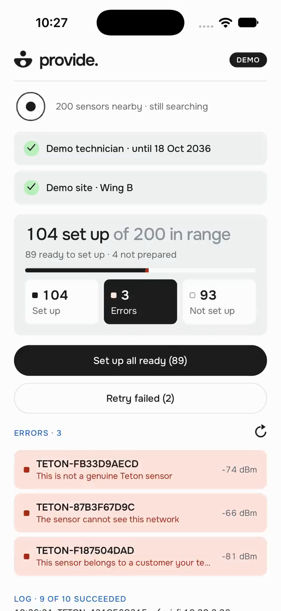
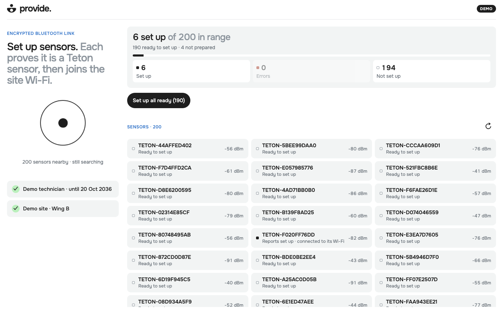
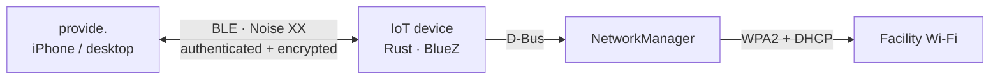

<p align="center">
  
</p>

<h1 align="center">provide.</h1>

<p align="center"><strong>From an offline sensor to a connected hospital wing.</strong></p>
<p align="center">Give headless IoT devices their Wi-Fi credentials over Bluetooth.<br />One technician. One app. No internet required during setup.</p>

<p align="center">
  <a href="#watch-the-demo">Watch the demos</a> ·
  <a href="#try-it">Try it</a> ·
  <a href="docs/SETUP.md">Ubuntu setup</a> ·
  <a href="docs/ARCHITECTURE.md">Architecture</a> ·
  <a href="docs/SECURITY.md">Security</a>
</p>

## The challenge

A technician arrives at a healthcare facility with headless devices that have no network connection. They need to send the facility’s Wi-Fi credentials securely and know which devices actually connected — without a terminal, a cloud relay or an existing shared network.

**provide.** discovers nearby sensors, authenticates both sides, sends encrypted credentials and reports the result of each Wi-Fi join. The same application serves an iPhone or a desktop, with a batch view for an entire wing.

## Watch the demo

Start with the original overview videos: a whole wing, 200 simulated sensors, batch progress and errors.

<table>
  <tr>
    <th>Mobile · original demo</th>
    <th>Desktop · 200 sensors</th>
  </tr>
  <tr>
    <td align="center">
      <a href="docs/assets/architecture/overall-200-sensors.mp4">
        
      </a>
    </td>
    <td align="center">
      <a href="docs/assets/demos/desktop-200-sensors.mp4">
        
      </a>
    </td>
  </tr>
  <tr>
    <td align="center"><a href="docs/assets/architecture/overall-200-sensors.mp4">▶ Mobile overview · 41 s</a></td>
    <td align="center"><a href="docs/assets/demos/desktop-200-sensors.mp4">▶ Desktop overview · 25 s</a></td>
  </tr>
</table>

### How to use provide.

Short videos show one action at a time, with a **visible pointer and click highlight**. Open a clip to view it at its original resolution: mobile 390 × 844, desktop 1280 × 800, at the source recording’s 25 fps. These MP4 tutorials preserve full colour and text detail.

| Step | Mobile | Desktop |
| --- | --- | --- |
| **1. Add the technician code** — paste, verify, save | [▶ Watch](docs/assets/demos/mobile-technician-code.mp4) | [▶ Watch](docs/assets/demos/desktop-technician-code.mp4) |
| **2. Set up the site Wi-Fi** — site, SSID, password, save | [▶ Watch](docs/assets/demos/mobile-site-wifi.mp4) | [▶ Watch](docs/assets/demos/desktop-site-wifi.mp4) |
| **3. Open and test a sensor** — Test → “world” received | [▶ Watch](docs/assets/demos/mobile-sensor-test.mp4) | [▶ Watch](docs/assets/demos/desktop-sensor-test.mp4) |
| **4. Configure one sensor** — Set up → Device connected | [▶ Watch](docs/assets/demos/mobile-sensor-setup.mp4) | [▶ Watch](docs/assets/demos/desktop-sensor-setup.mp4) |
| **5. Configure all ready sensors** — batch, errors, retry | [▶ Watch](docs/assets/demos/mobile-configure-all.mp4) | [▶ Watch](docs/assets/demos/desktop-configure-all.mp4) |

**Demo scope:** the original mobile overview was recorded in the iOS Simulator. The desktop overview and both tutorial layouts use a browser. All fleet results are simulated. Setup tutorials use a public test code and fictitious Wi-Fi details; the sensor tutorials use the app’s separate demo mode. The batch tutorial accelerates the middle of the run 4×. No real credentials are shown and these videos do not prove 200 physical devices were provisioned. [Recording details](docs/assets/demos/README.md).

## Built for the technician

- **Discover automatically.** Nearby sensors appear with their identity, signal and setup state.
- **Authorize once.** Import a technician code and enter or scan the facility’s Wi-Fi details.
- **Set up one or a whole wing.** A queue runs up to six sessions at a time, with progress for every sensor.
- **Fix the exceptions.** Filter errors, read the reason and retry failed devices.
- **See the actual result.** A successful device reports the IP address from that provisioning attempt.

## How it works



The sensor proves a certified key. The configurator proves authorization with a holder-bound technician token. Credentials travel only after those checks, inside the encrypted Noise channel. No operating-system pairing PIN or per-sensor QR scan is needed.

Read the [BLE trade-offs](docs/ARCHITECTURE.md#why-bluetooth-low-energy), [credential protection](docs/SECURITY.md) and [design for 200 devices](docs/ARCHITECTURE.md#200-devices-in-a-hospital-wing).

## Try it

### Explore the app without hardware

With Node.js 22.18 or later:

```sh
git clone https://github.com/NoeBrt/iot-provisioning.git
cd iot-provisioning/configurator
npm ci
npm run web
```

Open the local URL printed by Expo with `?demo=1`, or tap the **provide.** logo to enter demo mode. Try **Set up all ready**, the error filter and **Retry failed**. The simulated sensors appear progressively over about a minute.

### Provision a real device

You need an Ubuntu device with BLE peripheral support and NetworkManager-managed Wi-Fi, a WPA2-Personal network, and an iPhone or macOS configurator prepared beforehand.

**[Follow the Ubuntu setup and real-device walkthrough →](docs/SETUP.md#hardware-and-assumptions)**

The guide covers installation, your own authorities, device staging, app builds, expected results and tests. A plain browser supports the simulation only; real Bluetooth requires a native app. Internet may be needed to prepare dependencies and builds before the offline visit.

## What has been demonstrated

| Run | Evidence |
| --- | --- |
| **Current protocol, real hardware:** macOS configurator → Linux device → real Wi-Fi connection | [App result and device journal, 23 October 2026](evidence/real/identity-advertisement.txt) |
| **Earlier protocol, real hardware:** iPhone → Ubuntu → real Wi-Fi connection | [Successful run and BLE capture summary](evidence/real/real-join.txt) |
| **Offline BLE:** phone networking disabled, device service answers hello | [Offline radio check](evidence/real/service-offline-hello.txt) |
| **200 simulated sensors:** batch progress, grouped errors and retries | Mobile and desktop videos above |

The current iPhone build is installed; provisioning on a physical iPhone after the identity update remains unverified. Android, desktop Windows/Linux runtime and 200 physical sensors remain unverified. Desktop secrets currently live in memory and are lost when the app closes; iPhone uses native secure storage.

For the four challenge constraints, exact evidence scope and remaining checks, see the [evaluation table](docs/SETUP.md#evidence-and-limits).

## Under the hood

| Part | Stack | Code |
| --- | --- | --- |
| Configurator | Expo / React Native / TypeScript | [configurator/](configurator) |
| Desktop shell and Bluetooth bridge | Tauri / Rust | [configurator/desktop/](configurator/desktop) |
| Linux device and Wi-Fi activation | Rust / BlueZ / NetworkManager | [device/](device) |
| Protocol and authorization | Noise XX / Ed25519 certificates | [src/](src) |
| Integration tests | Rust and shared Noise vectors | [tests/](tests) |
| BLE simulation bench | Python / Bumble; simulated Wi-Fi | [lab/](lab) |

**Further reading:** [setup and tests](docs/SETUP.md) · [architecture](docs/ARCHITECTURE.md) · [security](docs/SECURITY.md) · [decisions](docs/DECISIONS.md) · [benchmarks](docs/BENCHMARKS.md)
