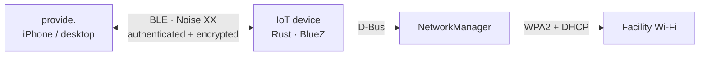

<p align="center">
  
</p>

<h1 align="center">provide.</h1>

<p align="center"><strong>From an offline sensor to a connected hospital wing.</strong></p>
<p align="center">Give headless IoT devices their Wi-Fi credentials over Bluetooth.<br />One technician. One app. No internet required during setup.</p>

<p align="center">
  <a href="#watch-the-demo">Watch the demos</a> ·
  <a href="#try-it">Try it</a> ·
  <a href="#requirements-map">Requirements map</a> ·
  <a href="#folder-tree">Folder tree</a> ·
  <a href="docs/SETUP.md">Ubuntu setup</a> ·
  <a href="docs/ARCHITECTURE.md">Architecture</a> ·
  <a href="docs/SECURITY.md">Security</a>
</p>

## The challenge

A technician arrives at a healthcare facility with headless devices that have no network connection. They need to send the facility’s Wi-Fi credentials securely and know which devices actually connected — without a terminal, a cloud relay or an existing shared network.

**provide.** discovers nearby sensors, authenticates both sides, sends encrypted credentials and reports the result of each Wi-Fi join. The same application serves an iPhone or a desktop, with a batch view for an entire wing.

## Watch the demo

Start with the original overview videos: a whole wing, 200 simulated sensors, batch progress and errors.

<table>
  <tr>
    <th>Mobile · original demo</th>
    <th>Desktop · 200 sensors</th>
  </tr>
  <tr>
    <td align="center">
      <a href="docs/media/overall-200-sensors.mp4">
        
      </a>
    </td>
    <td align="center">
      <a href="docs/media/desktop-200-sensors.mp4">
        
      </a>
    </td>
  </tr>
  <tr>
    <td align="center"><a href="docs/media/overall-200-sensors.mp4">▶ Mobile overview · 41 s</a></td>
    <td align="center"><a href="docs/media/desktop-200-sensors.mp4">▶ Desktop overview · 25 s</a></td>
  </tr>
</table>

### How to use provide.

Short videos show one action at a time, with a **visible pointer and click highlight**. Open a clip to view it at its original resolution: mobile 390 × 844, desktop 1280 × 800, at the source recording’s 25 fps. These MP4 tutorials preserve full colour and text detail.

| Step | Mobile | Desktop |
| --- | --- | --- |
| **1. Add the technician code** — paste, verify, save | [▶ Watch](docs/media/mobile-technician-code.mp4) | [▶ Watch](docs/media/desktop-technician-code.mp4) |
| **2. Set up the site Wi-Fi** — site, SSID, password, save | [▶ Watch](docs/media/mobile-site-wifi.mp4) | [▶ Watch](docs/media/desktop-site-wifi.mp4) |
| **3. Open and test a sensor** — Test → “world” received | [▶ Watch](docs/media/mobile-sensor-test.mp4) | [▶ Watch](docs/media/desktop-sensor-test.mp4) |
| **4. Configure one sensor** — Set up → Device connected | [▶ Watch](docs/media/mobile-sensor-setup.mp4) | [▶ Watch](docs/media/desktop-sensor-setup.mp4) |
| **5. Configure all ready sensors** — batch, errors, retry | [▶ Watch](docs/media/mobile-configure-all.mp4) | [▶ Watch](docs/media/desktop-configure-all.mp4) |

**Demo scope:** the original mobile overview was recorded in the iOS Simulator. The desktop overview and both tutorial layouts use a browser. All fleet results are simulated. Setup tutorials use a public test code and fictitious Wi-Fi details; the sensor tutorials use the app’s separate demo mode. The batch tutorial accelerates the middle of the run 4×. No real credentials are shown and these videos do not prove 200 physical devices were provisioned. [Recording details](docs/media/README.md).

## Built for the technician

- **Discover automatically.** Nearby sensors appear with their identity, signal and setup state.
- **Authorize once.** Import a technician code and enter or scan the facility’s Wi-Fi details.
- **Set up one or a whole wing.** A queue runs up to six sessions at a time, with progress for every sensor.
- **Fix the exceptions.** Filter errors, read the reason and retry failed devices.
- **See the actual result.** A successful device reports the IP address from that provisioning attempt.

## How it works



The sensor proves a certified key. The configurator proves authorization with a holder-bound technician token. Credentials travel only after those checks, inside the encrypted Noise channel. No operating-system pairing PIN or per-sensor QR scan is needed.

Read the [BLE trade-offs](docs/ARCHITECTURE.md#why-bluetooth-low-energy), [credential protection](docs/SECURITY.md) and [design for 200 devices](docs/ARCHITECTURE.md#200-devices-in-a-hospital-wing).

## Try it

### Explore the app without hardware

With Node.js 22.18 or later:

```sh
git clone https://github.com/NoeBrt/iot-provisioning.git
cd iot-provisioning/configurator
npm ci
npm run web
```

Open the local URL printed by Expo with `?demo=1`, or tap the **provide.** logo to enter demo mode. Try **Set up all ready**, the error filter and **Retry failed**. The simulated sensors appear progressively over about a minute.

### Provision a real device

You need an Ubuntu device with BLE peripheral support and NetworkManager-managed Wi-Fi, a WPA2-Personal network, and an iPhone or macOS configurator prepared beforehand.

**[Follow the Ubuntu setup and real-device walkthrough →](docs/SETUP.md#hardware-and-assumptions)**

The guide covers installation, your own authorities, device staging, app builds, expected results and tests. A plain browser supports the simulation only; real Bluetooth requires a native app. Internet may be needed to prepare dependencies and builds before the offline visit.

## Requirements map

Each item of the challenge, where it is answered, and what the proof covers.

| Challenge requirement | Where | Proof and limits |
| --- | --- | --- |
| **1. No internet** — local channel, no cloud relay, no shared network at the start | Bluetooth LE GATT ([why BLE](docs/ARCHITECTURE.md#why-bluetooth-low-energy)) | [Offline hello](evidence/real/service-offline-hello.txt): the phone, with networking off, exchanged hello with the device over BLE. A full offline encrypted setup is not recorded yet. |
| **2. Real network connection** with the received credentials | NetworkManager on the device ([device/](device/)) | [Current protocol, macOS → Linux](evidence/real/identity-advertisement.txt): app result and device journal report the join. [Earlier protocol, iPhone → Ubuntu](evidence/real/real-join.txt). |
| **3. No plaintext credentials over the air** | Noise XX, device certificates, holder-bound technician codes ([SECURITY.md](docs/SECURITY.md)) | Interoperability and rejection tests ([device/tests/](device/tests/), [configurator tests](configurator/src/)). The [earlier BLE capture](evidence/real/real-join.txt) checked the SSID is absent; a fresh capture of the current protocol is still to do. |
| **4. Usable by a non-developer** | Automatic discovery, code import, saved sites, one sensor or a whole batch, errors and retry | [Videos above](#watch-the-demo), with simulated sensors. No usability study with a facilities team. |
| **Working code**, configurator and device | [configurator/](configurator/), [device/](device/) | |
| **Setup and run on Ubuntu**, hardware assumptions | [docs/SETUP.md](docs/SETUP.md) | Not reproduced on a clean machine. |
| **Architecture writeup**: channel and trade-offs, protection in transit, 200 devices | [docs/ARCHITECTURE.md](docs/ARCHITECTURE.md) ([200 devices](docs/ARCHITECTURE.md#200-devices-in-a-hospital-wing)), [docs/SECURITY.md](docs/SECURITY.md) | The 200-sensor runs are simulations: [measurements](evidence/simulation/README.md). |
| **Evidence of a successful run** | [evidence/](evidence/) | Real runs, simulations and test logs are kept apart. |

Not verified: provisioning from a physical iPhone since the identity change, Android, the desktop app on Windows and Linux, 200 physical sensors, and reboot recovery on hardware. The desktop app keeps the technician code and sites in memory only (lost when it closes); the iPhone uses the system's secure storage.

## Folder tree

```text
README.md                you are here: demo, requirements map, folder tree
configurator/            CONFIGURATOR side: provide., the technician app (iPhone and desktop, one code base)
  App.tsx                  the whole screen: discovery, sensor cards, batch
  src/                     provisioning logic (Noise initiator, certificates, codes, batch queue) and its tests
  desktop/                 desktop shell (Tauri): window, Rust Bluetooth bridge, layout checks
  assets/                  app icons and logo
device/                  IOT DEVICE side: the Linux service, one Rust crate
  bin/                     programs: the BLE service (main.rs, wifi.rs), stage, authority, audit-host
  src/                     protocol library: hello probe, Noise responder, certificates and codes, simulation
  tests/                   integration tests, incl. Noise vectors shared with the configurator
  examples/                200-sensor simulation and benchmark
  systemd/                 service unit, permissions and installer for Ubuntu
docs/
  SETUP.md                 reproduce on Ubuntu: hardware, build, staging, tests
  ARCHITECTURE.md          channel choice and trade-offs, data flow, 200 devices in a hospital wing
  SECURITY.md              how credentials are protected in transit, threats, limits
  DECISIONS.md             dated decision log
  media/                   screenshots and videos used by the docs (ui-history/: how the app evolved)
evidence/
  real/                    runs on real hardware (BLE hello, Wi-Fi join, reconfiguration)
  simulation/              200-sensor simulations and benchmarks, with their method (README.md)
  tests/                   test and check logs, desktop screenshots, video checks
tools/                   bench and demo tooling: simulated BLE sensors, capture check, video scripts
```

Start with [docs/SETUP.md](docs/SETUP.md) to run it, [docs/ARCHITECTURE.md](docs/ARCHITECTURE.md) to understand it, and [evidence/](evidence/) to check it.
