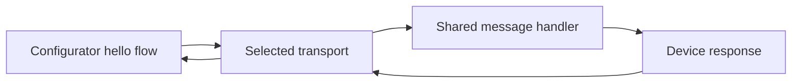

# Architecture and Selected Stack

Status: the shared hello contract and dependency-free simulation are implemented
and tested. No Jetson is currently available. Simulated acceptance and hardware
acceptance are distinct; the original challenge requires the latter.

## Stack

| Responsibility | Choice | Rationale / validation status |
| --- | --- | --- |
| Baseline | Ubuntu 22.04 target, Rust 1.88.0, edition 2024 | Installed `stable` reports 1.88.0; ARM64/device checks pending |
| Current runtime | Standard-library threads | No third-party dependencies; builds offline |
| Simulation | Two bounded `std::sync::mpsc` channels per session, synthetic discovery | Capacity one each; no radio, sockets, root, or Bluetooth dependency |
| Tests | `cargo test`, `#[test]` | Handler unit tests and simulation integration tests; finite real-time receive deadlines |
| Planned real BLE runtime | Tokio | Needed by `bluer`; not installed or declared yet |
| Planned device BLE | BlueZ GATT/advertising via `bluer` | Supported local GATT role; hardware validation pending |
| Planned configurator BLE | `bluer` remote GATT/discovery | Same library for both Linux roles |
| Later Wi-Fi control | NetworkManager D-Bus via `dbus`/`dbus-tokio` | Match `bluer`'s library family; no password subprocess arguments |
| Planned device lifecycle | systemd + compiled Rust binary | Host BlueZ/NetworkManager access; permissions/recovery checks pending |
| Packaging and checks | Cargo.lock, rust-toolchain.toml, Rustfmt, Clippy | Manifest, dependency-free lockfile, and exact toolchain pin exist |
| State | Memory for the transport milestone | A fresh instance starts available; no persistent provisioning state yet |

Rust replaces the earlier Python proposal at the user's request to align with
the fleet. Exact fleet toolchain/crate versions remain to be confirmed.
Tokio and bluer are absent from the local Cargo cache and the crate index is
unreachable. [Decision 12](DECISIONS.md#12-executable-simulation-without-uncached-crates)
therefore uses the standard library for the executable software milestone.
[BlueR (`bluer`)](https://docs.rs/bluer/0.17.4/bluer/) supports both local and
remote GATT roles on Linux and uses Tokio. Its
[manifest](https://docs.rs/crate/bluer/0.17.4/source/Cargo.toml.orig) declares
the `bluetoothd` feature and `dbus`/`dbus-tokio` dependencies. Candidate `bluer`
0.17.4 is documentation-reviewed, not build-tested here. Compile only the needed
features; verify the selected crate graph against Rust 1.88 before locking it.

Future BLE builds need the host D-Bus development libraries, `pkg-config`, and a C
toolchain for libdbus bindings. `pkg-config` detects libdbus locally; complete
build/link checks and device distribution compatibility are still pending.

## Responsibility boundaries



In simulation, the transport supplies fake device metadata and two bounded
channels; a worker thread runs the shared handler. The planned hardware adapter
will use `bluer` and BlueZ for discovery, connection, and GATT exchange. The shared
handler receives bytes and returns bytes; it imports neither BLE nor NetworkManager.
Keep simulation wiring out of the real service.

The current single Cargo package contains:

```text
Cargo.toml / Cargo.lock / rust-toolchain.toml
src/lib.rs / src/protocol.rs   shared byte handler, unit tests beside code
src/simulation.rs             reusable fake transport, lifecycle unit tests
src/simulation/batch.rs       bounded pool of independent simulated device jobs
tests/simulation.rs           discovery, exchange, rejection, recovery tests
tests/scaled.rs               public batch API coverage and concurrency bounds
examples/simulation.rs        labeled hello demonstration
examples/benchmark.rs         local measurements and bounded soak runner
```

Add `device/main.rs` / `device/ble.rs` and `configurator/main.rs` /
`configurator/ble.rs` when real adapter work starts. Declare their binary paths
with `required-features = ["ble"]` and an optional `bluer` dependency then;
the feature does not exist yet. Default software tests must not build libdbus or
connect to BlueZ. The demo, integration tests, and benchmark reuse the same
simulation module and handler. Add no unused modules, generic transport
framework, or multi-crate workspace.

## First message contract

- Demo identity: `IOT-DEMO-001`; its name is only a discovery hint.
- Request: exactly the five bytes `hello`; response: exactly `world`.
- Reject other input without echoing or logging it. This endpoint accepts no credentials.
- One request at a time; nonblocking sends, finite receive deadlines, explicit errors.
- The simulator rejects inputs above 20 bytes before copying; this is a software
  bound, not a measured BLE MTU.
- Each new connection gets fresh channels. Timeout/disconnect closes the session;
  retry requires a fresh connection. Invalid input leaves a valid session usable.
- Closing drops the reply receiver before the request sender, then joins the worker,
  so late replies cannot be accepted by the closed session.
- Device stop disables discovery, new connections, and subsequent requests. A wait
  already in progress keeps its receive deadline; stop is not instant cancellation.

The eventual BLE adapter advertises a project-specific service UUID and exposes
one characteristic with write and read properties. The configurator performs
an acknowledged write, then reads the response. Both messages are small; no
fragmentation or notification protocol is needed for this probe. The UUID will
be generated once and stored in the shared contract when the BLE adapter is built.
The secure provisioning protocol may need a different framing scheme later.

## What simulation proves

| Check | Software simulation | Required later |
| --- | --- | --- |
| Discover expected demo ID | Synthetic registry only | Actual advertisements and scan |
| `hello` response | Actual shared handler through channels | GATT write/read over BLE |
| Timeout, disconnect, retry | Injected dropped reply/disconnect; bounded real-time waits | Driver/radio disconnect behavior |
| Restart | Replace simulated device instance | systemd restart and machine reboot |
| Offline operation | No external services by construction | Radio demo without Internet or shared LAN |
| Wi-Fi success | Not simulated in milestone one | NetworkManager activation plus assigned IP |

Do not label software logs as successful BLE provisioning. Future fake network
results must also be labeled simulations; they cannot satisfy the real-Wi-Fi requirement.

The 23 tests (15 handler/simulation, four scaled batches, four benchmark harness)
pass in debug and release on the installed Rust 1.88.0 compiler. The software checkpoint includes
three benchmark trials and a completed 300-second recovery soak; see
[the measured results and raw evidence](BENCHMARKS.md).
The follow-up scale matrix also has three independent process trials.
Run the full suite with
`RUSTUP_TOOLCHAIN=stable cargo test --all-targets --locked --offline`; use this
override only after confirming `stable` is 1.88.0. Standard Ubuntu setup must
preinstall the pinned toolchain and its Rustfmt/Clippy components; Cargo's
`--offline` flag does not prevent rustup from downloading a missing compiler.

Benchmark and soak evidence must identify the release profile, commands, host,
sample counts, elapsed time, and outcomes. Thread/channel measurements describe
this software harness only; they predict neither BLE throughput nor capacity
for 200 real devices. A simulated restart replaces an object, not a systemd
service or machine reboot.

The scaled software workload queues task indices at batch start. A bounded
pool creates an independent fake device/session for each job, checks literal
`hello`/`world`, and closes/joins it. The public batch API rejects sizes outside
1-10,000 jobs and concurrency outside 1-32 clients before allocation/spawning.
Each active client uses at most one session worker; a healthy batch therefore
uses at most twice its client limit plus the calling thread. This is a per-batch
limit; callers running several batches at once must bound their aggregate load.
The example uses at most eight clients. Indices identify synthetic jobs, not
advertised physical identities. BLE discovery and production queueing remain future work.

## Docker and alternatives

Docker is optional packaging for the same software tests. If added, use an
unprivileged runner with networking disabled and dependencies already in the
image. Do not add a Compose network: it would introduce a shared LAN the actual
challenge does not assume. Docker's host Bluetooth/D-Bus passthrough would still
exercise host hardware and require host access.

A BlueZ `btvirt`/VHCI integration lab could later test actual GATT registration
without physical radios, but requires host kernel/device access. It is outside
the first simulation; see the [BlueZ emulator source](https://kernel.googlesource.com/pub/scm/bluetooth/bluez.git/+/master/emulator/vhci.c).
If real BLE proves unsuitable, audit SoftAP support and adapt the transport.
QR provisioning remains a documented alternative, not another implementation.

## Boundaries for later phases

Before any wireless credential transfer, select an established authenticated
channel and physical device-identity bootstrap. Evaluate BLE authenticated
pairing against a library-based application channel; decide based on actual
I/O capabilities and platform support. A BLE name, RSSI, or raw Diffie-Hellman
exchange is insufficient. Record sender authorization, replay policy, and
post-success exposure in `docs/SECURITY.md` before enabling secrets.

Then implement NetworkManager activation with an IP-based success criterion,
technician-friendly errors, and a small local UI if needed. The demo targets
personal WPA Wi-Fi; hospital EAP/certificate requirements are a separate scope.
Discuss site profiles, authenticated manifests, bounded queues, multiple operators,
and staging versus corridor setup for 200 devices; do not implement orchestration now.
