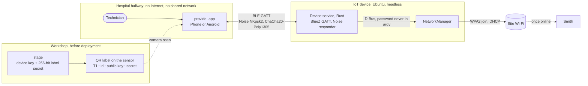
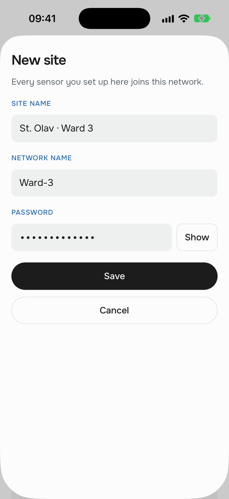
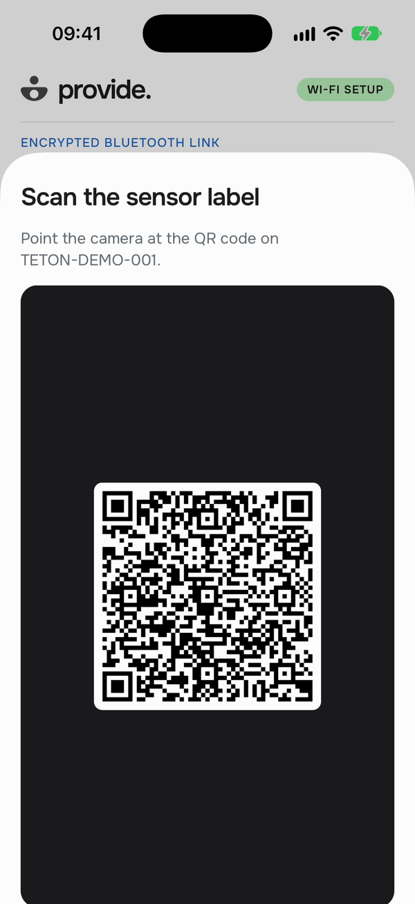
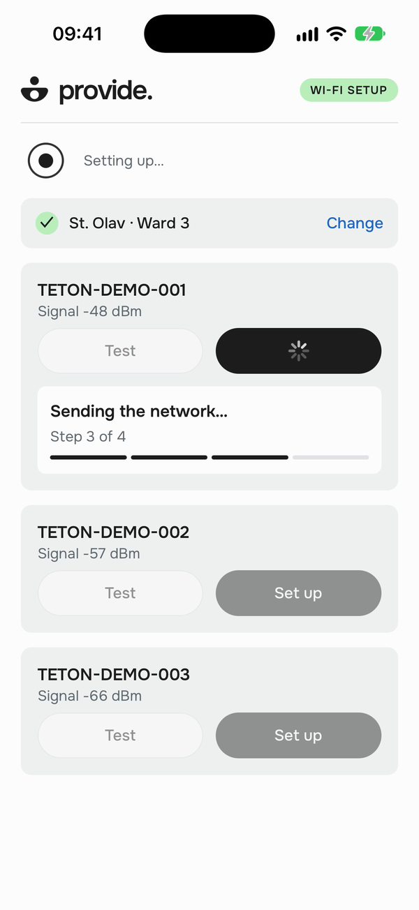
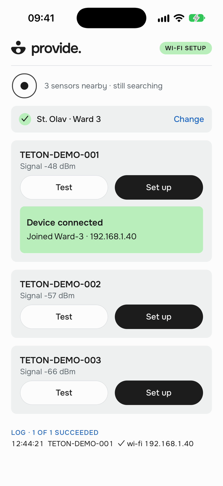
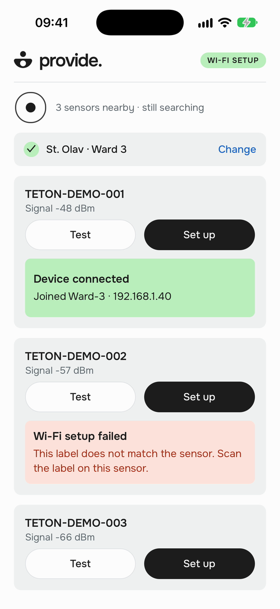
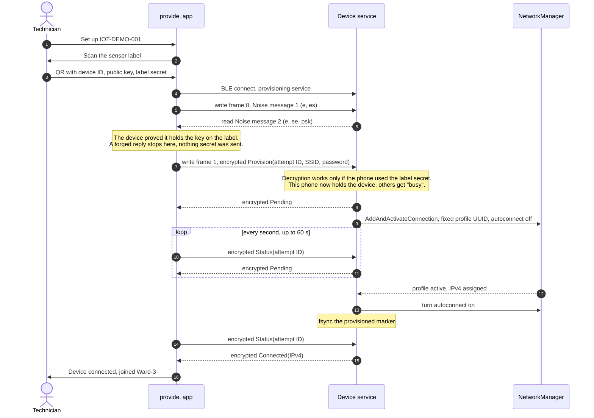
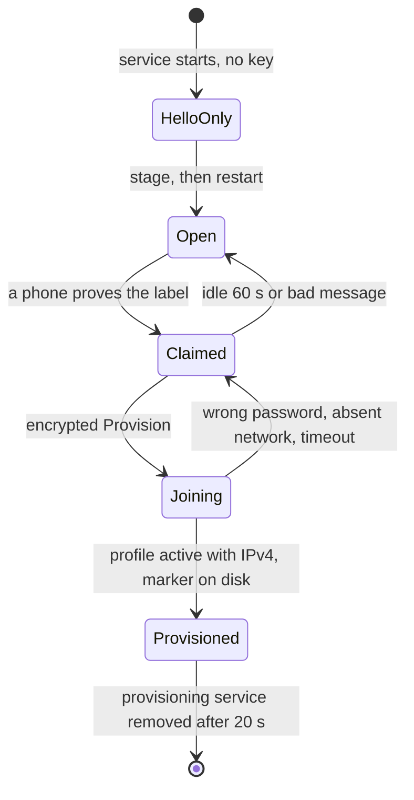
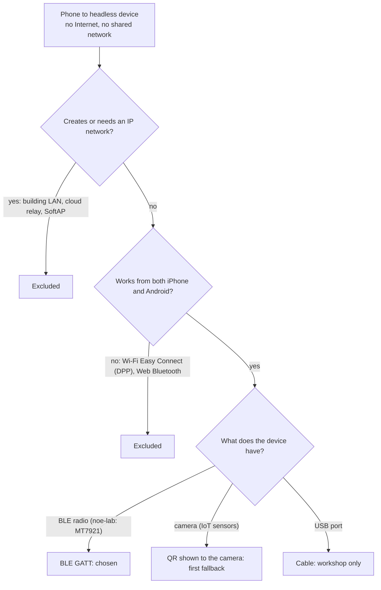
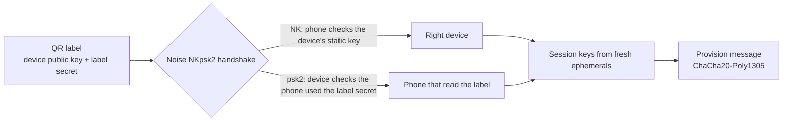

# Architecture

A technician's phone hands Wi-Fi credentials to a headless IoT device over Bluetooth Low Energy. The two sides
share no network and no Internet. The device proves its identity with the key printed on its QR label, the phone
proves it read that label, and only then does the password travel, encrypted. The device joins the network through
NetworkManager and reports the address it received for that exact attempt.

| Side | Code | Runs on |
| --- | --- | --- |
| Configurator (**provide.**) | `configurator/`: Expo SDK 57, React Native 0.86, TypeScript | iPhone (tested), Android (same code, not run) |
| Device service | `device/main.rs`, `device/wifi.rs`, `src/provision.rs`: Rust 1.88, BlueZ through `bluer`, Noise through `snow`, NetworkManager over D-Bus | Ubuntu 22.04, any adapter with BLE and Wi-Fi |
| Staging tool | `device/stage.rs` | The device, once, before deployment |

Setup and run steps live in the [README](../README.md); the security design and its tests in
[SECURITY.md](SECURITY.md); every decision with its alternatives in [DECISIONS.md](DECISIONS.md); the live
requirement check in [tasks/compliance.md](../tasks/compliance.md).

## System at a glance



The device exposes one GATT service with two characteristics. **Hello** answers `world` to `hello` and never
carries credentials; it lets a technician check the radio link. **Provisioning** carries Noise messages, one per
acknowledged write, and exists only while the device is staged and not yet provisioned.

## The technician's flow

<table>
<tr>
<td align="center"><br><sub>1. The app scans as soon as it opens</sub></td>
<td align="center"><br><sub>2. Sensors appear; the site Wi-Fi is missing</sub></td>
<td align="center"><br><sub>3. Site Wi-Fi, entered once per facility</sub></td>
<td align="center"><br><sub>4. Scan the label of this sensor</sub></td>
</tr>
<tr>
<td align="center"><br><sub>5. Plain-language steps, inside the card</sub></td>
<td align="center"><br><sub>6. Device connected, with its new IP</sub></td>
<td align="center"><br><sub>7. A key mismatch stops before any secret leaves</sub></td>
<td></td>
</tr>
</table>

Video, 33 s: [architecture/demo-simulator.mp4](architecture/demo-simulator.mp4).

The technician taps **Set up** on a sensor. The first time, the app asks for the site Wi-Fi (facility name,
network, password), typed or scanned from the network's standard Wi-Fi QR code, and keeps it in the Keychain
behind Face ID. Then it opens the camera on the sensor's label,
runs the four steps (connecting, securing the channel, sending the network, joining the Wi-Fi) and shows the
result in that sensor's card. The next sensor in the room needs one tap and one scan. Errors name the fix:
"The Wi-Fi password was refused. Edit the site password, then try again." The device needs no screen, keyboard or
SSH.

**What these images prove.** They come from the iOS Simulator (`SIMULATION`): the radio is faked, the rest is the
app's own code. `IOT-DEMO-001` answers with the byte transcript that the device's Rust code produced with `snow`
(`tests/noise_vectors.rs`), so the app runs its real handshake, encryption and decryption against it.
`IOT-DEMO-002` answers with a key that does not match its label. NetworkManager plays no part in this video. The
real-hardware runs are listed under [What is proven](#what-is-proven).

## How one sensor gets its Wi-Fi



Success means the profile created for this attempt is active and holds an IPv4 address. A fallback connection or
an older profile never counts. The device reads join failures from NetworkManager's `StateChanged` signal and maps
them to the technician's words: wrong password, network not in range, timeout.

The attempt ID makes retries safe. If the phone loses the link after sending, the next tap reconnects, runs a
fresh handshake and sends the same attempt again; the device answers with the stored result instead of joining twice.
The same ID with a different password is refused, so a corrected password starts a new attempt.



A failed join deletes its profile. At startup an unprovisioned device deletes any profile a crash left behind, so
only a recorded success can autoconnect after a reboot. A provisioned device never reopens provisioning, even after
a restart or a power cut.

## Why Bluetooth Low Energy

The constraints rule out most channels before taste enters. The configurator and the device may share no network at
the start, the technician carries an iPhone or an Android phone, and the device has no screen.



| Option | Verdict | Reason |
| --- | --- | --- |
| **BLE GATT** | **Chosen** | Both phone platforms expose it to apps; Ubuntu exposes a GATT peripheral through BlueZ; no IP network forms; the range of a few metres keeps the technician in front of the device. |
| SoftAP (the device hosts a setup Wi-Fi) | Excluded | Needs no app install, but the phone joins a network the device creates. The brief forbids a shared local network at the start; we chose not to bet the submission on a reading of "at the start". |
| Wi-Fi Easy Connect (DPP) | Excluded | Built for this exact job, but only Android offers it to a configurator; iPhone has no API. |
| Web Bluetooth page | Excluded | Safari on iPhone does not support it, and the page still has to reach the phone offline. |
| QR shown to the device's camera | Fallback | IoT sensors have cameras; one-way, so success needs feedback (LED, sound, or Smith). Reuses the label key and the NetworkManager code. |
| USB cable | Fallback | No radio at all; needs a reachable port on a mounted sensor. |

**What BLE costs us.**

- The technician needs a prepared app; nothing works from a bare browser. We build it once with Expo and install it
  before the visit.
- BLE pairing does not help. "Just Works" authenticates nobody, a static passkey on the label leaks in about 19
  reconnects, and out-of-band pairing is closed to iOS apps. We run our own authenticated channel above GATT
  ([SECURITY.md](SECURITY.md)).
- Small packets: each Noise message fits one GATT write (the longest is 131 bytes, the limit 512), so the code has
  no chunking layer.
- the production sensors may lack BLE. noe-lab, the "device" of this demo, has it; we asked IoT and ranked the
  fallbacks above ([decision 25](DECISIONS.md#25-channel-if-iots-own-sensors-have-no-ble)).

## How credentials are protected in transit



- **Handshake.** `Noise_NKpsk2_25519_ChaChaPoly_SHA256`. The phone knows the device's static public key from the
  label, so a look-alike that advertises `IOT-DEMO-001` cannot answer. The 256-bit label secret, mixed in as a
  pre-shared key, makes the device accept only phones that read this label. The prologue binds the protocol version
  and the device ID.
- **Payload.** The SSID and password leave the phone only inside a transport message, after the handshake. AEAD
  gives confidentiality and integrity; fresh ephemeral keys give each session new keys, so a recorded session
  cannot be replayed.
- **One phone at a time.** The device grants its single slot when the phone's first encrypted message decrypts.
  Anyone can replay a first handshake message, so that message alone grants nothing.
- **Single use.** After success the device removes the provisioning service and refuses to reopen it. Changing the
  network later needs a new label secret from the workshop or, in production, a token signed by Smith.
- **No plaintext path.** The hello characteristic accepts only `hello`, and no build flag sends credentials any
  other way. Logs hold outcomes and attempt IDs, never SSID, password, keys or addresses.
- **Two implementations, one transcript.** The device uses `snow`; the phone uses pure-JavaScript `@noble`
  primitives. The phone's tests replay the exact bytes `snow` produced; a test with a forged reply checks that the
  password never reaches the air.
- **At rest.** The phone keeps each site password in its own Keychain entry behind Face ID. The device keeps its key
  and secret in a 0600 state directory, and NetworkManager keeps the PSK in a root-only file.

**Risks we accept for the demo.** Someone who photographs a label can provision that sensor before the technician
does; a Smith manifest or device attestation closes this ([decision 24](DECISIONS.md#24-authenticate-the-sensor-with-its-qr-label-for-the-mvp)).
With WPA2-Personal every sensor holds the same site password. `snow` has had no formal audit.

## 200 devices in a hospital wing

The flow above already avoids per-device typing: the site Wi-Fi goes in once, and each sensor costs one tap and one
scan. A wing of 200 sensors run by a facilities team needs the changes below. None of them exist in this repository.

| Change | Why |
| --- | --- |
| **Work order from Smith** synced to the phone before the visit: sensor IDs, public keys, room assignments | The phone refuses a label that is not on the list (a sticker swapped in a patient room), and the label secret stops being the only authorization. Device attestation (a per-device certificate from a IoT CA) later removes secrets from labels. |
| **Per-device Wi-Fi credentials** (EAP-TLS or per-device PSK) issued by Smith | One stolen sensor no longer exposes the hospital's network, revoking one sensor touches one credential, and the phone never holds a facility password. |
| **Room batches with a queue** | The technician scans every label in a room, then taps once; the app works through the sensors and shows one status each, with targeted retries. Several technicians split the wing. |
| **Stop the batch on the first wrong password** | A typo should cost one attempt, not 200. |
| **Staggered joins** | 200 sensors associating and asking for DHCP at once can exhaust an AP or a DHCP pool. |
| **Result sync to Smith** | The phone records sensor, room, attempt and result, and uploads them when it has a connection. The sensor's own check-in with Smith becomes the final proof. |
| **Weak-coverage report** | "Network not in range" maps to a room, which tells IT where to add an access point. |

BLE throughput is not the bottleneck: the exchange is a few hundred bytes. The network join dominates (NetworkManager
allows 45 s), so parallel technicians or concurrent BLE links on one phone set the pace. We have not measured
concurrent links.

## The path we took

| Step | What we did | What changed our mind |
| --- | --- | --- |
| 1 | Planned a Jetson as the device and Python as the stack. | No Jetson was available; Rust replaced Python to match the fleet ([decision 11](DECISIONS.md#11-rust-to-align-with-the-fleet)). |
| 2 | Built a dependency-free simulation of a `hello`/`world` exchange, with recovery tests and benchmarks up to 1,000 jobs. | The contract and its failure modes got pinned down before any radio ([BENCHMARKS.md](BENCHMARKS.md)). |
| 3 | Wrote `audit-host`, a read-only preflight of BlueZ and NetworkManager, then inventoried the real host. | Bluetooth was soft-blocked by rfkill and BlueZ reported it as a generic "busy"; the device now names rfkill when it cannot power the adapter. |
| 4 | Compared channels. SoftAP looked best for a zero-install web page. | We excluded it to stay clear of "no shared local network" ([decision 18](DECISIONS.md#18-exclude-softap-from-the-mvp)) and required both iPhone and Android. |
| 5 | Reviewed security before sending any secret: Just Works, static passkey, LE Secure Connections OOB, SRP6a, Noise. | iOS apps cannot use out-of-band pairing, so the channel had to live above GATT: Noise NKpsk2 keyed by the QR label. |
| 6 | Built the BlueZ hello peripheral, then an Expo app; first real exchange from an iPhone 15 Pro to Ubuntu. | Six exchanges and a reconnect after a service restart worked ([demo/phone-hello.txt](../demo/phone-hello.txt)). |
| 7 | Iterated the app with a facilities technician in mind: automatic scan, results inside the card, small screens and large text ([configurator history](configurator/README.md)). | A result listed at the bottom went off-screen with ten sensors; it moved into the tested card. |
| 8 | Added staging, the Noise channel on both sides, attempt IDs and NetworkManager over D-Bus. | Site Wi-Fi once per visit, then saved sites behind Face ID because a technician serves several facilities ([decision 26](DECISIONS.md#26-saved-sites-behind-face-id)). |
| 9 | Ran two independent reviews. | Eight fixes: a double prompt, a double scan, a cached bad label, a replayed first message that locked the device, a non-durable "provisioned" marker, profiles that kept autoconnect, missed failure reasons. |
| 10 | Next: join a real Wi-Fi on noe-lab with SSH kept on Ethernet, capture the air with `btmon`, start the service from systemd, run offline, run on Android. | |

The [standalone mockup](architecture-demo.html) from step 4 shows the early design; the app has replaced it.

## What is proven

| Claim | Evidence | Class |
| --- | --- | --- |
| An iPhone finds the device by service UUID and exchanges `hello`/`world` over real BLE, again after a restart | [demo/phone-hello.txt](../demo/phone-hello.txt): iPhone 15 Pro, iOS 27.0; Ubuntu 22.04.5, BlueZ 5.64 | `ACTUAL_BLE` |
| Phone and device speak the same Noise, byte for byte, and a forged device never receives the password | `tests/noise_vectors.rs`, `configurator/src/noise.test.ts`, `configurator/src/setup.test.ts` | `COMMAND_FIXTURE` |
| Device protocol: replay, conflicting attempts, single use, one phone at a time, durable marker | `cargo test --features ble --bin device`, `cargo test --features stage`, [demo/tdd-provision.txt](../demo/tdd-provision.txt) | `COMMAND_FIXTURE` |
| Technician flow on screen, including the refusal of a mismatched label | Screens and video above | `SIMULATION` |
| The device joins a real Wi-Fi network with received credentials | Waiting for an Ethernet cable on noe-lab, so the test cannot cut the SSH link it runs over | `NOT_RUN` |
| No SSID or password bytes in a BLE capture | `btmon` capture planned with the real join | `NOT_RUN` |
| Full flow with Internet off, systemd start at boot, Android | Planned | `NOT_RUN` |

## Code map

```text
src/provision.rs      Noise session, request/response encoding, attempt registry (shared with tests)
src/protocol.rs       Service and characteristic UUIDs, the hello contract
device/main.rs        BLE peripheral: hello and provisioning characteristics, one-phone claim, single use
device/wifi.rs        NetworkManager over D-Bus: activation, failure reasons, profile cleanup
device/stage.rs       Staging: key, label secret, QR label, handshake self-check
device/audit.rs       Read-only host preflight
configurator/App.tsx  Scan, sensor cards, set-up flow wiring
configurator/src/     noise.ts (Noise initiator), setup.ts (one sensor), flow.ts (site → label → join),
                      SiteSheet.tsx (sites behind Face ID), LabelScanner.tsx (QR), probe.ts (hello test)
tests/                Noise vectors, simulation, scale and host-audit tests
```
