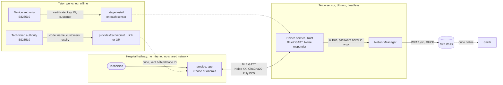
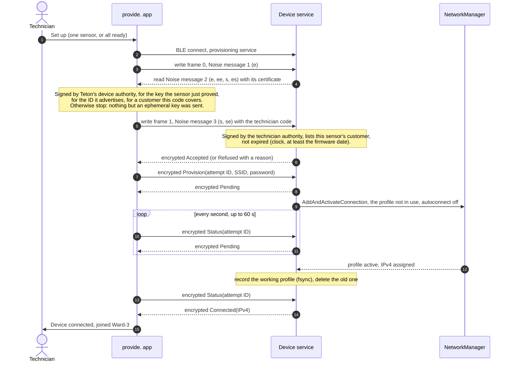
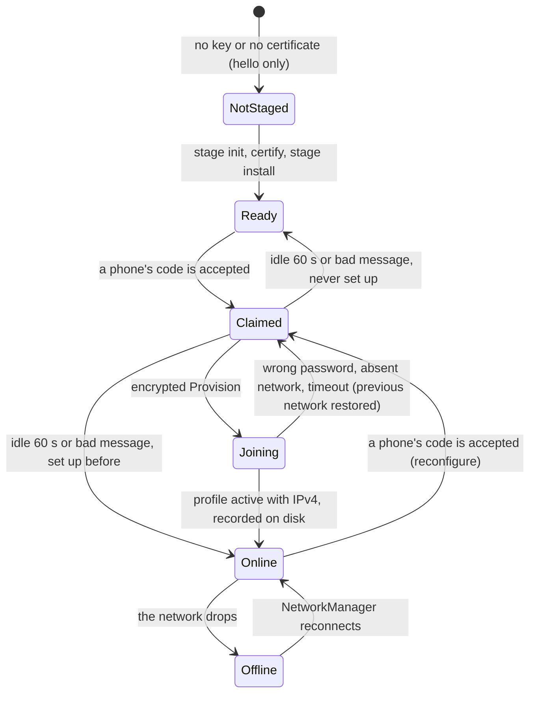
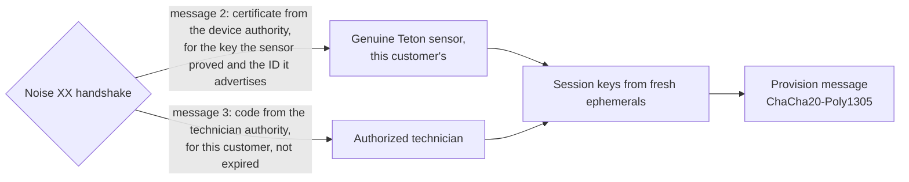

# Architecture

A technician's phone hands Wi-Fi credentials to headless Teton sensors over Bluetooth Low Energy, up to a whole
wing at a time. The two sides share no network and no Internet. Each sensor proves it is a genuine Teton sensor with
a certificate Teton signed for its key, the phone proves its technician holds a code Teton issued, and only then does
the password travel, encrypted. The sensor joins the network through NetworkManager and reports the address it
received for that exact attempt.

| Side | Code | Runs on |
| --- | --- | --- |
| Configurator (**provide.**) | `configurator/`: Expo SDK 57, React Native 0.86, TypeScript | iPhone (tested), Android (same code, not run) |
| Device service | `device/main.rs`, `device/wifi.rs`, `src/provision.rs`, `src/authority.rs`: Rust 1.88, BlueZ through `bluer`, Noise through `snow`, Ed25519 through `ed25519-dalek`, NetworkManager over D-Bus | Ubuntu 22.04, any adapter with BLE and Wi-Fi |
| Staging tool | `device/stage.rs` | The sensor, once, before deployment |
| Authority tool | `device/authority.rs` | Teton's workshop, offline: certifies sensors, issues technician codes |

Setup and run steps live in the [README](../README.md); the security design and its tests in
[SECURITY.md](SECURITY.md); every decision with its alternatives in [DECISIONS.md](DECISIONS.md); the live
requirement check in [tasks/compliance.md](../tasks/compliance.md).

## System at a glance



The device exposes one GATT service with two characteristics. **Hello** answers `world` to `hello` and never
carries credentials; it lets a technician check the radio link. **Provisioning** carries Noise messages, one per
acknowledged write, and exists once the sensor is staged. Each sensor advertises its ID, `TETON-` and 10 hex
digits of the hash of its key, and one state byte that the app shows on its card: not staged, ready, online, or
Wi-Fi not connected.

## The technician's flow

<table>
<tr>
<td align="center"><br><sub>1. The app scans as soon as it opens</sub></td>
<td align="center"><br><sub>2. 20 sensors; the code and the site Wi-Fi are missing</sub></td>
<td align="center"><br><sub>3. The technician code, opened from Teton's link</sub></td>
<td align="center"><br><sub>4. Site Wi-Fi, entered once per facility</sub></td>
</tr>
<tr>
<td align="center"><br><sub>5. Set up all ready: three at a time, counters</sub></td>
<td align="center"><br><sub>6. Failures first, each with its reason</sub></td>
<td align="center"><br><sub>7. Filter on failures, then Retry failed</sub></td>
<td></td>
</tr>
</table>

Video, 55 s: [architecture/demo-simulator.mp4](architecture/demo-simulator.mp4).

The technician opens the link Teton sent once (or scans its QR code); the app checks the code and keeps it behind
Face ID for its 30 days. The first time at a facility, the app asks for the site Wi-Fi (facility name, network,
password), typed or scanned from the network's standard Wi-Fi QR code, and keeps it behind Face ID too. Then one tap,
**Set up all ready (N)**, sets up every ready sensor in range, three at a time. Each card runs the four steps
(connecting, securing the channel, sending the network, joining the Wi-Fi); counters show done, failed and left;
failures rise to the top with their reason and a **Retry failed** button. A single sensor can still be set up, or
reconfigured once online, from its own card. Errors name the fix: "The Wi-Fi password was refused. Edit the site
password, then try again." The sensor needs no screen, keyboard or SSH.

**What these images prove.** They come from the iOS Simulator (`SIMULATION`): the radio is faked, the rest is the
app's own code. Each of the 20 fake sensors runs a Noise `XX` responder with its own key and a certificate signed by
a throwaway demo authority, so the app runs its real handshake, certificate checks, token and encryption against
each one. One sensor copies another's certificate and is refused as not genuine; one belongs to another customer and
is skipped before the code leaves the phone. The harness was temporary and is not in the repository. NetworkManager
plays no part in this video. The real-hardware runs are listed under [What is proven](#what-is-proven).

## How one sensor gets its Wi-Fi



Success means the profile created for this attempt is active and holds an IPv4 address. A fallback connection or
an older profile never counts. The device reads join failures from NetworkManager's `StateChanged` signal and maps
them to the technician's words: wrong password, network not in range, timeout.

The attempt ID makes retries safe. If the phone loses the link after sending, the next tap reconnects, runs a
fresh handshake and sends the same attempt again; the device answers with the stored result instead of joining twice.
The same ID with a different password is refused, so a corrected password starts a new attempt.



The device keeps two NetworkManager profiles with fixed UUIDs and uses them in turn. A new attempt takes the profile
not in use; if it fails, the device deletes it and reactivates the working one, so a mistyped password during a
reconfiguration never strands a sensor. Only a recorded success can autoconnect after a reboot: at startup the device
deletes any profile other than the recorded one.

## Why Bluetooth Low Energy

The constraints rule out most channels before taste enters. The configurator and the device may share no network at
the start, the technician carries an iPhone or an Android phone, and the device has no screen.


| Option | Verdict | Reason |
| --- | --- | --- |
| **BLE GATT** | **Chosen** | Both phone platforms expose it to apps; Ubuntu exposes a GATT peripheral through BlueZ; no IP network forms; the range of a few metres keeps the technician near the sensors. |
| SoftAP (the device hosts a setup Wi-Fi) | Excluded | Needs no app install, but the phone joins a network the device creates. The brief forbids a shared local network at the start; we chose not to bet the submission on a reading of "at the start". |
| Wi-Fi Easy Connect (DPP) | Excluded | Built for this exact job, but only Android offers it to a configurator; iPhone has no API. |
| Web Bluetooth page | Excluded | Safari on iPhone does not support it, and the page still has to reach the phone offline. |
| QR shown to the device's camera | Fallback | Teton sensors have cameras; one-way, so success needs feedback (LED, sound, or Smith). Reuses the device key and the NetworkManager code. |
| USB cable | Fallback | No radio at all; needs a reachable port on a mounted sensor. |

**What BLE costs us.**

- The technician needs a prepared app; nothing works from a bare browser. We build it once with Expo and install it
  before the visit.
- BLE pairing does not help. "Just Works" authenticates nobody, a static passkey leaks in about 19 reconnects, and
  out-of-band pairing is closed to iOS apps. We run our own authenticated channel above GATT
  ([SECURITY.md](SECURITY.md)).
- Small packets: each Noise message fits one GATT write (the largest, message 3 with a code for 8 customers, stays
  under the 512-byte limit), so the code has no chunking layer.
- Teton's production sensors may lack BLE. noe-lab, the "device" of this demo, has it; we asked Teton and ranked the
  fallbacks above ([decision 25](DECISIONS.md#25-channel-if-tetons-own-sensors-have-no-ble)).

## How credentials are protected in transit



- **Handshake.** `Noise_XX_25519_ChaChaPoly_SHA256`. Each side proves a static key. The sensor sends a certificate
  that Teton's device authority signed for that key, its ID and its customer; the app holds the authority's public
  key and checks all three before it sends anything. A rogue device cannot forge the certificate, and one that copies
  a real sensor's certificate cannot prove the key inside it. The prologue binds the protocol version.
- **Technician code.** The phone sends its code only to a sensor that passed those checks. The sensor checks the
  technician authority's signature, its own customer in the code, and the expiry against its clock (never earlier
  than its firmware build date), and refuses with a reason the app can show: other customer, expired, invalid.
- **Payload.** The SSID and password leave the phone only inside a transport message, after the code is accepted.
  AEAD gives confidentiality and integrity; fresh ephemeral keys give each session new keys, so a recorded session
  cannot be replayed.
- **One phone at a time.** The sensor grants its single slot when a code is accepted. Anyone can open a handshake, so
  a handshake alone grants nothing.
- **Reconfiguration.** A set-up sensor accepts a new network from any phone with a valid code, and falls back to its
  working network if the new one fails.
- **No plaintext path.** The hello characteristic accepts only `hello`, and no build flag sends credentials any
  other way. Logs hold outcomes and attempt IDs, never SSID, password, codes, keys or addresses.
- **Two implementations, one transcript.** The device uses `snow` and `ed25519-dalek`; the phone uses pure-JavaScript
  `@noble` primitives. The phone's tests replay the exact bytes the device produced; tests with a forged reply, a
  copied certificate, another authority and another ID check that neither the code nor the password reaches the air.
- **At rest.** The phone keeps the technician code and each site password in their own Keychain entries behind Face
  ID. The sensor keeps its key in a 0600 state directory, and NetworkManager keeps the PSK in a root-only file.

**Risks we accept for the demo.** The sensor's key sits in a file, not a secure element, and there is no revocation
list: a key extracted from one sensor impersonates that sensor. A leaked technician code works for its customers until
it expires. With WPA2-Personal every sensor holds the same site password. `snow` has had no formal audit.
([decision 27](DECISIONS.md#27-certified-sensors-and-technician-codes-for-200-devices))

## 200 devices in a hospital wing

The first milestone cost one tap and one label scan per sensor. A wing of 200 sensors run by a facilities team needed
the changes below; the first four are built.

| Change | Status | Why |
| --- | --- | --- |
| **Certified sensors** instead of labels | Built | Nothing to scan or print per sensor; a rogue device in range cannot pass as a sensor. |
| **Technician codes** from Teton, per customer, 30 days | Built | The app is reserved to technicians; a sensor of another customer is skipped. |
| **Set up all ready sensors in range**, three at a time | Built | One tap for the room or the corridor. The app shows a status per sensor, counters, failures first and **Retry failed**. A test runs 200 fake sensors through the queue. |
| **Stop the batch on a site-wide error** | Built | A wrong password or a refused code would repeat on every sensor: no new sensor starts, the ones in flight finish, the rest show "not tried" with the reason. A failure that belongs to one sensor (out of range, not genuine) does not stop the others. |
| **Room mapping in Smith** | Later | Smith links each sensor ID to its room once sensors check in; the app stays room-agnostic. |
| **Per-device Wi-Fi credentials** (EAP-TLS or per-device PSK) issued by Smith | Later | One stolen sensor no longer exposes the hospital's network, and the phone never holds a facility password. |
| **Staggered joins and result sync** | Later | 200 sensors asking for DHCP at once can exhaust a pool; the phone uploads results when it has a connection. |

BLE throughput is not the bottleneck: the exchange is under a kilobyte. The network join dominates (NetworkManager
allows 45 s), so three concurrent links on one phone, and several technicians, set the pace. Three is a starting point
to measure on real phones and access points; we have run one real sensor at a time.

## The path we took

| Step | What we did | What changed our mind |
| --- | --- | --- |
| 1 | Planned a Jetson as the device and Python as the stack. | No Jetson was available; Rust replaced Python to match Teton's fleet ([decision 11](DECISIONS.md#11-rust-to-align-with-the-fleet)). |
| 2 | Built a dependency-free simulation of a `hello`/`world` exchange, with recovery tests and benchmarks up to 1,000 jobs. | The contract and its failure modes got pinned down before any radio ([BENCHMARKS.md](BENCHMARKS.md)). |
| 3 | Wrote `audit-host`, a read-only preflight of BlueZ and NetworkManager, then inventoried the real host. | Bluetooth was soft-blocked by rfkill and BlueZ reported it as a generic "busy"; the device now names rfkill when it cannot power the adapter. |
| 4 | Compared channels. SoftAP looked best for a zero-install web page. | We excluded it to stay clear of "no shared local network" ([decision 18](DECISIONS.md#18-exclude-softap-from-the-mvp)) and required both iPhone and Android. |
| 5 | Reviewed security before sending any secret: Just Works, static passkey, LE Secure Connections OOB, SRP6a, Noise. | iOS apps cannot use out-of-band pairing, so the channel had to live above GATT: Noise NKpsk2 keyed by a QR label. |
| 6 | Built the BlueZ hello peripheral, then an Expo app; first real exchange from an iPhone 15 Pro to Ubuntu. | Six exchanges and a reconnect after a service restart worked ([demo/phone-hello.txt](../demo/phone-hello.txt)). |
| 7 | Iterated the app with a facilities technician in mind: automatic scan, results inside the card, small screens and large text ([configurator history](configurator/README.md)). | A result listed at the bottom went off-screen with ten sensors; it moved into the tested card. |
| 8 | Added staging, the Noise channel on both sides, attempt IDs and NetworkManager over D-Bus. | Site Wi-Fi once per visit, then saved sites behind Face ID because a technician serves several facilities ([decision 26](DECISIONS.md#26-saved-sites-behind-face-id)). |
| 9 | Ran two independent reviews. | Eight fixes: a double prompt, a double scan, a cached bad label, a replayed first message that locked the device, a non-durable "provisioned" marker, profiles that kept autoconnect, missed failure reasons. |
| 10 | Installed the systemd service and ran the real setup from the iPhone, with SSH on Ethernet and `btmon` recording. | The device joined, but the phone never got the result: BlueZ's battery plugin read the iPhone's battery level, iOS asked to pair, and BlueZ stopped answering. `bluetoothd` now runs without that plugin; the second run showed **Device connected** ([demo/real-join.txt](../demo/real-join.txt)). |
| 11 | Asked what blocks 200 sensors, then settled 24 requirement questions in one session. | Scanning 200 labels is the bottleneck, and a label secret in every patient room is a liability. Certificates and technician codes replaced labels; the batch, the reconfiguration with rollback and the advertised state followed ([decision 27](DECISIONS.md#27-certified-sensors-and-technician-codes-for-200-devices)). |

The [standalone mockup](architecture-demo.html) from step 4 shows the early design; the app has replaced it.

## What is proven

| Claim | Evidence | Class |
| --- | --- | --- |
| An iPhone finds the device by service UUID and exchanges `hello`/`world` over real BLE, again after a restart | [demo/phone-hello.txt](../demo/phone-hello.txt): iPhone 15 Pro, iOS 27.0; Ubuntu 22.04.5, BlueZ 5.64 | `ACTUAL_BLE` |
| Phone and device speak the same Noise `XX`, certificates and codes, byte for byte | `tests/noise_vectors.rs`, `configurator/src/noise.test.ts`, `configurator/src/authority.test.ts` | `COMMAND_FIXTURE` |
| A copied certificate, another authority, another ID or another customer never receives the code or the password; refused codes close the session | `configurator/src/setup.test.ts`, `src/provision.rs`, `src/authority.rs` tests | `COMMAND_FIXTURE` |
| Device protocol: replay, conflicting attempts, reconfiguration, profile rotation, one phone at a time, durable record | `cargo test --features ble,stage --all-targets` (80 tests) | `COMMAND_FIXTURE` |
| 200 sensors through the batch: three at a time, per-sensor failures continue, site-wide failures stop new starts, every sensor accounted for | `configurator/src/batch.test.ts` | `COMMAND_FIXTURE` |
| Technician flow on screen with 20 sensors, including an impostor and another customer's sensor | Screens and video above | `SIMULATION` |
| An iPhone sets up the device's Wi-Fi end to end: encrypted exchange, NetworkManager join, Device connected with the address | [demo/real-join.txt](../demo/real-join.txt) (first protocol, QR label) | `ACTUAL` |
| The credentials cross the air only inside an encrypted write; the SSID bytes appear nowhere in a `btmon` capture | [demo/real-join.txt](../demo/real-join.txt) (first protocol) | `ACTUAL` |
| The systemd service answers a phone whose network is off | [demo/service-offline-hello.txt](../demo/service-offline-hello.txt) | `ACTUAL_BLE` |
| Certificates and technician codes on hardware; wrong password, absent network and rollback on hardware; reboot; Android | Planned | `NOT_RUN` |

## Code map

```text
src/authority.rs      Device certificates and technician codes: encoding, Ed25519 signatures, checks, device ID
src/provision.rs      Noise XX session, identity files, request/response encoding, attempt registry
src/protocol.rs       Service and characteristic UUIDs, the hello contract
device/main.rs        BLE peripheral: hello and provisioning, one-phone claim, advertised state, reconfiguration
device/wifi.rs        NetworkManager over D-Bus: two alternating profiles, rollback, failure reasons, cleanup
device/stage.rs       Staging: key, then certificate and technician authority
device/authority.rs   Teton's authorities: init, public keys, certify a sensor, issue a technician code
device/audit.rs       Read-only host preflight
configurator/App.tsx  Scan, requirements, batch controls, sensor cards, set-up flow wiring
configurator/src/     noise.ts (Noise initiator), authority.ts (certificate and code checks), setup.ts (one sensor),
                      batch.ts (queue, three at a time), flow.ts (code → site → join), TechnicianSheet.tsx (code
                      behind Face ID), SiteSheet.tsx (sites behind Face ID), probe.ts (hello test, advertised state)
tests/                Noise vectors, simulation, scale and host-audit tests
```
