# Architecture

A technician's phone hands Wi-Fi credentials to headless Teton sensors over Bluetooth Low Energy, up to a whole
wing at a time. The two sides share no network and no Internet. Each sensor proves it is a genuine Teton sensor with
a certificate Teton signed for its key, the phone proves its technician holds a code Teton issued, and only then does
the password travel, encrypted. The sensor joins the network through NetworkManager and reports the address it
received for that exact attempt.

| Side | Code | Runs on |
| --- | --- | --- |
| Configurator (**provide.**) | `configurator/`: Expo SDK 57, React Native 0.86, TypeScript | iPhone (tested), Android (same code, not run) |
| Device service | `device/main.rs`, `device/wifi.rs`, `src/provision.rs`, `src/authority.rs`: Rust 1.88, BlueZ through `bluer`, Noise through `snow`, Ed25519 through `ed25519-dalek`, NetworkManager over D-Bus | Ubuntu 22.04, any adapter with BLE and Wi-Fi |
| Staging tool | `device/stage.rs` | The sensor, once, before deployment |
| Authority tool | `device/authority.rs` | Teton's workshop, offline: certifies sensors, issues technician codes |

Setup and run steps live in the [README](../README.md); the security design and its tests in
[SECURITY.md](SECURITY.md); every decision with its alternatives in [DECISIONS.md](DECISIONS.md); the live
requirement check in [tasks/compliance.md](../tasks/compliance.md).

## System at a glance

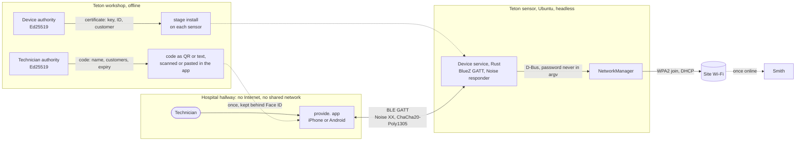

The device exposes one GATT service with two characteristics. **Hello** answers `world` to `hello` and never
carries credentials; it lets a technician check the radio link. **Provisioning** carries Noise messages, one per
acknowledged write, and exists once the sensor is staged. Each sensor advertises its ID, `TETON-` and 10 hex
digits of the hash of its key, and one state byte that the app shows on its card: not staged, ready, online, or
Wi-Fi not connected.

## The technician's flow

<table>
<tr>
<td align="center">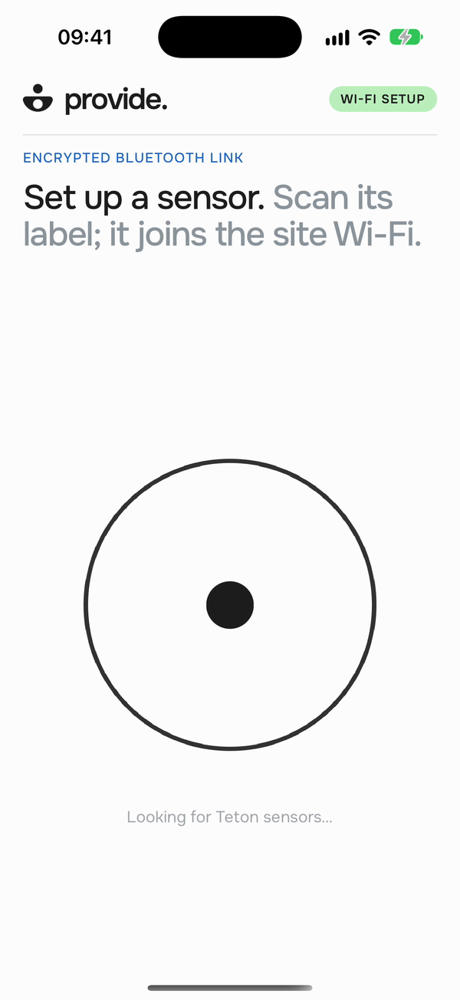<br><sub>1. The app scans as soon as it opens</sub></td>
<td align="center"><br><sub>2. 20 sensors; the code and the site Wi-Fi are missing</sub></td>
<td align="center">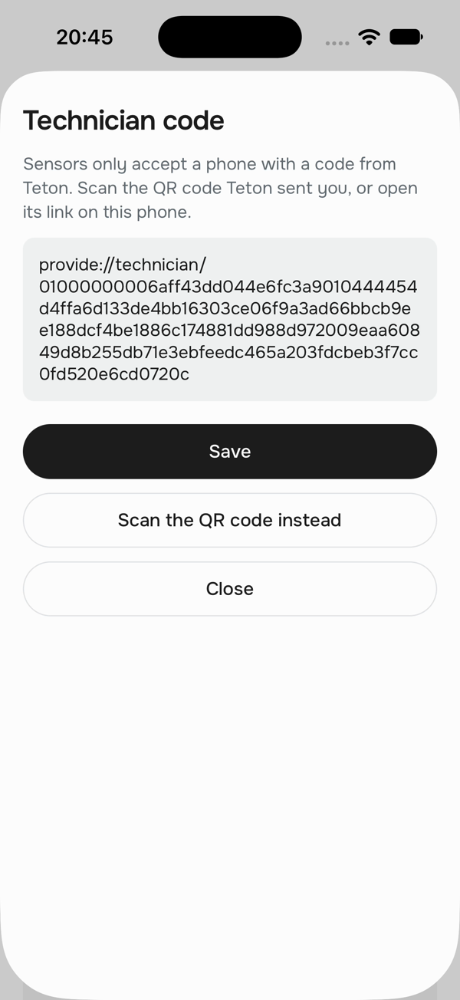<br><sub>3. The technician code (earlier build, which opened a link)</sub></td>
<td align="center"><br><sub>4. Site Wi-Fi, entered once per facility</sub></td>
</tr>
<tr>
<td align="center">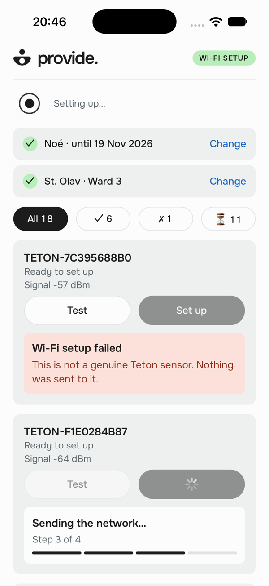<br><sub>5. Set up all ready: several at a time, counters</sub></td>
<td align="center">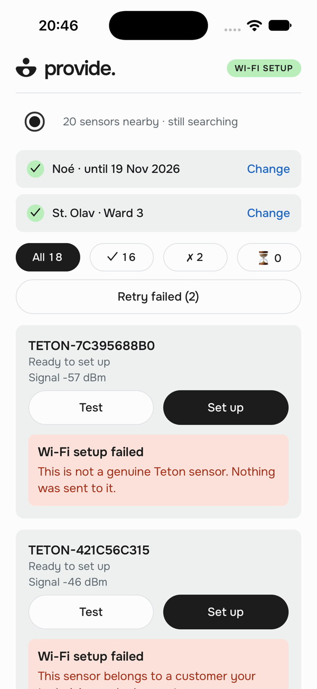<br><sub>6. Each failure with its reason</sub></td>
<td align="center">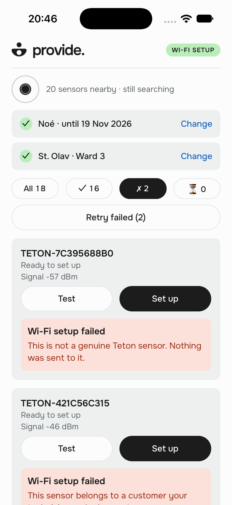<br><sub>7. Filter on failures, then Retry failed</sub></td>
<td></td>
</tr>
</table>

Video, 55 s: [architecture/demo-simulator.mp4](architecture/demo-simulator.mp4). Screens 5 to 7 and this video show
the earlier filter pills and the earlier sort, failures first; the overall card below replaced them.

The technician scans the code Teton sent once, with the app's own camera, or pastes it; the app checks the code and
keeps it behind Face ID until it expires (30 days at most). The app registers no `provide` scheme and reads no
incoming URL (only Expo's default bundle-ID and dev-client schemes remain), so no link can carry the code. The first
time at a facility, the app asks for the site Wi-Fi (facility name, network, password), typed or scanned from the
network's standard Wi-Fi QR code, and keeps it behind Face ID too. Then one tap,
**Set up all ready (N)**, sets up every ready sensor in range, six at a time. Each sensor runs the four steps
(connecting, securing the channel, sending the network, joining the Wi-Fi). Past four sensors, a card above the list
counts set up, errors and not set up; its **Errors** tab lists the failures, each with its reason, and **Retry
failed** sets them up again. A single sensor can still be set up, or reconfigured once online, from its own card.
Errors name the fix: "The Wi-Fi password was refused. Edit the site password, then try again." The sensor needs no
screen, keyboard or SSH.

At launch the title and the radar come first, then the technician code and site rows, which can be set before any
sensor is found, then the sensors heard meanwhile (after about 1.4 s). When the list gets crowded, the radar folds to
its compact row at once, so the overall card shows whole. A batch folds it once, never per sensor.

**What these images prove.** They come from the iOS Simulator (`SIMULATION`): the radio is faked, the rest is the
app's own code. Each of the 20 fake sensors runs a Noise `XX` responder with its own key and a certificate signed by
a throwaway demo authority, so the app runs its real handshake, certificate checks, token and encryption against
each one. One sensor copies another's certificate and is refused as not genuine; one belongs to another customer and
is skipped before the code leaves the phone. That harness was temporary; demo mode (`configurator/src/demo.ts`) now
does the same inside the app, with 200 sensors. NetworkManager plays no part in this video. The real-hardware runs
are listed under [What is proven](#what-is-proven).

**A wing at a glance.** With 200 sensors the list runs to 200 cards. Past four sensors in range, two things change.
Each sensor becomes a one-line row: its group's shape, one status line (the step in progress, "Waiting in the
batch", the first sentence of a failure, or its state) and its signal. A tap opens the row in place into the full
card, with **Test** and **Set up**; a second tap folds it. And one more card sits above the list, in the cards' style.
Its title reads "104 set up of 200 in range", in two tones like the screen title. One line under it says what is
running during a batch ("6 in progress · 83 waiting · about 1 min left", the time left once ten sensors of this batch
have finished), and otherwise what is left to do (how many are ready to set up, how many are not prepared, and how
many advertise no state, from older firmware: "· N state unknown"). One bar shows the set-up sensors in ink, the
errors in red and the rest blank. Three tabs, **Set up**, **Errors** and **Not set up**, give the counts and filter the
list below: a second tap shows all again, and a tab at 0 is disabled unless it is selected. A selected tab stays on.
It keeps every sensor it has shown, updated in place, and adds at the end the sensors that join its group, so nothing
vanishes under the thumb.

The list keeps the scan order. Only the **Errors** tab, when tapped, groups the failures by cause, so the same fix
reads once down the list. The list's header names what it shows ("SENSORS · 200", "NOT SET UP · 93", "SET UP · 104",
"ERRORS · 3") beside a refresh icon, hidden while anything runs: it drops the sensors not heard for 15 s
(`STALE_MS`), never one in the batch, and while the search is paused it only resumes it. **Not set up** puts the
sensors being set up in an **IN PROGRESS** block on top, one fixed slot per running sensor: a sensor keeps its slot
while it is in the block, and a freed slot stays empty until the next sensor takes it, so the rows below do not move.
The list under the block is what is left to do; a finished sensor moves to Set up or Errors. A row opened while in
progress stays in the block with its result until it is closed.

During a batch, sensors found meanwhile join it with **Add N to the batch**. **Test** stays available on the sensors
the batch is not working on; **Set up** by hand waits for the end of the batch.

Each sensor sits in one group: this session's result first, from a batch or a setup by hand; otherwise a sensor
online counts as set up, one set up but not on its Wi-Fi as an error, and the rest as not set up. A sensor that
joined this session but now advertises offline counts as an error. What a sensor advertises never turns a failure
into set up: an impostor can advertise online. **Retry failed** also appears after a setup by hand fails, with no
batch needed. A sensor that failed by hand leaves **Set up all ready** and counts under Errors, so a sensor that is
not genuine is no longer retried by that button (**Retry failed** leaves it out too). Words and shapes mark the
groups (a filled ink square, a filled red square, a hollow one), not symbols or color alone.

<table>
<tr>
<td align="center">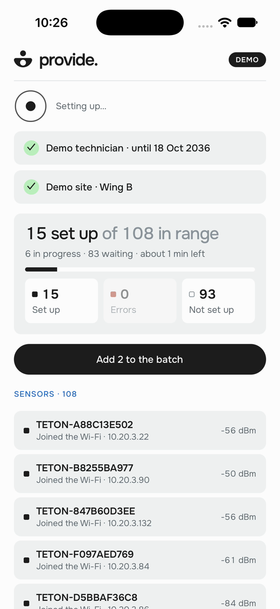<br><sub>8. During a batch: compact rows, 6 in progress, Add 2 to the batch</sub></td>
<td align="center">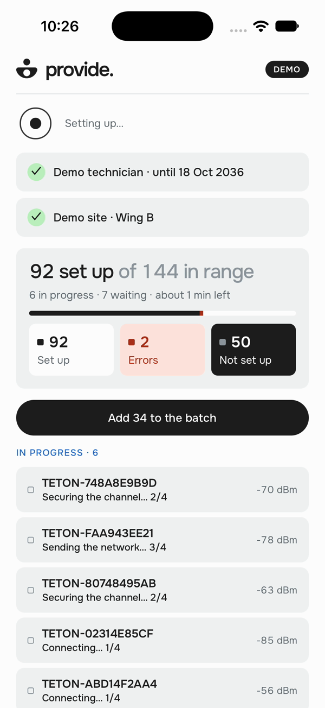<br><sub>9. Not set up tab: IN PROGRESS · 6 on top, what is left below</sub></td>
<td align="center">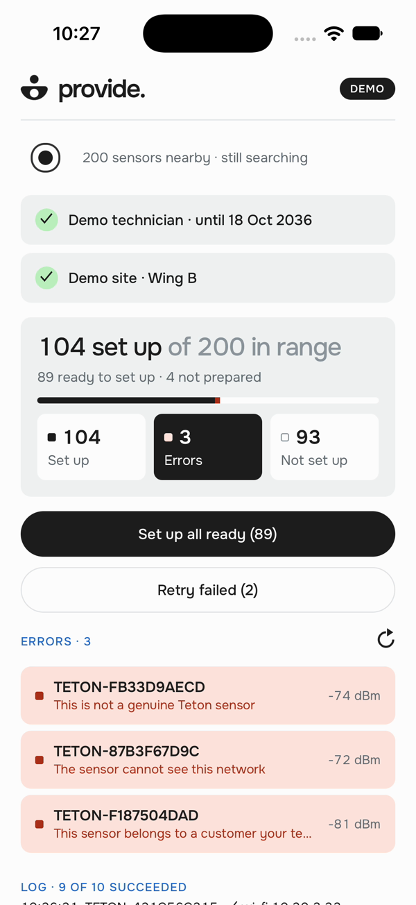<br><sub>10. After a batch: Errors tab, 3 errors grouped by cause, refresh icon, Retry failed (2)</sub></td>
<td align="center">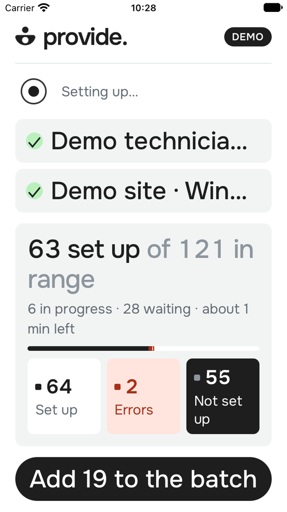<br><sub>11. iPhone SE, accessibility-large text, during a batch: the title, the line and "Not set up" wrap</sub></td>
</tr>
</table>

Video, 42 s at 2x speed: [architecture/overall-200-sensors.mp4](architecture/overall-200-sensors.mp4) (`SIMULATION`):
discovery, a batch with sensors added as they are found, the Not set up tab, then the Errors tab. Screens and video
come from the iOS Simulator in demo mode (`configurator/src/demo.ts`), on an iPhone 16 Pro, and an iPhone SE for
screen 11. The demo's 200 sensors are heard gradually, about half within 4 s and the rest over a minute; each runs a
real Noise `XX` responder. Among them, 6 were set up before, 4 are not prepared, 3 cannot see the network, 3 are not
genuine and 2 belong to another customer. **Retry failed** leaves out the sensors that are not genuine: screen 10
shows 3 errors and **Retry failed (2)**.

## How one sensor gets its Wi-Fi

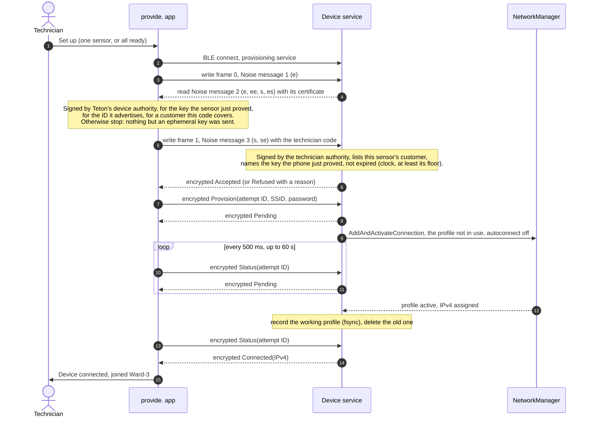

Success means the profile created for this attempt is active and holds an IPv4 address. A fallback connection or
an older profile never counts. The device reads join failures from NetworkManager's `StateChanged` signal and maps
them to the technician's words: wrong password, network not in range, timeout.

The attempt ID makes retries safe. If the phone loses the link after sending, the next tap reconnects, runs a
fresh handshake and sends the same attempt again; the device answers with the stored result instead of joining twice.
The same ID with a different password is refused, so a corrected password starts a new attempt. In a batch, a link
failure (timeout, rejected, busy, result lost) sends the sensor back to the end of the queue, up to two more times,
with the same attempt ID when the request may have reached it; a Wi-Fi failure or a refusal is final, and nothing is
retried after a stop.

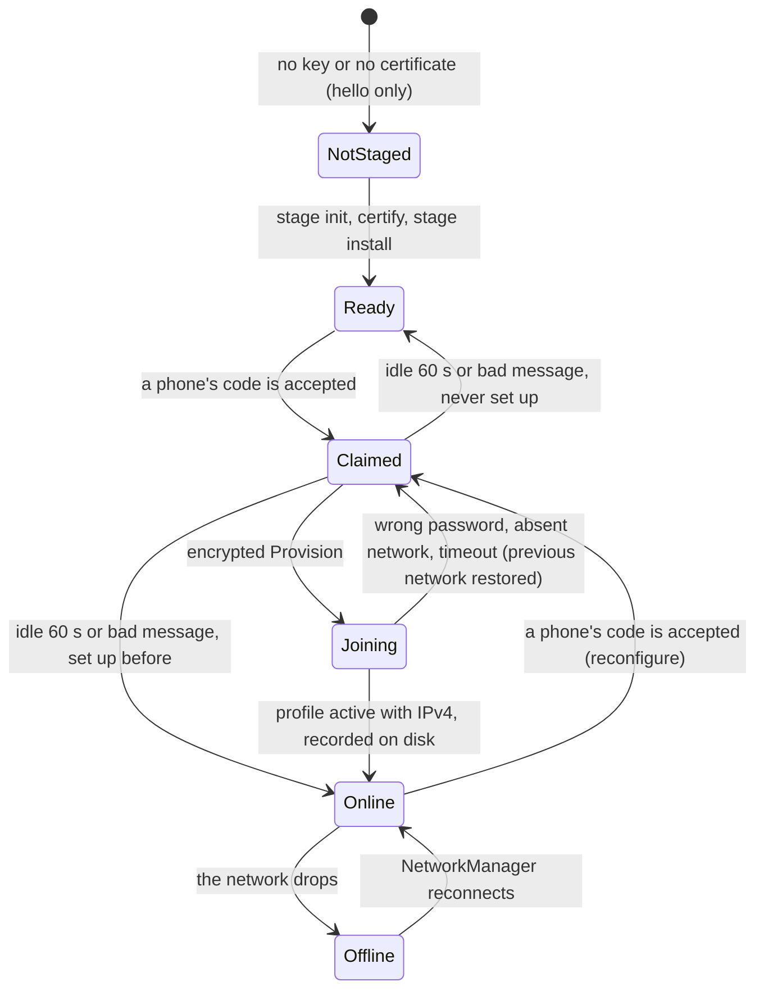

The device keeps two NetworkManager profiles with fixed UUIDs and uses them in turn. A new attempt takes the profile
not in use; if it fails, the device deletes it and reactivates the working one, so a mistyped password during a
reconfiguration never strands a sensor. Only a recorded success can autoconnect after a reboot: at startup the device
deletes any profile other than the recorded one.

## Why Bluetooth Low Energy

The constraints rule out most channels before taste enters. The configurator and the device may share no network at
the start, the technician carries an iPhone or an Android phone, and the device has no screen.


| Option | Verdict | Reason |
| --- | --- | --- |
| **BLE GATT** | **Chosen** | Both phone platforms expose it to apps; Ubuntu exposes a GATT peripheral through BlueZ; no IP network forms; the range of a few metres keeps the technician near the sensors. |
| SoftAP (the device hosts a setup Wi-Fi) | Excluded | Needs no app install, but the phone joins a network the device creates. The brief forbids a shared local network at the start; we chose not to bet the submission on a reading of "at the start". |
| Wi-Fi Easy Connect (DPP) | Excluded | Built for this exact job, but only Android offers it to a configurator; iPhone has no API. |
| Web Bluetooth page | Excluded | Safari on iPhone does not support it, and the page still has to reach the phone offline. |
| QR shown to the device's camera | Fallback | Teton sensors have cameras; one-way, so success needs feedback (LED, sound, or Smith). Reuses the device key and the NetworkManager code. |
| USB cable | Fallback | No radio at all; needs a reachable port on a mounted sensor. |

**What BLE costs us.**

- The technician needs a prepared app; nothing works from a bare browser. We build it once with Expo and install it
  before the visit.
- BLE pairing does not help. "Just Works" authenticates nobody, a static passkey leaks in about 19 reconnects, and
  out-of-band pairing is closed to iOS apps. We run our own authenticated channel above GATT
  ([SECURITY.md](SECURITY.md)).
- Small packets: each Noise message fits one GATT write (the largest, message 3 with a code for 8 customers, stays
  under the 512-byte limit), so the code has no chunking layer.
- Teton's production sensors may lack BLE. noe-lab, the "device" of this demo, has it; we asked Teton and ranked the
  fallbacks above ([decision 25](DECISIONS.md#25-channel-if-tetons-own-sensors-have-no-ble)).

## How credentials are protected in transit

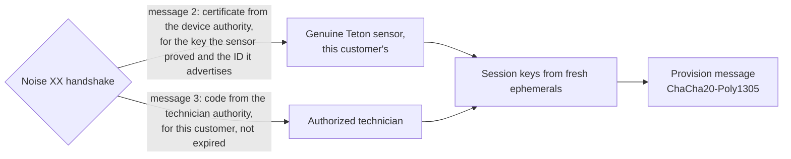

- **Handshake.** `Noise_XX_25519_ChaChaPoly_SHA256`. Each side proves a static key. The sensor sends a certificate
  that Teton's device authority signed for that key, its ID and its customer; the app holds the authority's public
  key and checks all three before it sends anything. A rogue device cannot forge the certificate, and one that copies
  a real sensor's certificate cannot prove the key inside it. The prologue binds the protocol version.
- **Technician code.** The phone sends its code only to a sensor that passed those checks. The sensor checks the
  technician authority's signature, its own customer in the code, that the phone proved the code's holder key, and
  the expiry against its clock (never earlier than its firmware build date or the last time it recorded, a floor
  that rises no faster than the sensor's uptime), and refuses with a reason the app can show: other customer,
  expired, invalid.
- **Payload.** The SSID and password leave the phone only inside a transport message, after the code is accepted.
  AEAD gives confidentiality and integrity; fresh ephemeral keys give each session new keys, so a recorded session
  cannot be replayed.
- **One phone at a time.** The sensor grants its single slot when a code is accepted. Anyone can open a handshake, so
  a handshake alone grants nothing.
- **Reconfiguration.** A set-up sensor accepts a new network from any phone with a valid code, and falls back to its
  working network if the new one fails.
- **No plaintext path.** The hello characteristic accepts only `hello`, and no build flag sends credentials any
  other way. Logs hold outcomes, attempt IDs, the name on an accepted code, refusal reasons and the BLE MTU, never
  SSID, password, codes, keys or addresses.
- **Two implementations, one transcript.** The device uses `snow` and `ed25519-dalek`; the phone uses pure-JavaScript
  `@noble` primitives. The phone's tests replay the exact bytes the device produced; tests with a forged reply, a
  copied certificate, another authority and another ID check that neither the code nor the password reaches the air.
- **At rest.** The phone keeps the technician code and each site password in their own Keychain entries behind Face
  ID. Once unlocked, both stay in memory; when the app comes back after more than 2 minutes away (`LOCK_AFTER_MS`),
  they are locked again. The sensor keeps its key in a 0600 state directory, and NetworkManager keeps the PSK in a root-only file.

**Risks we accept for the demo.** The sensor's key sits in a file, not a secure element, and there is no revocation
list: a key extracted from one sensor impersonates that sensor. A leaked technician code works for its customers on
any phone until it expires; a token a sensor records is useless without the code's holder key. With WPA2-Personal
every sensor holds the same site password. `snow` has had no formal audit. Demo mode trusts a second authority with
public seeds, only for its simulated sensors on its fake radio; the bench's identities are certified by the real
device authority, so a phone whose code covers `LAB` sends them the site password ([SECURITY.md](SECURITY.md)).
([decision 27](DECISIONS.md#27-certified-sensors-and-technician-codes-for-200-devices))

## 200 devices in a hospital wing

The first milestone cost one tap and one label scan per sensor. A wing of 200 sensors run by a facilities team needed
the changes below; the first five are built.

| Change | Status | Why |
| --- | --- | --- |
| **Certified sensors** instead of labels | Built | Nothing to scan or print per sensor; a rogue device in range cannot pass as a sensor. |
| **Technician codes** from Teton, per customer, 30 days | Built | The app is reserved to technicians; a sensor of another customer is skipped. |
| **Set up all ready sensors in range**, six at a time | Built | One tap for the room or the corridor. The app shows a status per sensor, the overall card and **Retry failed**. Link failures go back to the queue twice; sensors found during a batch can join it. A test runs 200 fake sensors through the queue. |
| **Stop the batch on a site-wide error** | Built | A wrong password or a refused code would repeat on every sensor: no new sensor starts, the ones in flight finish, the rest show "not tried" with the reason at once. A failure that belongs to one sensor (out of range, not genuine) does not stop the others. |
| **Overall of the sensors in range** | Built | 200 cards are too many to read one by one. One card above the list counts set up, errors and not set up, with the time left during a batch; its three tabs filter the list, and the Errors tab groups by cause. Past four sensors each sensor is a one-line row that opens into its card ([decision 28](DECISIONS.md#28-overall-of-the-sensors-in-range)). |
| **Room mapping in Smith** | Later | Smith links each sensor ID to its room once sensors check in; the app stays room-agnostic. |
| **Per-device Wi-Fi credentials** (EAP-TLS or per-device PSK) issued by Smith | Later | One stolen sensor no longer exposes the hospital's network, and the phone never holds a facility password. |
| **Staggered joins and result sync** | Later | 200 sensors asking for DHCP at once can exhaust a pool; the phone uploads results when it has a connection. |

BLE throughput is not the bottleneck: the exchange is under a kilobyte. The network join dominates (about 5.5 s
measured on noe-lab, NetworkManager allows 45 s), so the number of concurrent links on one phone, and several
technicians, set the pace. Each sensor holds a link about 7.5 s (1.3 s to connect, 0.5 s of handshake and request,
5.5 s of join); at three links a wing of 200 takes about 8 minutes, at six about 4. Six is set from that arithmetic and
iOS's limits, not yet measured: the links share one radio. The noe-lab test bench (`lab/teton_sim.py`, 200 simulated
sensors over real Bluetooth) is where it gets measured; we have run one real sensor at a time. On the bench, one run
with 14 advertising sets and a 3 s cycle had 84 provisioning sessions and 79 joins, against 20 sessions in the run
before the link retries and the faster cycle (`ACTUAL_BLE`, simulated sensors). The bench's sensors are on air only
part of the time, so connecting takes longer there than with real sensors. The scan also keeps running during
setups, so sensors found meanwhile can join the batch; iOS was thought to connect more reliably without a concurrent
scan, which is still to measure ([decision 29](DECISIONS.md#29-batch-at-the-pace-of-a-wing)).

Two more steps would shorten a wing further, within the current model:

| Step | Gain | Cost |
| --- | --- | --- |
| **Release the link during the join**: disconnect once the sensor answers "pending", come back for the result | About 2.3x: a link is held about 3.3 s instead of 7.5 s | The sensor keeps the session 60 s per phone; check that the real device keeps it across a disconnect |
| **Shorter connection interval, one message less** (code and Wi-Fi request together) | A few tenths of a second per sensor | A protocol change on both sides |

### Beyond one phone: other provisioning models (not built)

The phone is the bottleneck because every sensor must prove itself to it and receive the Wi-Fi from it, one encrypted
session each. Removing the phone from that path changes the model; these are options for Teton, not decisions.

| Model | How it works | Gain | What it needs or risks |
| --- | --- | --- | --- |
| **802.1X with the device certificate** (EAP-TLS) | Each sensor already has a key certified by Teton. The hospital's RADIUS trusts a Teton-issued client certificate per sensor, and the sensor joins the secure SSID by itself at power-on. | Zero touch: no phone, no shared password on the phone or the sensor | The hospital IT runs 802.1X and accepts a Teton CA; certificates per customer and revocation; the sensor still needs the SSID name (factory or staging) |
| **Per-device credentials from Smith** (per-device PSK or EAP-TLS) | Smith issues each sensor its own credential; the phone or the network delivers it. | One stolen sensor exposes only itself; the facility password never reaches the phone | Smith integration and an access point that supports per-device PSK (iPSK, DPSK) or 802.1X |
| **Wi-Fi Easy Connect (DPP)** | Standard onboarding: the sensor's bootstrap key (QR or the certificate) is given to the access point's configurator, which provisions it over Wi-Fi. | Standard, no custom BLE protocol, works at scale from the network side | Access points and NetworkManager with DPP support; enterprise rollout uneven |
| **Relay through set-up sensors** | A sensor that has joined passes the Wi-Fi on to its neighbours over BLE, each hop with the same certificate checks. | The wing provisions itself in waves after a few sensors from the phone | Each sensor becomes a credential holder and a relay: a larger attack surface, rate limits and loop control on the device |
| **Staging before delivery** | Sensors are provisioned in a staging room or at the warehouse with the site's credentials, then installed. | Nothing to do in the wing | Credentials known before installation; re-provisioning when they rotate |

The 802.1X option reuses what is built (device keys certified by Teton) and removes the shared Wi-Fi password, which
is the shared password risk in [SECURITY.md](SECURITY.md); it is the first to evaluate with a customer's IT.

## The path we took

| Step | What we did | What changed our mind |
| --- | --- | --- |
| 1 | Planned a Jetson as the device and Python as the stack. | No Jetson was available; Rust replaced Python to match Teton's fleet ([decision 11](DECISIONS.md#11-rust-to-align-with-the-fleet)). |
| 2 | Built a dependency-free simulation of a `hello`/`world` exchange, with recovery tests and benchmarks up to 1,000 jobs. | The contract and its failure modes got pinned down before any radio ([BENCHMARKS.md](BENCHMARKS.md)). |
| 3 | Wrote `audit-host`, a read-only preflight of BlueZ and NetworkManager, then inventoried the real host. | Bluetooth was soft-blocked by rfkill and BlueZ reported it as a generic "busy"; the device now names rfkill when it cannot power the adapter. |
| 4 | Compared channels. SoftAP looked best for a zero-install web page. | We excluded it to stay clear of "no shared local network" ([decision 18](DECISIONS.md#18-exclude-softap-from-the-mvp)) and required both iPhone and Android. |
| 5 | Reviewed security before sending any secret: Just Works, static passkey, LE Secure Connections OOB, SRP6a, Noise. | iOS apps cannot use out-of-band pairing, so the channel had to live above GATT: Noise NKpsk2 keyed by a QR label. |
| 6 | Built the BlueZ hello peripheral, then an Expo app; first real exchange from an iPhone 15 Pro to Ubuntu. | Six exchanges and a reconnect after a service restart worked ([demo/phone-hello.txt](../demo/phone-hello.txt)). |
| 7 | Iterated the app with a facilities technician in mind: automatic scan, results inside the card, small screens and large text ([configurator history](configurator/README.md)). | A result listed at the bottom went off-screen with ten sensors; it moved into the tested card. |
| 8 | Added staging, the Noise channel on both sides, attempt IDs and NetworkManager over D-Bus. | Site Wi-Fi once per visit, then saved sites behind Face ID because a technician serves several facilities ([decision 26](DECISIONS.md#26-saved-sites-behind-face-id)). |
| 9 | Ran two independent reviews. | Eight fixes: a double prompt, a double scan, a cached bad label, a replayed first message that locked the device, a non-durable "provisioned" marker, profiles that kept autoconnect, missed failure reasons. |
| 10 | Installed the systemd service and ran the real setup from the iPhone, with SSH on Ethernet and `btmon` recording. | The device joined, but the phone never got the result: BlueZ's battery plugin read the iPhone's battery level, iOS asked to pair, and BlueZ stopped answering. `bluetoothd` now runs without that plugin; the second run showed **Device connected** ([demo/real-join.txt](../demo/real-join.txt)). |
| 11 | Asked what blocks 200 sensors, then settled 24 requirement questions in one session. | Scanning 200 labels is the bottleneck, and a label secret in every patient room is a liability. Certificates and technician codes replaced labels; the batch, the reconfiguration with rollback and the advertised state followed ([decision 27](DECISIONS.md#27-certified-sensors-and-technician-codes-for-200-devices)). |

The [standalone mockup](architecture-demo.html) from step 4 shows the early design; the app has replaced it.

## What is proven

| Claim | Evidence | Class |
| --- | --- | --- |
| An iPhone finds the device by service UUID and exchanges `hello`/`world` over real BLE, again after a restart | [demo/phone-hello.txt](../demo/phone-hello.txt): iPhone 15 Pro, iOS 27.0; Ubuntu 22.04.5, BlueZ 5.64 | `ACTUAL_BLE` |
| Phone and device speak the same Noise `XX`, certificates and codes, byte for byte | `tests/noise_vectors.rs`, `configurator/src/noise.test.ts`, `configurator/src/authority.test.ts` | `COMMAND_FIXTURE` |
| A copied certificate, another authority, another ID or another customer never receives the code or the password; refused codes close the session | `configurator/src/setup.test.ts`, `src/provision.rs`, `src/authority.rs` tests | `COMMAND_FIXTURE` |
| Device protocol: replay, conflicting attempts, reconfiguration, profile rotation, one phone at a time, durable record | `cargo test --features ble,stage --all-targets` (88 tests) | `COMMAND_FIXTURE` |
| 200 sensors through the batch: six at a time, link failures retried twice, sensors added during the run, per-sensor failures continue, site-wide failures stop new starts and mark the queue at once, every sensor accounted for | `configurator/src/batch.test.ts` | `COMMAND_FIXTURE` |
| Technician flow on screen with 20 sensors, including an impostor and another customer's sensor | Screens and video above | `SIMULATION` |
| Overall with 200 sensors: each sensor in one group, this session's result first (a batch or a setup by hand), a sensor that joined then advertises offline is an error; time left only after ten have finished; counts, tabs, compact rows, the IN PROGRESS block and Retry failed on screen | `configurator/src/wing.test.ts`; screens 8 to 11 and the 200-sensor video above (demo mode) | `COMMAND_FIXTURE`, `SIMULATION` |
| Demo mode: each simulated sensor gives its expected outcome through the app's real `setup()`; a demo sensor is refused as not genuine under the real device authority | `configurator/src/demo.test.ts` | `COMMAND_FIXTURE` |
| The app over real BLE against 200 simulated sensors (bench): one run had 84 provisioning sessions and 79 joins | `lab/teton_sim.py`; run log on noe-lab, not in the repository | `ACTUAL_BLE` |
| An iPhone sets up the device's Wi-Fi end to end: encrypted exchange, NetworkManager join, Device connected with the address | [demo/real-join.txt](../demo/real-join.txt) (first protocol, QR label) | `ACTUAL` |
| The credentials cross the air only inside an encrypted write; the SSID bytes appear nowhere in a `btmon` capture | [demo/real-join.txt](../demo/real-join.txt) (first protocol) | `ACTUAL` |
| The systemd service answers a phone whose network is off | [demo/service-offline-hello.txt](../demo/service-offline-hello.txt) | `ACTUAL_BLE` |
| Certificates and technician codes on real sensors; wrong password, absent network and rollback on hardware; the overall, six links and scanning during runs with many real sensors; reboot; Android | Planned | `NOT_RUN` |

## Code map

```text
src/authority.rs      Device certificates and technician codes: encoding, Ed25519 signatures, checks, device ID
src/provision.rs      Noise XX session, identity files, request/response encoding, attempt registry
src/protocol.rs       Service and characteristic UUIDs, the hello contract
device/main.rs        BLE peripheral: hello and provisioning, one-phone claim, advertised state, reconfiguration
device/wifi.rs        NetworkManager over D-Bus: two alternating profiles, rollback, failure reasons, cleanup
device/stage.rs       Staging: key, then certificate and technician authority
device/authority.rs   Teton's authorities: init, public keys, certify a sensor, issue a technician code
device/audit.rs       Read-only host preflight
configurator/App.tsx  Scan, requirements, overall and batch controls, sensor cards and compact rows, set-up flow
                      wiring, demo mode switch
configurator/src/     noise.ts (Noise initiator), authority.ts (certificate and code checks), setup.ts (one sensor),
                      batch.ts (queue, six at a time), flow.ts (code → site → join), TechnicianSheet.tsx (code
                      behind Face ID), SiteSheet.tsx (sites behind Face ID), probe.ts (hello test, advertised state),
                      wing.ts (each sensor's group, time left), Summary.tsx (overall card and its three tabs),
                      demo.ts (200 simulated sensors on a fake radio, demo authority)
tests/                Noise vectors, simulation, scale and host-audit tests
lab/                  noe-lab test bench, outside the app: teton_sim.py (200 simulated sensors over real BLE),
                      mint-lab.sh (their identities), sim-lab.sh (lends hci0 to the bench, then gives it back)
```
