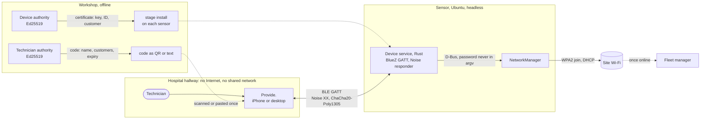
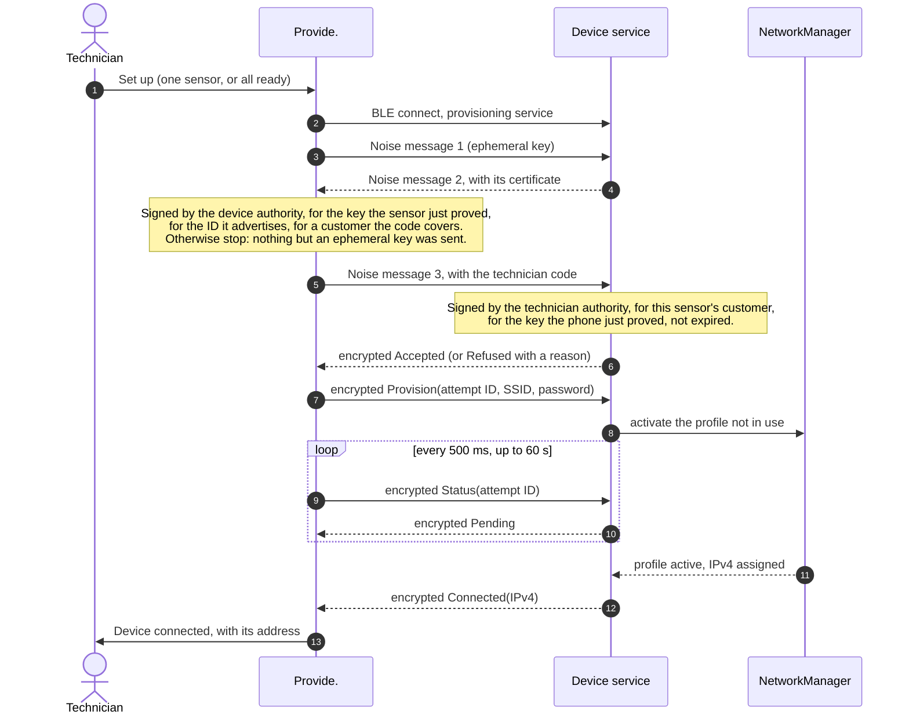
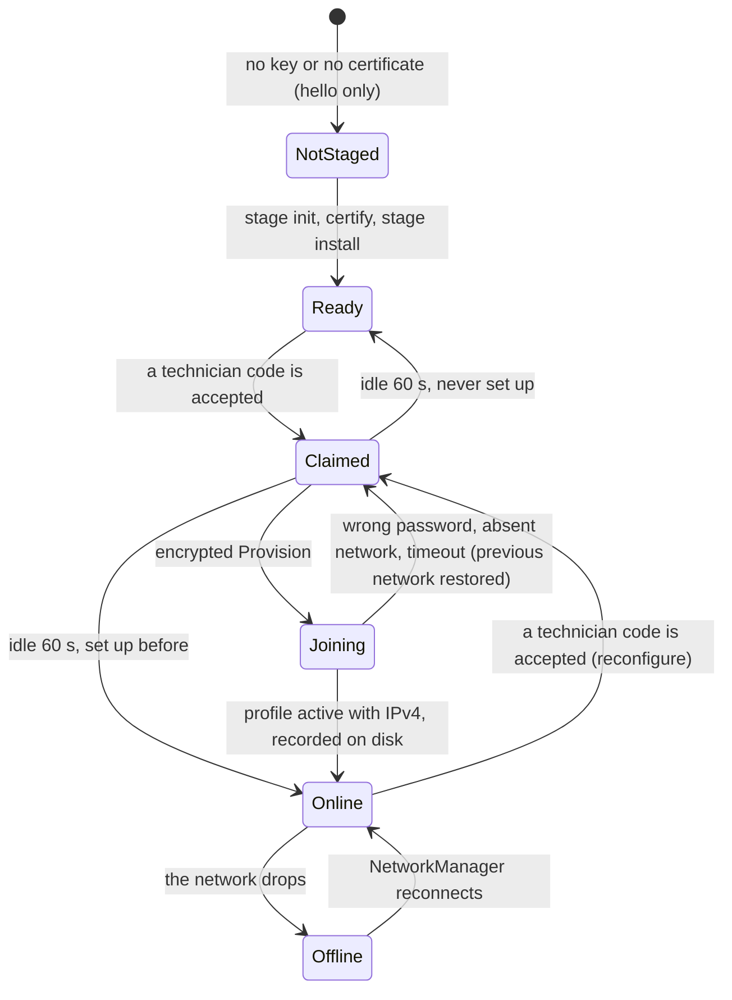

# Architecture

A technician's phone or laptop hands Wi-Fi credentials to headless sensors over Bluetooth Low Energy, up to a
whole wing at a time. The two sides share no network and no Internet. Each sensor proves it is a genuine sensor
with a certificate the device authority signed for its key; the configurator proves its technician holds a code the technician authority issued; only
then does the password travel, encrypted. The sensor joins the network through NetworkManager and reports the address
it received for that exact attempt.

| Part | Code | Runs on |
| --- | --- | --- |
| Configurator, **Provide.** | `configurator/`: Expo / React Native, TypeScript; desktop shell in Tauri with a Rust Bluetooth bridge | iPhone and macOS (tested on hardware); Android and Windows/Linux desktop not run |
| Device service | `device/bin/main.rs`, `device/bin/wifi.rs`: Rust, BlueZ (`bluer`), NetworkManager over D-Bus | Ubuntu 22.04 with a BLE adapter and Wi-Fi |
| Protocol library | `device/src/`: Noise (`snow`), certificates and codes (`ed25519-dalek`) | Shared by the device and its tools |
| Staging and workshop tools | `device/bin/stage.rs`, `workshop/` (`iot-workshop`) | The sensor once before deployment; the workshop, offline |

How to run it: [SETUP.md](SETUP.md). Security design and its tests: [SECURITY.md](SECURITY.md). Every decision with
its alternatives: [DECISIONS.md](DECISIONS.md). What is proven: the [requirements map](../README.md#requirements-map).

## Design choices

### Why Bluetooth Low Energy

The constraints rule out most channels before taste enters: no shared network at the start, a phone or laptop on the
technician's side, no screen on the device.

| Option | Verdict | Reason |
| --- | --- | --- |
| **BLE GATT** | **Chosen** | Phones and laptops expose it to apps; Ubuntu exposes a GATT peripheral through BlueZ; no IP network forms; a range of a few metres keeps the technician near the sensors. |
| SoftAP (the device hosts a setup Wi-Fi) | Excluded | The phone would join a network the device creates: a shared local network, which the brief forbids at the start ([decision 18](DECISIONS.md#18-exclude-softap-from-the-mvp)). |
| Wi-Fi Easy Connect (DPP) | Excluded | Built for this job, but iPhone gives apps no configurator API. |
| Web Bluetooth page | Excluded | Not in Safari on iPhone, and the page must still reach the phone offline. |
| QR shown to the device's camera, USB cable | Fallbacks | One-way (QR) or a reachable port (USB); kept in case production sensors lack BLE ([decision 25](DECISIONS.md#25-channel-if-production-sensors-have-no-ble)). |

What BLE costs: the technician needs a prepared app (built once, installed before the visit); BLE pairing
authenticates nobody useful ("Just Works" authenticates no one, a static passkey leaks, out-of-band pairing is closed
to iOS apps), so I run my own authenticated channel above GATT; packets are small, so each Noise message is sized
to fit one GATT write.

### Other choices

| Choice | Instead of | Why |
| --- | --- | --- |
| **Noise XX above GATT**, both sides proving a static key | BLE pairing, a per-sensor password | Works the same on every phone and laptop; authentication I control and can test byte for byte. |
| **Device certificates and technician codes** signed by two offline authorities | A QR label scanned per sensor | Nothing to scan or print per sensor, so a wing of 200 becomes one tap; a rogue device cannot pass as a sensor; a code covers only its customers and expires within 30 days ([decision 27](DECISIONS.md#27-certified-sensors-and-technician-codes-for-200-devices)). |
| **The sensor ID in the main advertisement packet** (5 bytes of the key hash) | The device name in the scan response | Phones and Macs do not always request the scan response and cache old names; the main packet always arrives. |
| **One app for iPhone and desktop**: React Native, with react-native-web in a Tauri window | Two apps | Same screens and protocol code; only the Bluetooth, storage and camera adapters differ. |
| **Rust on the device**, NetworkManager over D-Bus | Python, `nmcli` | Matches the target fleet ([decision 11](DECISIONS.md#11-rust-to-align-with-the-fleet)); the password never appears in a command line. |
| **Attempt IDs and two alternating NetworkManager profiles** | Fire and forget | A lost link can be retried without joining twice; a wrong password never strands a sensor that was online. |

## Data flow



**Discovery.** Each sensor advertises the provisioning service, its state (not staged, ready, online, Wi-Fi lost) and
its ID, `IOT-` and 10 hex digits of the hash of its key, in one manufacturer-data record: `[state][5 ID bytes]`
under test company `0xFFFF`. Flags, service UUID and this record fill the 31-byte legacy packet exactly. The service
has two characteristics: **Hello** answers `world` to `hello` (a radio check, never credentials) and **Provisioning**
carries Noise messages, one per acknowledged write.

**One sensor's setup:**



Success means the profile created for this attempt is active and holds an IPv4 address; a fallback connection never
counts. Join failures come from NetworkManager's state changes and reach the technician in plain words (wrong
password, network not in range, timeout). If the link drops after sending, the next tap runs a fresh handshake and
asks again with the same attempt ID: the device answers with the stored result instead of joining twice.

**The sensor's states:**



## How credentials are protected in transit

- **Handshake.** `Noise_XX_25519_ChaChaPoly_SHA256`. The sensor proves its key and sends a certificate for that key,
  its ID and its customer; the app checks all three against the device authority before sending anything. A rogue
  device cannot forge the certificate, and one that copies a real sensor's certificate cannot prove the key in it.
- **Technician code.** Sent only to a sensor that passed those checks. The sensor checks the technician authority's
  signature, its own customer in the code, that the phone proved the code's holder key, and the expiry against a
  clock that never goes below its firmware date. A code a sensor records is useless without the holder key.
- **Credentials.** The SSID and password leave the configurator only inside an encrypted transport message, after the
  code is accepted. ChaCha20-Poly1305 gives confidentiality and integrity; fresh ephemeral keys give every session
  new keys, so a recorded session cannot be replayed.
- **No plaintext path.** The hello characteristic accepts only `hello`. Logs hold outcomes, attempt IDs, the name on
  an accepted code and refusal reasons, never the SSID, password, codes, keys or addresses.
- **Two implementations, one transcript.** The device uses `snow`; the app uses the `@noble` primitives. The app's
  tests replay the exact bytes the device produced, and tests with a forged reply, a copied certificate, another
  authority or another ID check that neither the code nor the password leaves the phone.
- **At rest.** iPhone: the code and each site password in the Keychain behind Face ID, locked again after 2 minutes
  away. Desktop: the system keychain (`desktop/src-tauri/src/secrets.rs`). Sensor: its key in a 0600 directory; NetworkManager keeps the PSK root-only.

**Accepted risks for the demo:** the sensor's key sits in a file, not a secure element, and the app has no list of
revoked sensors; a leaked technician code works until it expires, 5 days at most; with WPA2-Personal every sensor holds the
same site password. Details and tests: [SECURITY.md](SECURITY.md).

## 200 devices in a hospital wing

| Change | Status | Why |
| --- | --- | --- |
| **Certified sensors** instead of labels | Built | Nothing to scan or print per sensor. |
| **Technician codes** per customer, 5 days at most | Built | A sensor of another customer is skipped before the code leaves the phone. |
| **Set up all ready sensors**, six at a time | Built | One tap for a room or a corridor; link failures go back to the queue twice; sensors found during a batch can join it. |
| **Stop on a site-wide error** | Built | A wrong password or a refused code would repeat on every sensor: the batch stops starting new ones. |
| **One overall card** | Built | 200 cards are too many to read: counts of set up, errors and not set up, the time left, errors grouped by cause, **Retry failed** ([decision 28](DECISIONS.md#28-overall-of-the-sensors-in-range)). |
| **Room mapping in the fleet manager** | Later | The fleet manager links each sensor ID to its room once sensors check in. |
| **Per-device Wi-Fi credentials** (EAP-TLS or per-device PSK) from the fleet manager | Later | A stolen sensor no longer exposes the hospital's network. |
| **Staggered joins, result sync** | Later | 200 DHCP requests at once can exhaust a pool; results upload once the phone is online. |

**Pace.** The exchange is under a kilobyte; the network join dominates (about 5.5 s measured, NetworkManager allows
45 s). A sensor holds a link about 7.5 s, so a wing of 200 takes about 8 minutes at three links and 4 at six. Six is
set from that arithmetic and iOS limits, not yet measured on 200 real sensors: the links share one radio. Releasing
the link during the join would hold it about 3.3 s instead of 7.5 s ([decision 29](DECISIONS.md#29-batch-at-the-pace-of-a-wing)).

**Beyond one phone (not built).** The phone is the bottleneck because every sensor proves itself to it. The first
model to evaluate with a customer's IT is **802.1X with the device certificate** (EAP-TLS): each sensor already has a
Certified key, so it could join the secure SSID by itself at power-on, with no phone and no shared password.
Other options: per-device credentials from the fleet manager, Wi-Fi Easy Connect from the access points, relaying through sensors
already set up, or staging before delivery. Their trade-offs are in [DECISIONS.md](DECISIONS.md).

## Code map

The [README's repo map](../README.md#what-is-inside-the-repo) lists every folder; the files that carry the design:

```text
device/src/authority.rs   certificates and technician codes: encoding, signatures, checks, device ID
device/src/provision.rs   Noise XX session, request/response encoding, attempt registry
device/src/protocol.rs    service and characteristic UUIDs, advertisement format, the hello contract
device/bin/main.rs        BLE peripheral: hello and provisioning, one phone at a time, advertised state
device/bin/wifi.rs        NetworkManager over D-Bus: two alternating profiles, rollback, failure reasons
device/bin/stage.rs       staging: key, then certificate and technician authority
workshop/src/main.rs      iot-workshop: the two authorities; deploy and certify a sensor, issue a technician code
configurator/src/         noise.ts (Noise initiator), authority.ts (certificate and code checks), probe.ts (scan,
                          state and ID), setup.ts (one sensor), batch.ts (queue, six at a time), demo.ts (200
                          simulated sensors)
configurator/desktop/     Tauri shell; src-tauri/src/ble.rs is the Bluetooth bridge
```

On macOS, `src/MenuPanel.tsx` displays a compact menu-bar window. `src/menuBar.ts` carries display-only snapshots
and actions between it and the main window; it never starts a radio or receives a password or technician token.
The main window stays alive when closed, with background throttling disabled so scans and batches keep running.
`desktop/src-tauri/src/menu_bar.rs` positions the panel and applies native Liquid Glass (macOS 26+) or popover
material. The menu panel uses the system font and follows the system appearance.
