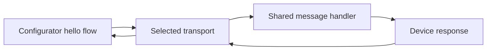

# Architecture and Selected Stack

Status: the shared hello contract, the dependency-free simulation, the real BlueZ
hello peripheral (`ble` feature), and the Expo iPhone configurator probe are
implemented and tested; the phone-to-device radio exchange is not yet evidenced. No Jetson is currently available. Simulated acceptance and hardware
acceptance are distinct; the original challenge requires the latter.
The final demo requires both Android and iPhone configurators and a headless
Ubuntu PC as the device. A Jetson is an optional later device target.

The [standalone visual guide](architecture-demo.html) illustrates this topology
and the proposed phone/desktop technician interface. All actions in that HTML
are simulated; it is not the runtime configurator.

## Stack

| Responsibility | Choice | Rationale / validation status |
| --- | --- | --- |
| Baseline | Ubuntu 22.04 target, Rust 1.88.0, edition 2024 | Installed `stable` reports 1.88.0; ARM64/device checks pending |
| Current runtime | Standard-library threads | No third-party dependencies; builds offline |
| Simulation | Two bounded `std::sync::mpsc` channels per session, synthetic discovery | Capacity one each; no radio, sockets, root, or Bluetooth dependency |
| Tests | `cargo test`, `#[test]` | Handler unit tests and simulation integration tests; finite real-time receive deadlines |
| Developer host preflight | Rust std + busctl/nmcli/GNU timeout, Bash/cat | Read-only prerequisites; no radio success claim |
| Real BLE runtime | Tokio 1.53 | Optional `ble` feature, locked in `Cargo.lock` |
| Device BLE | BlueZ GATT/advertising via `bluer` 0.17.4 | Registers and advertises on the real host (`demo/host-ble-endpoint.txt`); no phone exchange yet |
| Planned Linux diagnostic configurator BLE | `bluer` remote GATT/discovery | Linux role only; not a phone client |
| Technician interface | Expo SDK 57 + React Native + TypeScript, `react-native-ble-manager` (decision 23) | Hello probe in `configurator/`; iPhone install via a Mac (free Apple ID) or EAS (paid); full flow mocked in `architecture-demo.html` |
| Later Wi-Fi control | NetworkManager D-Bus via `dbus`/`dbus-tokio` | Match `bluer`'s library family; no password subprocess arguments |
| Planned device lifecycle | systemd + compiled Rust binary | Host BlueZ/NetworkManager access; permissions/recovery checks pending |
| Packaging and checks | Cargo.lock, rust-toolchain.toml, Rustfmt, Clippy | Manifest, dependency-free lockfile, and exact toolchain pin exist |
| State | Memory for the transport milestone | A fresh instance starts available; no persistent provisioning state yet |

Rust replaces the earlier Python proposal at the user's request to align with
the fleet. Exact fleet toolchain/crate versions remain to be confirmed.
Tokio and bluer are absent from the local Cargo cache and the crate index is
unreachable. [Decision 12](DECISIONS.md#12-executable-simulation-without-uncached-crates)
therefore uses the standard library for the executable software milestone.
[BlueR (`bluer`)](https://docs.rs/bluer/0.17.4/bluer/) supports both local and
remote GATT roles on Linux and uses Tokio. Its
[manifest](https://docs.rs/crate/bluer/0.17.4/source/Cargo.toml.orig) declares
the `bluetoothd` feature and `dbus`/`dbus-tokio` dependencies. Candidate `bluer`
0.17.4 is documentation-reviewed, not build-tested here. Compile only the needed
features; verify the selected crate graph against Rust 1.88 before locking it.

Future BLE builds need the host D-Bus development libraries, `pkg-config`, and a C
toolchain for libdbus bindings. `pkg-config` detects libdbus locally; complete
build/link checks and device distribution compatibility are still pending.

## Technician interface and demo topology

The original three-page challenge PDF was reread on 2026-10-17. Pages 1-2 allow
a phone or second laptop as configurator and require use by a non-developer.
The user requires both Android and iPhone support and a device without a screen.
A graphical interface on each mobile platform is part of acceptance.

```text
Android phone or iPhone                         Headless Ubuntu PC / later Jetson
Prepared graphical configurator -- secure BLE --> Rust service -- Wi-Fi --> Target network
```

The technician opens the prepared configurator and enters the site SSID/password
once per intervention ([decision 22](DECISIONS.md#22-enter-the-site-network-once-provision-room-by-room)).
Then, room by room, they enter the room number, scan the label of each sensor
(rooms hold several), and tap **Connect**. The interface
guides Bluetooth permission/disabled-radio problems, then shows device checking,
transfer, and network-connection progress per sensor, with targeted retries.
The scanned label, not the BLE name or signal strength, selects each sensor.
An established authenticated and encrypted channel is required before any
credential bytes leave the client; validate confidentiality, integrity, and
peer authentication explicitly.
Its mechanism remains a security decision, not an implemented guarantee.

Use labeled fields, a masked password with an explicit reveal control, readable
touch targets, and text statuses that do not rely on color. Report success only
after freshly observed NetworkManager state confirms the requested target
connection is active and has an assigned IP address. Bind that status to the
current provisioning attempt; an old connection, fallback network, or cached
address must not count as success. A fresh observation may report the same IP.
Wrong credentials or an unavailable network need an explanation and retry
action. If the result is unknown after disconnection, reconnect, authenticate,
and recover fresh status for that attempt before reporting success or repeating
a request. An unrecoverable result stays explicitly unknown. No command, SSH,
or device-side screen interaction belongs in this operator flow. Technical installation and
identity-label preparation happen beforehand; systemd starts the device service.

An Ubuntu configurator should provide the same guided steps through its local
Bluetooth adapter. Do not require the phone to reach a server on that computer:
there is no shared LAN initially, and `localhost` on the phone is the phone.
The BLE design must prepare and install a working client on each mobile platform
before provisioning starts, including all assets needed for offline startup.
Serving a web page from the unprovisioned device would need a separate,
validated bootstrap channel.

Both mobile platforms are fixed requirements. Before selecting a mobile framework,
review an authenticated bootstrap that works offline with a headless device on
both platforms: how a trusted physical label binds device identity, how the
technician is authorized, and how impersonation/replay and interrupted-result
recovery are handled. Check the proposed channel's platform APIs and maintained
library support; a QR, BLE name, or successful hello is not proof of security.
This is an early design/feasibility review only. Security implementation and
credential transfer remain blocked until the real harmless BLE milestone passes.
Then select adapters against the actual supported models and OS versions:

- Android exposes native BLE central APIs for discovery and GATT exchange
  ([Android documentation](https://developer.android.com/develop/connectivity/bluetooth/ble/ble-overview)).
  Verify the actual build's scan/connect runtime permissions and denial/retry
  behavior ([Android permissions](https://developer.android.com/develop/connectivity/bluetooth/bt-permissions)).
- iOS exposes native central operations through Core Bluetooth
  ([Apple documentation](https://developer.apple.com/library/archive/documentation/NetworkingInternetWeb/Conceptual/CoreBluetooth_concepts/PerformingCommonCentralRoleTasks/PerformingCommonCentralRoleTasks.html)).
  Verify build, signing, and preinstallation feasibility before choosing an iOS app.
- A browser client is conditional: verify the exact phone/browser, secure context,
  offline asset delivery, and user-initiated device selection. Chrome documents
  Web Bluetooth on Android and requires a secure context and user gesture
  ([Chrome documentation](https://developer.chrome.com/docs/capabilities/bluetooth)).
  This does not establish an iPhone solution or encrypt the GATT payload;
  Android browser success cannot satisfy iPhone acceptance.

Rust remains the device stack. `bluer` is a Linux adapter, not a cross-platform
mobile UI library. No mobile framework is selected: shared UI or separate native
clients must first satisfy the same bootstrap and BLE requirements on both
platforms. Record model/OS versions, build/signing/distribution, preinstallation,
offline startup, and physical BLE results separately for Android and iPhone.
The MVP excludes SoftAP and captive portals to avoid
depending on an interpretation of the challenge's shared-network constraint;
see [decision 18](DECISIONS.md#18-exclude-softap-from-the-mvp). A physical QR label
may bootstrap device identity without creating a Wi-Fi setup network.
The phone configurator exists as a hello probe (`configurator/`); the guided provisioning flow is still a mockup.

## Responsibility boundaries



In simulation, the transport supplies fake device metadata and two bounded
channels; a worker thread runs the shared handler. The planned hardware adapter
will use `bluer` and BlueZ for discovery, connection, and GATT exchange. The shared
handler receives bytes and returns bytes; it imports neither BLE nor NetworkManager.
Keep simulation wiring out of the real service.

The current single Cargo package contains:

```text
Cargo.toml / Cargo.lock / rust-toolchain.toml
src/lib.rs / src/protocol.rs   shared byte handler, unit tests beside code
src/simulation.rs             reusable fake transport, lifecycle unit tests
src/simulation/batch.rs       bounded pool of independent simulated device jobs
tests/simulation.rs           discovery, exchange, rejection, recovery tests
tests/scaled.rs               public batch API coverage and concurrency bounds
examples/simulation.rs        labeled hello demonstration
examples/benchmark.rs         local measurements and bounded soak runner
device/audit.rs               read-only Ubuntu host preflight binary
tests/host_audit.rs           public CLI tests with external-command fixtures
```

`device/main.rs` is the real BLE peripheral, declared with
`required-features = ["ble"]` and optional `bluer`/`tokio` dependencies.
`configurator/` is a separate Expo project, not a Cargo target. Default software
tests must not build libdbus or connect to BlueZ. The demo, integration tests, and benchmark reuse the same
simulation module and handler. Add no unused modules, generic transport
framework, or multi-crate workspace.

## First message contract

- Demo identity: `IOT-DEMO-001`; its name is only a discovery hint.
- Request: exactly the five bytes `hello`; response: exactly `world`.
- Reject other input without echoing or logging it. This endpoint accepts no credentials.
- One request at a time; nonblocking sends, finite receive deadlines, explicit errors.
- The simulator rejects inputs above 20 bytes before copying; this is a software
  bound, not a measured BLE MTU.
- Each new connection gets fresh channels. Timeout/disconnect closes the session;
  retry requires a fresh connection. Invalid input leaves a valid session usable.
- Closing drops the reply receiver before the request sender, then joins the worker,
  so late replies cannot be accepted by the closed session.
- Device stop disables discovery, new connections, and subsequent requests. A wait
  already in progress keeps its receive deadline; stop is not instant cancellation.

The eventual BLE adapter advertises a project-specific service UUID and exposes
one characteristic with write and read properties. The configurator performs
an acknowledged write, then reads the response. Both messages are small; no
fragmentation or notification protocol is needed for this probe. The UUID will
be generated once and stored in the shared contract when the BLE adapter is built.
The secure provisioning protocol may need a different framing scheme later.

## What simulation proves

| Check | Software simulation | Required later |
| --- | --- | --- |
| Discover expected demo ID | Synthetic registry only | Actual advertisements and scan |
| `hello` response | Actual shared handler through channels | GATT write/read over BLE |
| Timeout, disconnect, retry | Injected dropped reply/disconnect; bounded real-time waits | Driver/radio disconnect behavior |
| Restart | Replace simulated device instance | systemd restart and machine reboot |
| Offline operation | No external services by construction | Radio demo without Internet or shared LAN |
| Wi-Fi success | Not simulated in milestone one | Fresh authenticated status for requested target connection and its assigned IP; no old/fallback success |

Do not label software logs as successful BLE provisioning. Future fake network
results must also be labeled simulations; they cannot satisfy the real-Wi-Fi requirement.

The 40 Rust tests (15 handler/simulation, four scaled batches, four benchmark harness,
17 host-preflight CLI tests)
pass in debug and release on the installed Rust 1.88.0 compiler. The software checkpoint includes
three benchmark trials and a completed 300-second recovery soak; see
[the measured results and raw evidence](BENCHMARKS.md).
The follow-up scale matrix also has three independent process trials.
The public release-executable regression adds four CLI cases through
`python3 tests/benchmark_cli.py target/release/examples/benchmark` after building
the examples; it checks help and redacted rejection of invalid OS arguments.
Run the full suite with
`RUSTUP_TOOLCHAIN=stable cargo test --all-targets --locked --offline`; use this
override only after confirming `stable` is 1.88.0. Standard Ubuntu setup must
preinstall the pinned toolchain and its Rustfmt/Clippy components; Cargo's
`--offline` flag does not prevent rustup from downloading a missing compiler.

Benchmark and soak evidence must identify the release profile, commands, host,
sample counts, elapsed time, and outcomes. Thread/channel measurements describe
this software harness only; they predict neither BLE throughput nor capacity
for 200 real devices. A simulated restart replaces an object, not a systemd
service or machine reboot.

`audit-host [hciN]` prepares actual Ubuntu checks without requiring Rust BLE
libraries. It resolves the current BlueZ unique bus name before reading the
selected adapter's power, GATT method, and advertising method/capacity. Unique
names cannot autoactivate BlueZ if it is stopped or disappears. NetworkManager
is queried only for device type and management status, not profiles or addresses.
GNU timeout kills each read-only command group at four seconds; stdout capture
is capped at 8 KiB and stderr is discarded. Exit 0 means observed prerequisites,
not working registration permissions, advertisements, or Wi-Fi activation.
The actual restricted-host run fails closed; public-command fixtures validate
software behavior only. See decision 16 and the README preflight command.

The scaled software workload queues task indices at batch start. A bounded
pool creates an independent fake device/session for each job, checks literal
`hello`/`world`, and closes/joins it. The public batch API rejects sizes outside
1-10,000 jobs and concurrency outside 1-32 clients before allocation/spawning.
Each active client uses at most one session worker; a healthy batch therefore
uses at most twice its client limit plus the calling thread. This is a per-batch
limit; callers running several batches at once must bound their aggregate load.
The example uses at most eight clients. Indices identify synthetic jobs, not
advertised physical identities. BLE discovery and production queueing remain future work.

## Docker and alternatives

Docker is optional packaging for the same software tests. If added, use an
unprivileged runner with networking disabled and dependencies already in the
image. Do not add a Compose network: it would introduce a shared LAN the actual
challenge does not assume. Docker's host Bluetooth/D-Bus passthrough would still
exercise host hardware and require host access.

A BlueZ `btvirt`/VHCI integration lab could later test actual GATT registration
without physical radios, but requires host kernel/device access. It is outside
the first simulation; see the [BlueZ emulator source](https://kernel.googlesource.com/pub/scm/bluetooth/bluez.git/+/master/emulator/vhci.c).
SoftAP was considered for a zero-install local web interface, but is excluded
from the MVP under decision 18. If BLE proves unsuitable, record the failed gate
and reassess hardware/client options without silently adding a setup Wi-Fi network.
QR provisioning remains a documented alternative, not another implementation.

## Boundaries for later phases

Review authenticated-channel and physical device-identity bootstrap feasibility
on both mobile platforms before framework selection. Before any wireless
credential transfer, select and validate that authenticated, encrypted channel. Evaluate BLE
authenticated pairing against a library-based application channel; decide based on actual
I/O capabilities and platform support. A BLE name, RSSI, or raw Diffie-Hellman
exchange is insufficient. Record sender authorization, replay policy, and
post-success exposure in `docs/SECURITY.md` before enabling secrets.

Then implement NetworkManager activation with fresh, authenticated confirmation
of the requested target connection and its IP, recovery after an interrupted
result, technician-friendly errors, and the required Android/iPhone graphical
interfaces. Keep the Ubuntu alternative. The demo targets
personal WPA Wi-Fi; hospital EAP/certificate requirements are a separate scope.
Discuss site profiles, authenticated manifests, bounded queues, multiple operators,
and staging versus corridor setup for 200 devices; do not implement orchestration now.
