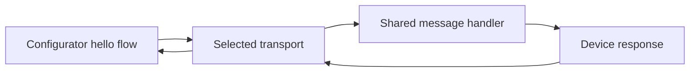

# Architecture and Selected Stack

Status: design only. No Jetson is currently available. Simulated acceptance
and hardware acceptance are distinct; the original challenge requires the latter.

## Stack

| Responsibility | Choice | Rationale / validation status |
| --- | --- | --- |
| Baseline | Ubuntu 22.04, Rust 1.88.0, edition 2024 | Toolchain already installed; ARM64/device checks pending |
| Application runtime | Tokio | Shared async model for simulation and Linux BLE; CLI first |
| Simulation | Bounded Tokio channels, synthetic discovery | No radio, sockets, root privileges, or Bluetooth dependency |
| Tests | `cargo test`, `#[test]`, `#[tokio::test]` | Built-in harness; Tokio test clock for deterministic timeouts |
| Real device BLE | BlueZ GATT/advertising via `bluer` | Supported local GATT role; hardware validation pending |
| Real configurator BLE | `bluer` remote GATT/discovery | Same library for both Linux roles |
| Later Wi-Fi control | NetworkManager D-Bus via `dbus`/`dbus-tokio` | Reuse the D-Bus library family used by `bluer`; no password subprocess arguments |
| Real device lifecycle | systemd + compiled Rust binary | Host BlueZ/NetworkManager access; permissions/recovery checks pending |
| Packaging and checks | Cargo.lock, rust-toolchain.toml, Rustfmt, Clippy | Create manifests/toolchain pin with code; lock resolved/tested crates |
| State | Memory for the transport milestone | A fresh instance starts available; no persistent provisioning state yet |

Rust replaces the earlier Python proposal at the user's request to align with
Teton's fleet. Exact fleet toolchain/crate versions remain to be confirmed.
[BlueR (`bluer`)](https://docs.rs/bluer/0.17.4/bluer/) supports both local and
remote GATT roles on Linux and uses Tokio. Its
[manifest](https://docs.rs/crate/bluer/0.17.4/source/Cargo.toml.orig) declares
the `bluetoothd` feature and `dbus`/`dbus-tokio` dependencies. Candidate `bluer`
0.17.4 is documentation-reviewed, not build-tested here. Compile only the needed
features; verify the selected crate graph against Rust 1.88 before locking it.

Real builds need the host D-Bus development libraries, `pkg-config`, and a C
toolchain for libdbus bindings. `pkg-config` detects libdbus locally; complete
build/link checks and device distribution compatibility are still pending.

## Responsibility boundaries



In simulation, the transport supplies fake device metadata and two bounded
channels. On hardware, `bluer` and BlueZ perform the discovery, connection, and
GATT exchange. The shared handler receives bytes and returns bytes; it imports
neither BLE nor NetworkManager. Keep simulation wiring out of the real service.

Use one Cargo package with this layout, created as each component is implemented:

```text
Cargo.toml / Cargo.lock / rust-toolchain.toml
src/lib.rs / src/protocol.rs   shared byte handler, unit tests beside code
examples/simulation.rs        fake transport, both flows, simulation tests
device/main.rs / device/ble.rs
configurator/main.rs / configurator/ble.rs
```

Declare the two binary paths explicitly in Cargo, with `required-features =
["ble"]`. Add the optional `bluer` dependency when the real adapter work starts;
default software tests should not build libdbus or connect to BlueZ. Keep the
simulation in the example, reusing the library's handler. Add no unused modules,
generic transport framework, or multi-crate workspace.

## First message contract

- Demo identity: `TETON-DEMO-001`; its name is only a discovery hint.
- Request: exactly the five bytes `hello`; response: exactly `world`.
- Reject other input without echoing or logging it. This endpoint accepts no credentials.
- One request at a time; finite connection/response timeouts and explicit errors.
- Each new simulated connection gets fresh channels; discard pending data on close.

The eventual BLE adapter advertises a project-specific service UUID and exposes
one characteristic with write and read properties. The configurator performs
an acknowledged write, then reads the response. Both messages are small; no
fragmentation or notification protocol is needed for this probe. The UUID will
be generated once and stored in the shared contract when the BLE adapter is built.
The secure provisioning protocol may need a different framing scheme later.

## What simulation proves

| Check | Software simulation | Required later |
| --- | --- | --- |
| Discover expected demo ID | Synthetic registry only | Actual advertisements and scan |
| `hello` response | Actual shared handler through channels | GATT write/read over BLE |
| Timeout, disconnect, retry | Deterministic fault injection | Driver/radio disconnect behavior |
| Restart | Replace simulated device instance | systemd restart and machine reboot |
| Offline operation | No external services by construction | Radio demo without Internet or shared LAN |
| Wi-Fi success | Not simulated in milestone one | NetworkManager activation plus assigned IP |

Do not label software logs as successful BLE provisioning. Future fake network
results must also be labeled simulations; they cannot satisfy the real-Wi-Fi requirement.

## Docker and alternatives

Docker is optional packaging for the same software tests. If added, use an
unprivileged runner with networking disabled and dependencies already in the
image. Do not add a Compose network: it would introduce a shared LAN the actual
challenge does not assume. Docker's host Bluetooth/D-Bus passthrough would still
exercise host hardware and require host access.

A BlueZ `btvirt`/VHCI integration lab could later test actual GATT registration
without physical radios, but requires host kernel/device access. It is outside
the first simulation; see the [BlueZ emulator source](https://kernel.googlesource.com/pub/scm/bluetooth/bluez.git/+/master/emulator/vhci.c).
If real BLE proves unsuitable, audit SoftAP support and adapt the transport.
QR provisioning remains a documented alternative, not another implementation.

## Boundaries for later phases

Before any wireless credential transfer, select an established authenticated
channel and physical device-identity bootstrap. Evaluate BLE authenticated
pairing against a library-based application channel; decide based on actual
I/O capabilities and platform support. A BLE name, RSSI, or raw Diffie-Hellman
exchange is insufficient. Record sender authorization, replay policy, and
post-success exposure in `docs/SECURITY.md` before enabling secrets.

Then implement NetworkManager activation with an IP-based success criterion,
technician-friendly errors, and a small local UI if needed. The demo targets
personal WPA Wi-Fi; hospital EAP/certificate requirements are a separate scope.
Discuss site profiles, authenticated manifests, bounded queues, multiple operators,
and staging versus corridor setup for 200 devices; do not implement orchestration now.
