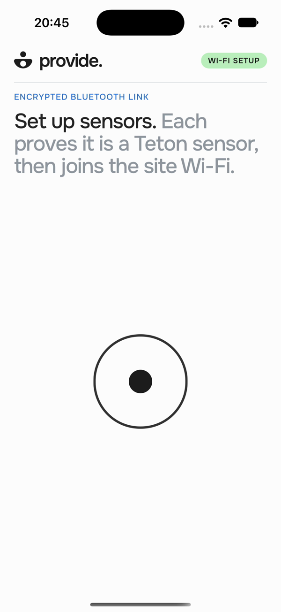
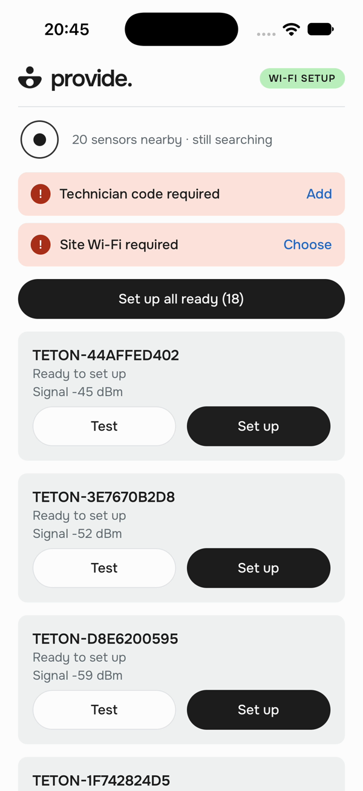

# Setup, usage and tests

**Send Wi-Fi credentials from a technician’s phone or laptop to a headless Linux device over Bluetooth, then confirm that the device joined the network.** No internet, cloud relay or shared network is needed during provisioning.

The repository contains both sides: the **provide. configurator** (React Native / Expo, with a Tauri desktop shell) and the **Linux device service** (Rust, BlueZ and NetworkManager).

```text
Technician → provide. → BLE + authenticated Noise XX → Linux device → Wi-Fi network
                           encrypted credentials       NetworkManager
                     ← result for this attempt + IP ←
```

**Validation status, 23 October 2026.** Real Wi-Fi setups to a Linux device have completed from the iPhone and from the macOS configurator. The 200-device UI runs against simulated sensors. This is not a validation of 200 physical devices.

## Start here

| Goal | Path |
| --- | --- |
| See the technician experience | [42-second demo video](media/overall-200-sensors.mp4) — simulated sensors, no real Wi-Fi joins |
| Explore the UI on Ubuntu without hardware | [Local preview](#preview-without-hardware) |
| Reproduce a real Wi-Fi join | [Hardware and assumptions](#hardware-and-assumptions), then [Ubuntu setup](#prepare-the-ubuntu-device) |
| Use the app as a technician | [Use provide.](#use-provide) |
| Check the four challenge constraints | [Requirements map](../README.md#requirements-map) |
| Review channel choice, security and 200-device deployment | [Architecture](ARCHITECTURE.md#why-bluetooth-low-energy), [security](SECURITY.md), [200-device design](ARCHITECTURE.md#200-devices-in-a-hospital-wing) |

## Preview without hardware

Requires Node.js 22.18 or later. From a fresh checkout:

```sh
git clone https://github.com/NoeBrt/iot-provisioning.git
cd iot-provisioning/configurator
npm ci
npm run web
```

Open the local URL printed by Expo and append `?demo=1`, or tap the **provide.** logo to enter demo mode. Try **Set up all ready**, the error filter and **Retry failed**.

Demo mode uses 200 fake sensors with the real application handshake and certificate checks, under a separate demo authority. It sends nothing over Bluetooth and never joins Wi-Fi. A plain browser supports this preview only; real Bluetooth provisioning requires the native phone or desktop app.

## Hardware and assumptions

| Role | Requirements and validation |
| --- | --- |
| Linux device | Ubuntu, BlueZ, NetworkManager, a Bluetooth adapter supporting **BLE peripheral mode**, and a NetworkManager-managed Wi-Fi interface. Ubuntu 22.04.5 has been tested; Ubuntu 24.04 has not. |
| Configurator | An iPhone with a standalone native build installed before the visit, or a Mac with the Tauri app. Android and desktop Windows/Linux hardware runs are unverified. |
| Target Wi-Fi | WPA2-Personal, SSID and an 8–63 character passphrase. Enterprise/EAP Wi-Fi is outside the demo’s scope. |
| Administration | Ethernet or a local console is recommended: provisioning changes the device’s Wi-Fi connection and can disconnect an SSH session using it. |

Dependencies, authorities and apps are prepared before the visit. Those preparation steps can require internet. The provisioning exchange itself does not.

## Prepare the Ubuntu device

Run these commands from the `device/` folder of a checkout, on a dedicated test device. The installer adds a system user, installs a service and NetworkManager permissions, restarts Bluetooth, and disables BlueZ’s battery plugin to avoid unwanted phone pairing requests.

### 1. Build and install

Install Rust 1.88.0 with rustup if it is not already available. The crate pins that toolchain in `device/rust-toolchain.toml`.

```sh
git clone https://github.com/NoeBrt/iot-provisioning.git
cd iot-provisioning/device
sudo apt update
sudo apt install build-essential pkg-config libdbus-1-dev bluez network-manager curl rfkill
curl --proto '=https' -sSf https://sh.rustup.rs | sh -s -- -y --default-toolchain 1.88.0 --profile minimal
. "$HOME/.cargo/env"
cargo build --release --features ble,stage --locked
nmcli device status
rfkill list bluetooth
```

If Bluetooth is soft-blocked, run `sudo rfkill unblock bluetooth`. Replace `wlo1` below with the Wi-Fi interface reported by `nmcli`:

```sh
sudo systemd/install.sh wlo1
```

The service runs as `iot`. Its private state lives in `/var/lib/iot-device`, mode `0700`. It cannot accept provisioning until staged below.

### 2. Create your evaluation authorities

For a self-contained evaluation, generate your own authorities. `cargo authority` (an alias in `device/.cargo/config.toml`) builds and runs the authority tool in one step; its short forms keep the authority in `~/iot-authority` (or `$IOT_AUTHORITY`), outside the checkout, and use the customer `DEMO`. In production these would be kept at the workshop, separate from deployed devices.

```sh
cargo authority init        # creates ~/iot-authority (private keys 0600) and prints both public keys
cargo authority public      # prints them again
```

The output names two **public** keys. In `../configurator/src/authority.ts`, replace both `DEVICE_AUTHORITY` and `TECHNICIAN_AUTHORITY` with these values **before building the configurator**. The first verifies devices; the second verifies imported technician codes. The checked-in public keys belong to the existing test deployment; its private keys are not included.

Never copy authority private keys into the app, the repository or evidence files.

### 3. Stage the device

```sh
sudo -u iot iot-stage init /var/lib/iot-device
```

Copy the device public key printed by this command, then run:

```sh
cargo authority certify <DEVICE_PUBLIC_KEY_HEX>
```

Copy the certificate hex and the technician authority public key from step 2:

```sh
sudo -u iot iot-stage install /var/lib/iot-device <CERTIFICATE_HEX> <TECHNICIAN_AUTHORITY_PUBLIC_KEY_HEX>
sudo systemctl restart iot-device
journalctl -u iot-device -n 20 --no-pager
```

Expected: a `IOT-XXXXXXXXXX` identifier and an advertising message. The identity is derived from the device key; app and device firmware must use the current manufacturer-data format. The app rejects older state-only advertisements with firmware-update guidance.

### 4. Issue a technician code

```sh
cargo authority issue "Evaluator"
```

This prints a QR code and a text code valid for one day, authorized for customer `DEMO`. The code contains a private holder key: treat it as a credential. Import it directly inside provide.; do not include it in screenshots or logs.

One code per technician: run the command again with another name. The authority tool also runs on macOS (it needs no Bluetooth), so codes can be issued from the examiner's laptop. For several customers or a longer validity (30 days at most), use the full form: `cargo authority issue ~/iot-authority "Name" DEMO,OTHER 7`. `cargo authority` alone prints the usage.

## Prepare the configurator

Build after setting both authority public keys above.

- **iPhone:** follow [Install on an iPhone from a Mac](../configurator/README.md#install-on-an-iphone-from-a-mac-free-apple-id). Use a **Release standalone build** with bundled JavaScript, so Metro and a shared network are unnecessary during the demo. Expo Go cannot run native Bluetooth provisioning.
- **macOS:** with Xcode command-line tools, Rust and Node installed, run the commands below. Grant Bluetooth access when prompted. The packaged application is under `configurator/desktop/src-tauri/target/release/bundle/`.

```sh
cd configurator
npm ci
npm run desktop:build
```

The device instructions target Ubuntu. The desktop configurator’s Linux and Windows builds have not been validated on hardware; use the iPhone or macOS path for the demonstrated real exchange.

On iPhone, the technician code and site credentials use native secure storage with authentication. The desktop implementation currently keeps them **in memory only**: closing the app loses them. Persistent desktop keychain storage is not implemented.

## Use provide.

This is what the technician does; the [README videos](../README.md#how-to-use-provide) show each step with a pointer.

<table>
<tr>
<td align="center"><br><sub>The app scans as soon as it opens</sub></td>
<td align="center"><br><sub>Sensors found; code and site Wi-Fi missing</sub></td>
<td align="center"><br><sub>Site Wi-Fi, entered once per facility</sub></td>
<td align="center"><br><sub>After a batch: errors by cause, Retry failed</sub></td>
</tr>
</table>
<sub>iOS Simulator, simulated sensors, earlier build; the README videos show the current one.</sub>

1. **Open the app.** It scans as soon as Bluetooth is on; each sensor appears with its `IOT-XXXXXXXXXX` ID, signal
   and state (ready, online, not prepared).
2. **Add the technician code** once: scan its QR code with the app's camera, or paste it. On the desktop, paste it, or
   paste, drop or choose a screenshot of the QR code. The app shows the name, customers and expiry.
3. **Choose the site Wi-Fi** once per facility: facility name, network and password, typed or scanned from the
   network's Wi-Fi QR code.
4. **Test** (optional) on a sensor's card exchanges `hello` / `world`: it checks the radio only.
5. **Set up** one sensor from its card, or **Set up all ready (N)** for every ready sensor in range, six at a time.
   Each sensor shows its step: connecting, securing the channel, sending the network, joining the Wi-Fi. Success
   reads **Device connected** with the sensor's new address.
6. **Fix the exceptions.** Past four sensors, one card counts set up, errors and not set up; its **Errors** tab
   groups the failures by cause, each in plain words ("The Wi-Fi password was refused. Edit the site password, then
   try again."), and **Retry failed** runs them again. A sensor already online offers **Reconfigure**.

The sensor needs no screen, keyboard or SSH.

### A real session, step by step

1. Open provide. in normal mode; there must be no **DEMO** indicator. Keep Bluetooth enabled. To demonstrate independence from networking, turn off the configurator's Wi-Fi and mobile data, and ensure the device is not already on the target network.
2. Add the technician code from [step 4](#4-issue-a-technician-code) by scanning or pasting it inside the app.
3. Wait for the device's `IOT-XXXXXXXXXX` identifier. **Test** exchanges `hello` / `world`.
4. Tap **Set up**, enter the facility name, target SSID and password, and confirm.
5. Expect connecting → securing the channel → sending the network → joining Wi-Fi, then **Device connected** with the target SSID and the device's new IPv4 address.

Check independently on the Linux device:

```sh
nmcli -f NAME,UUID,DEVICE connection show --active
journalctl -u iot-device -n 40 --no-pager
```

Expected: the `iot-provisioned` profile is active and the journal reports the provisioning attempt as connected. The service does not log Wi-Fi credentials. For a headless deployment, the systemd service starts automatically at boot.

A configured device offers **Reconfigure**. The implementation rolls back to the previous profile if a new network fails; the wrong-password, absent-network and rollback scenarios still need hardware validation.

## Evidence and the 200-device case

The [requirements map in the README](../README.md#requirements-map) links each challenge constraint to its proof and states what remains unverified. The channel choice, credential protection and the 200-device design are in [ARCHITECTURE.md](ARCHITECTURE.md#why-bluetooth-low-energy) and [SECURITY.md](SECURITY.md).

## Tests

Run the full device suite on Ubuntu, from `device/`; BlueZ/D-Bus dependencies and Linux host-audit fixtures are platform-specific:

```sh
cd device
cargo test --features ble,stage --all-targets --locked
cargo clippy --features ble,stage --all-targets --locked -- -D warnings
```

Run configurator checks with Node.js 22.18 or later:

```sh
cd configurator
npm ci
npm test
npm run typecheck
npm run lint
```

Desktop shell (Bluetooth bridge restrictions), then the browser checks of the desktop layout, with Metro running
(`npm run web`) and Playwright installed:

```sh
cd configurator/desktop/src-tauri && cargo test && cd ../..
node desktop/layout-check.mjs <path to the playwright module>   # layouts, resizes, scrolling, in Chromium and WebKit
node desktop/playtest.mjs <path to the playwright module>       # demo batch, errors, retry, dialogs and keyboard
```

Tests cover Rust/TypeScript Noise interoperability, certificate and technician-token rejection, malformed messages, attempt handling and the simulated batch queue. They complement the hardware evidence; they do not replace it.

## Code map

The [folder tree in the README](../README.md#folder-tree) describes every folder.
