# Configurator design history

How the iPhone configurator (`configurator/`, app name **provide.**) evolved from a bare BLE probe into the
screen a facilities technician uses, and why each change was made. All screenshots come from the iOS
Simulator with fake sensors (`SIMULATION`) unless stated otherwise; the real BLE run is recorded in
[`evidence/real/phone-hello.txt`](../../../evidence/real/phone-hello.txt) (`ACTUAL_BLE`).

This history covers the hello-probe stage. The app now also sets up a sensor's Wi-Fi over the encrypted
channel; those screens and a video are in [`docs/ARCHITECTURE.md`](../../SETUP.md#use-provide).

## Evolution

| # | Screen | Change | Why |
|---|---|---|---|
| 1 | 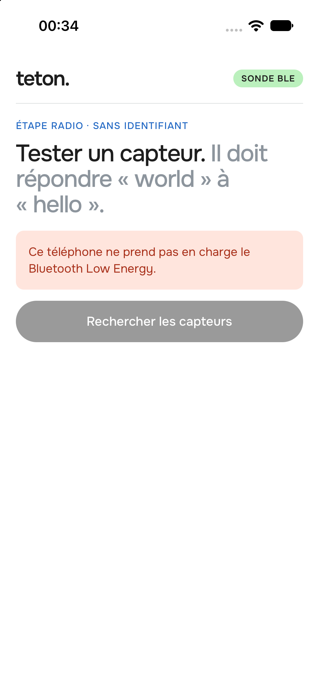 | Starting point: a **Rechercher les capteurs** button, 5-second scan, French UI. | First working probe (commit `85f8b61`). |
| 2 | 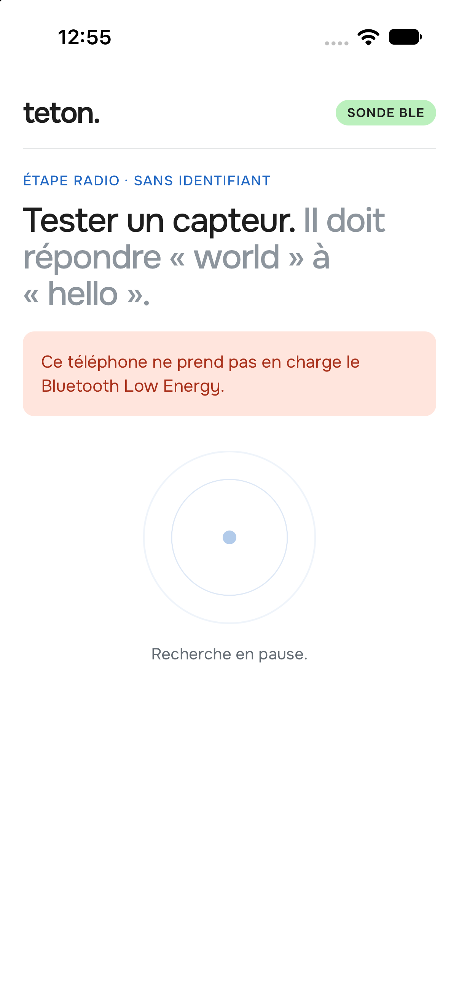 | The button becomes an **automatic scan** with a radar animation. | A technician should not have to know when to search; the app looks as soon as Bluetooth is on. |
| 3 | 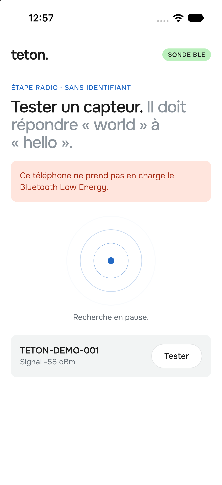 | Sensors appear under the radar as they are found. | Discovery is visible without any action. |
| 4 | 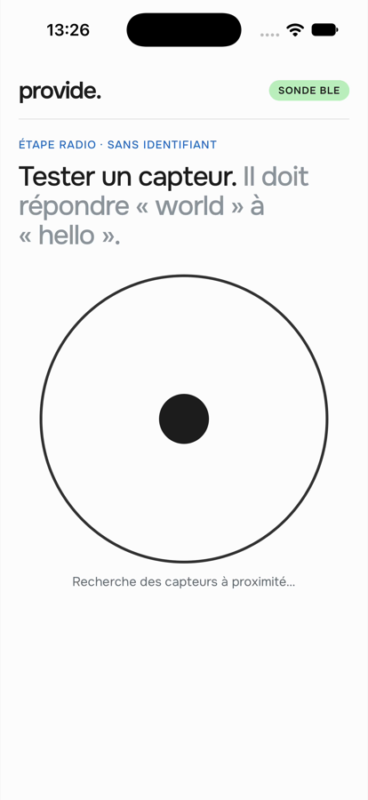 | Waves become black, slower, with a constant-width stroke; larger dot. | Match the Onest typography and the manufacturer's ink colour; make the dot an obvious tap target. |
| 5 | 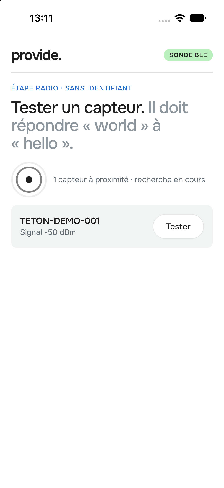 | Radar shrinks beside a caption once sensors exist; app renamed **provide.** | Leave room for the list without stopping the search. |
| 6 | 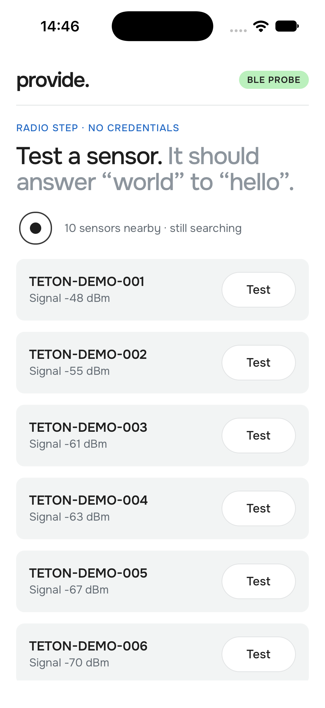 | English UI, tested with ten sensors. | Check layout and ergonomics at room scale (decision 22: several sensors per room). |
| 7 | 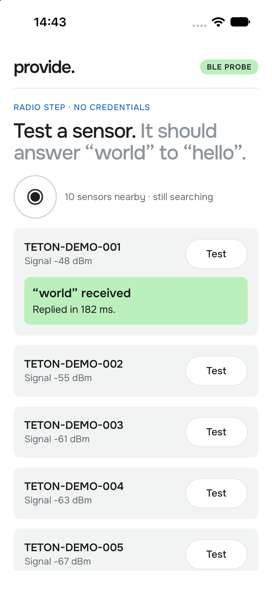 | Result shown **inside the tested card** instead of at the end of the list. | With ten sensors the result was off-screen after tapping Test. |

## Final behaviour

| Screen | Behaviour |
|---|---|
| 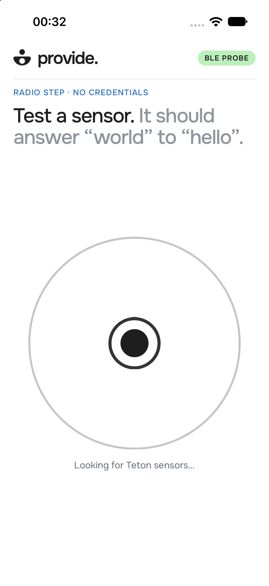 | **Nothing found yet:** large radar centred in the free space; tap the dot to pause or resume the scan. |
| 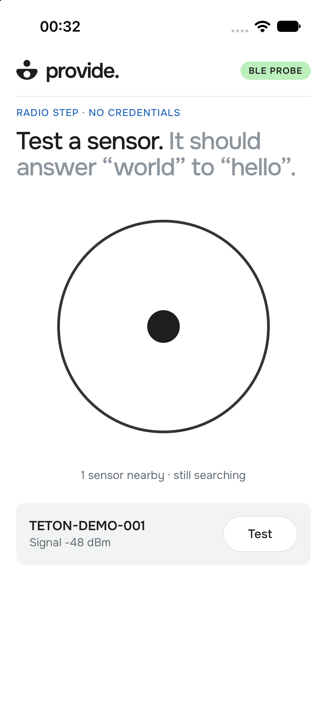 | **One to four sensors:** the radar stays large and the list sits under it; only the finger folds it. |
| 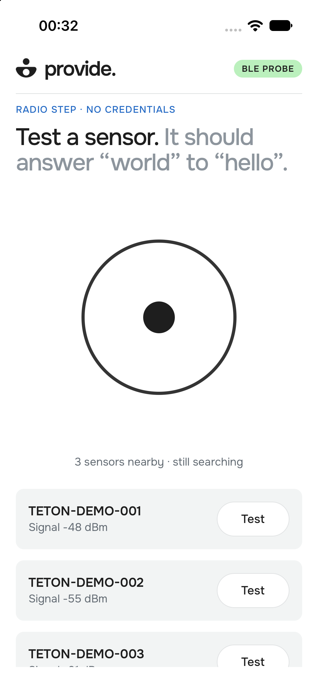 | Each new sensor fades in; the scan keeps running. |
| 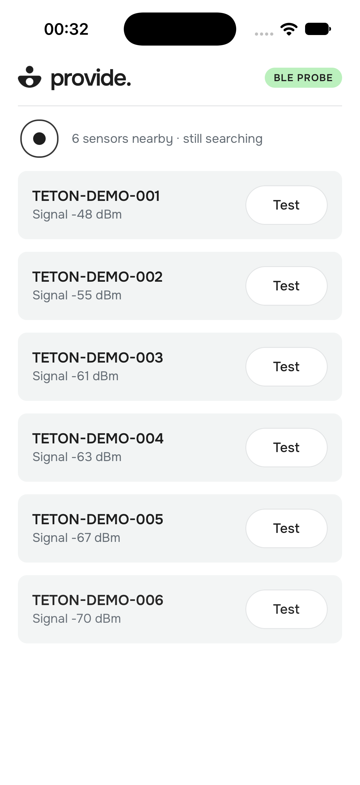 | **Five or more sensors:** the radar folds once by itself (1.2 s ease) so the room's list fits. |
| 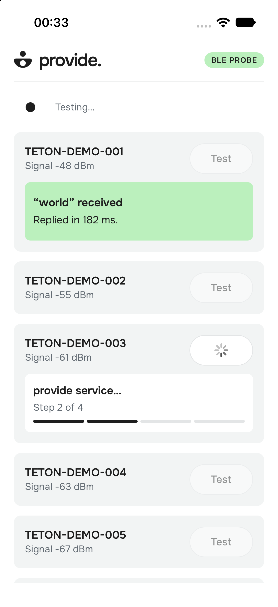 | **Test:** a native spinner in the button and one drawer of steady height with the current step and a 4-segment bar. Progress stays at least 0.7 s so an instant failure never flashes. |
| 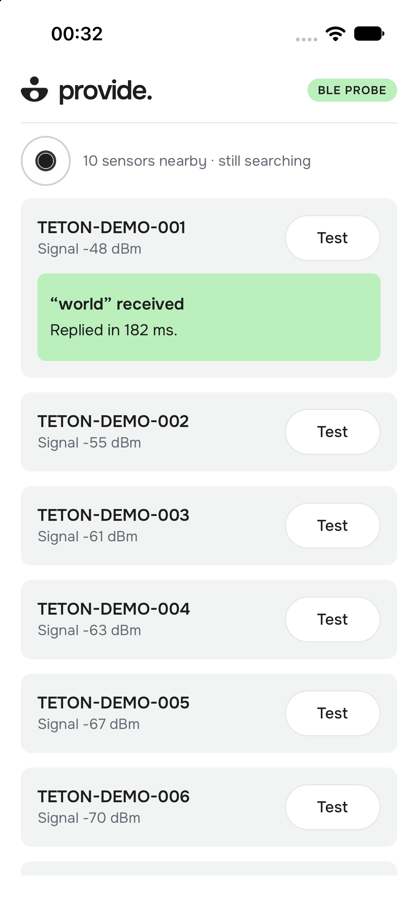 | **Success** fades in inside the same drawer: “world” received, with the real round-trip time. |
| 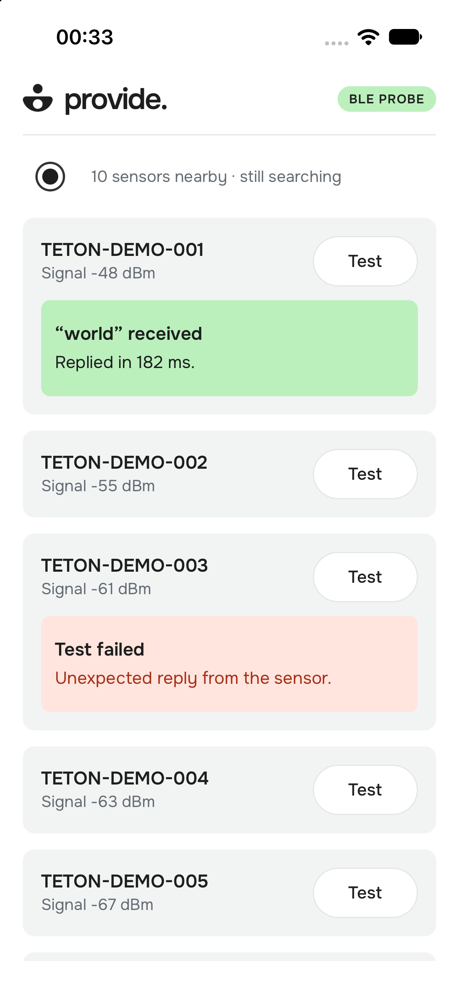 | **Failure** gives a plain-language reason in that sensor's card. |
| 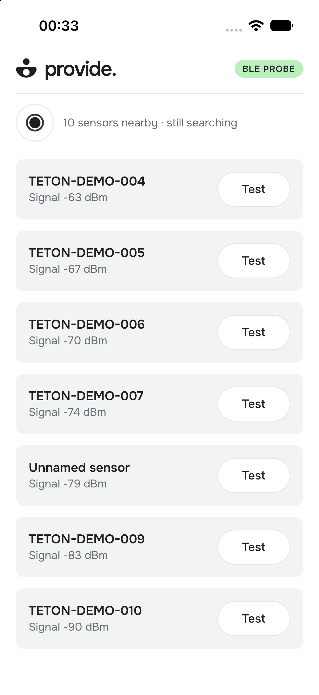 | **Scrolling:** header and compact radar stay; the list passes under them. Scrolling back up stops at the list's top; a second pull brings the large radar back. |
| 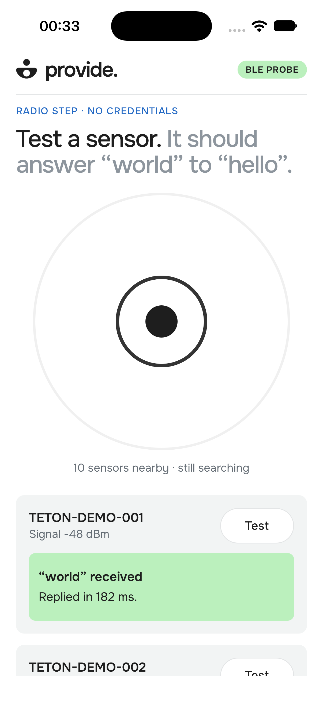 | **Pulled open:** the radar grows with the finger (it follows the iOS bounce, nothing is triggered). |

Video of the whole flow (Simulator, 1206×2622, HEVC): [`simulator-flow.mp4`](simulator-flow.mp4).

## Choices and trade-offs

- **Scroll-driven geometry.** Radar size, position, title and captions are pure functions of the scroll
  offset, computed every frame on the UI thread (Reanimated 4). Earlier versions switched between
  large and compact during the gesture, which jumped under the finger and fought the iOS bounce.
- **Native snapping and a sticky compact mode.** `snapToOffsets` settles the radar fully large or fully
  compact. Once in the list, `contentInset` makes the list's top the scroll edge, so a fling back up does
  not reopen the radar by accident (iOS only; Android keeps the simpler behaviour).
- **Results where the finger is.** The outcome lives in the tested card; the log at the bottom is kept
  for evidence (`evidence/real/phone-hello.txt`).
- **No fake precision.** A BLE signal gives a rough distance, not a direction, so sensors are not drawn
  as dots on the radar. Proximity (sorting, signal bars) is deferred until real RSSI is measured.
- **Accessibility.** The dot is a button with a 44 pt target and a VoiceOver label; captions are live
  regions; Reduce Motion stops the waves.
- **Known limits.** Sensors that stop advertising stay listed; the large-mode pull is tuned for one
  phone size (iPhone 15/16 Pro); Android has not been run on a device.
